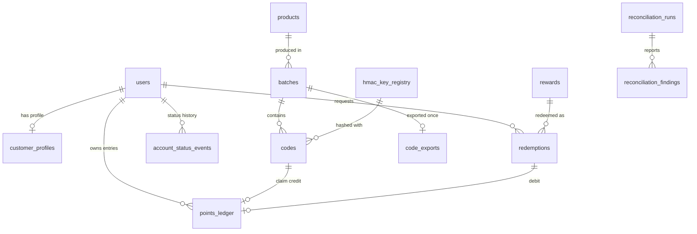
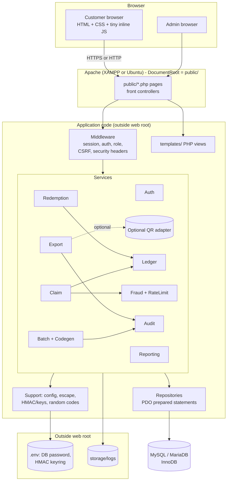
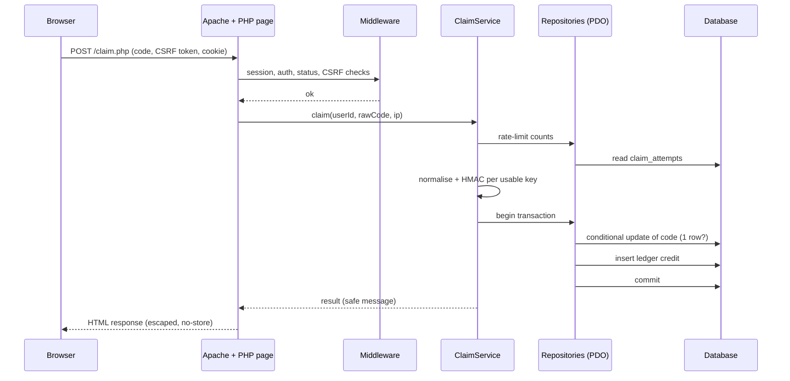

# ARCHITECTURE.md: Customer Loyalty Rewards System

Stage 2 design document. **Design only: no application code, no SQL schema, no database tables exist yet.**

Companion documents: [DATABASE_DESIGN.md](DATABASE_DESIGN.md), [WORKFLOWS.md](WORKFLOWS.md), [PROJECT_STRUCTURE.md](PROJECT_STRUCTURE.md), [ASSUMPTIONS.md](ASSUMPTIONS.md), [TEST_PLAN.md](TEST_PLAN.md).

---

## 0. How to read this document

Every statement carries one of these labels (the same labels are used in all six documents).

| Label | Meaning |
|---|---|
| **[Confirmed]** | A decision you approved in Stage 1 or your Stage 2 brief. Not changed here. |
| **[Requirement]** | Explicitly stated in the Assignment 2 PDF. |
| **[Project constraint]** | Supplied separately in the project brief; not stated in the Assignment 2 PDF. |
| **[Fact]** | A technical statement checked against a named source. |
| **[Recommendation]** | My engineering judgement. You must be able to explain and defend it. |
| **[Assumption]** | A selected coursework design assumption used to fill an assignment gap; documented with rationale in ASSUMPTIONS.md, but not represented as a client-verified fact. |
| **[Unresolved]** | A question or compatibility check that still needs an answer from you or your machine. |

### 0.1 Result of inspecting the existing project

[Project constraint: your separate brief asks me to inspect before designing]

- The project upload folder available to me was **empty**. I could not read an existing README.md, ASSUMPTIONS.md, ARCHITECTURE.md, database files or configuration files, so I have not assumed their contents.
- I used the **corrected Stage 1 research report** (version 2) written earlier in this conversation as the primary research reference.
- Your repository may already contain older design documents or earlier decisions (for example a different table list, a separate admin table, a batch-size cap, or different batch status names). **I cannot see them.** Before you commit these six documents, compare them with what is already in the repository and list every difference. Where this design differs from older drafts, the Stage 2 brief and Stage 1 report win, because they are the latest approved instructions.
- If you upload the existing files, I will reconcile them and report conflicts explicitly. I have not overwritten anything.

### 0.2 What this design does not do

No PHP pages, no `schema.sql`, no SQL execution, no Composer or PHPUnit installation, no QR code generation, and no Stage 3 work. Short pseudocode and plain-language descriptions of constraints are used instead of executable code.

---

## 1. Constraints and confirmed decisions

### 1.1 Project-specific technology constraints [Confirmed project constraints; not stated in the Assignment 2 PDF]

- PHP 8, MySQL or MariaDB, PDO for all database access, InnoDB for every table.
- HTML inside PHP files only; CSS3 in separate `.css` files; JavaScript only inline inside PHP files and only when necessary.
- No React, Vue, Angular, Node.js, separate `.html` files or separate `.js` files.
- Windows XAMPP is the primary local environment. The design must also work on Ubuntu with Apache, PHP and MySQL/MariaDB.
- PHP libraries, Composer and test frameworks are **allowed** but must be justified by real compatibility.

### 1.2 Confirmed Stage 1 decisions [Confirmed]

| # | Decision | Where it shows up in this design |
|---|---|---|
| 1 | QR generation: vendor CSV is the baseline; an optional PHP QR library may be added | Section 8; WORKFLOWS section 2 |
| 2 | Testing with PHPUnit if compatible with the installed PHP | TEST_PLAN section 2 (compatibility pending) |
| 3 | Codes stored as HMAC-SHA-256 with key IDs | DATABASE_DESIGN `codes`, `hmac_key_registry` |
| 4 | 16-character codes from `23456789ABCDEFGHJKMNPQRSTVWXYZ` (30 symbols), secure random, no biased modulo | WORKFLOWS section 2.3 |
| 5 | QR claim links use the URL fragment; manual entry always works | WORKFLOWS section 3 |
| 6 | Code sits under a scratch-off layer and/or on an insert inside the box | ASSUMPTIONS |

**Purchase-proof approach (selected assumption A-24):** every sealed product box contains one unique factory-issued 16-character code beneath a scratch-off layer or on an insert inside the box. The customer reveals and claims that code after buying/opening the box. The system accepts possession of this concealed, single-use code as its operational proof-of-purchase credential. The code proves possession of a genuine factory-issued secret; it does **not** independently prove payment or a retail transaction. The design deliberately omits receipt upload and retailer/POS integration in the first version (A-25), and must disclose this limitation in the demo and README. This is the chosen coursework answer to Assignment 2 AR-02, not a claim of stronger verification.

---

## 2. Architecture style

**A layered monolith**: one PHP application, one database, no separate services. [Recommendation]

Why this suits a college project on XAMPP:

- One deployment unit: copy the folder, create the database, edit `.env`. No containers or message queues.
- You can trace any request from the browser to the database in a live demo.
- The layers keep security-critical logic (claiming codes, spending points) in a few small, testable classes instead of scattered through page files.
- It maps one-to-one onto the required modules without inventing microservices. [Project design constraint: avoid unnecessary microservices]

### 2.1 The layers

| Layer | Folder | What it does | May call |
|---|---|---|---|
| **Pages** (front controllers) | `public/` | One PHP file per URL. Starts the request, calls guards, calls a service, picks a template. Contains almost no logic. | Middleware, Services, Templates |
| **Middleware** (guards) | `src/Middleware/` | Reusable checks run before page logic: logged in? right role? valid CSRF token? security headers set? | Services (Auth, Security) |
| **Services** | `src/Service/` | Business rules and transactions: "claim a code", "redeem a reward". The only layer allowed to start transactions. | Repositories, other services |
| **Repositories** | `src/Repository/` | All SQL for one table or aggregate, using PDO prepared statements. No business decisions. | Database connection |
| **Support** | `src/Support/` | Small helpers: output escaping, config reader, time (UTC), HMAC/key helper, random code generator, validators. | Nothing above it |
| **Templates** | `templates/` | PHP files that print HTML. Every printed value goes through the escaping helper. | Nothing (pure output) |

Rule of thumb: **pages talk to services, services talk to repositories, repositories talk to the database.** A page never contains SQL. A repository never decides business rules. [Recommendation]

---

## 3. Modules, responsibilities and communication

| Module | Responsibility | Tables it owns (writes) | Calls / is called by |
|---|---|---|---|
| **Authentication & account lifecycle** | Registration, login, logout, sessions, role checks, account-status checks, suspension, reactivation, closure and login throttling | `users`, `login_attempts`, `account_status_events` | Used by every protected page via middleware; Admin management calls its lifecycle methods |
| **Customer profiles** | View, edit and anonymise name, phone and optional contact details | `customer_profiles` | Authentication, Admin management, Audit |
| **Products** | Create, edit, deactivate products and their default points value | `products` | Admin pages; Batches read it |
| **Production batches** | Own every batch-state transition (draft → generated → exported → printed → active → voided) | `batches` | Products, Code generation, Export, Audit |
| **Code lifecycle** | Generate and store HMAC hashes, verify codes, and enforce the single-use code state machine | `codes` (one repository; CodeGeneratorService inserts, ClaimService owns `unclaimed → claimed`, BatchService owns `unclaimed → voided`) | Batches, Key management, Claiming service |
| **Key management** | Load keys from `.env`, know which key is active, check keys against the registry, support rotation | `hmac_key_registry` | Generation, Verification |
| **CSV export** | Coordinate the protected one-time CSV; call BatchService for `generated → exported`; record export without plaintext | `code_exports` | Generation, Audit, Batches |
| **Optional QR generation** | Turn a claim link into an SVG (only if you approve a library) | none | Export (optional adapter) |
| **Customer code claiming** | Accept the concealed per-box code as the purchase-proof credential under A-24; perform the atomic claim, rate-limit checks and safe messaging; delegate ledger writes to LedgerService | `claim_attempts` | Code lifecycle, Ledger, Fraud, Authentication |
| **Points ledger** | Sole writer of append-only points entries; balance calculation and compensating corrections | `points_ledger` | Claiming, Redemption, Admin adjustments, Reconciliation |
| **Reward catalogue** | Create/edit/deactivate rewards and own every stock mutation (reserve, restock and return) through RewardService | `rewards` | Admin pages, Reward redemption |
| **Reward redemption** | Own redemption records and coordinate the atomic debit/stock reservation/fulfilment process; call RewardService for stock and LedgerService for points | `redemptions` | Ledger, Reward catalogue, Audit |
| **Admin management** | Dashboards and admin use cases for customer search, suspension, fulfilment and reporting; delegates writes to the owning modules | none (coordinator only) | Everything admin-side |
| **Fraud monitoring** | Record suspicious events; list and review them | `fraud_events` | Claiming, Redemption, Rate limiting |
| **Audit logging** | Append-only "who did what, when" for administrative and security-relevant actions | `audit_logs` | Called by almost every admin action |
| **Reporting** | Read-only summaries (claims per batch, points issued vs spent, redemptions) | none (reads) | Ledger, Codes, Redemptions |
| **Reconciliation** | Run ledger/business consistency checks; record runs and findings; never auto-correct | `reconciliation_runs`, `reconciliation_findings` | Ledger, Reporting, Admin |

### 3.1 High-level data model

The application uses one relational database. The core business relationships are shown below; the complete table/column definitions and full entity-relationship diagram are in `DATABASE_DESIGN.md` sections 2–4. This overview is included here because the assignment requires the architecture document to explain the data model.

The key integrity rule is that each successfully claimed code can create at most one claim-credit ledger entry, and each redemption can create at most one debit entry. Reversals are new ledger rows linked to the original; they do not edit or delete history. The current customer balance is calculated from the append-only ledger. Historical retired HMAC keys remain available for retained code rows so same-customer repeat claims can still be recognised after key rotation [A-12/A-23]. [Recommendation; details in DATABASE_DESIGN §4 and §9]

### 3.2 Communication rules [Recommendation]

1. Each table has one repository and one owning module. Within the code-lifecycle module, CodeGeneratorService inserts `codes`, ClaimService alone changes `unclaimed → claimed`, and BatchService alone changes `unclaimed → voided`; BatchService also owns every `batches.status` transition. The authentication/account-lifecycle module owns `users`, `login_attempts` and `account_status_events`; its named methods handle their respective writes. CustomerProfiles owns `customer_profiles`. RewardService alone writes `rewards`, including stock reservation, restock and return. RedemptionService owns `redemptions` and calls RewardService stock methods within its transaction. LedgerService alone inserts `points_ledger`; ReconciliationService alone writes reconciliation run/finding records. Admin pages coordinate through these services and do not bypass them.
2. Transactions are started in services, never in pages or repositories, so one business action is one transaction.
3. Audit logging is called **inside** the same transaction as an admin change when possible, so a change cannot be saved without its audit record.
4. Fraud events are written **outside** the main transaction (after a rollback) so a rejected claim can still leave evidence. [Recommendation, reasoning: if the event were inside a transaction that rolls back, it would vanish.]

---

## 4. Architecture diagram

---

## 5. Request flow: from browser to database and back

Example: a customer submits a code on the claim page.

1. **Browser** sends `POST /claim.php` with the code and a CSRF token, plus the session cookie.
2. **Apache** serves only the `public/` folder, so only page files are reachable. It starts PHP for `claim.php`.
3. **The page** loads `bootstrap/app.php`: reads `.env`, opens the session with safe settings, sets security headers, creates the PDO connection (exceptions on error, UTC time, strict SQL mode).
4. **Middleware** runs in order: require login, require an active account, require a valid CSRF token for a POST. A failure ends the request with a safe message.
5. **The page** passes the cleaned input to `ClaimService`.
6. **ClaimService** checks rate limits (through `FraudService`), normalises the code, asks the verifier to compute the HMAC under each usable key, then opens **one transaction**: conditional update of the code, ledger credit, commit.
7. **Repositories** execute prepared SQL through PDO. Values are always bound parameters, never concatenated. [Requirement: PDO; Recommendation: no emulated prepares]
8. **ClaimService** returns a result object (success with points, or a generic failure). It never returns the reason a guess failed to the browser.
9. **The page** chooses a template and prints the result. All output is escaped.
10. **Response** carries `Cache-Control: no-store` and `Referrer-Policy: no-referrer` on claim pages.

---

## 6. Cross-cutting design

### 6.1 Configuration and secrets [Requirement + Recommendation]

- Real values live in `.env` **outside** the web root. `.env.example` contains placeholders only. `.gitignore` excludes `.env` from the first commit.
- Secrets: database password, the HMAC keyring (key ID to secret), and the active key ID. PHP has no built-in `.env` reader (Stage 1: unverified), so a small hand-written reader in `src/Support/Config` is the plan. [Recommendation]
- Demo and development keys must be obviously fake and different from any production key.

### 6.2 Sessions [Fact: PHP manual session-security page, Stage 1]

Use strict mode, cookies only, HttpOnly, SameSite Lax or Strict, Secure when HTTPS, a short garbage-collection lifetime, a new session ID after login, and an idle timeout. The Secure flag cannot work on plain local HTTP, so it is driven by a `.env` setting. [Recommendation]

### 6.3 CSRF [Fact: OWASP CSRF sheet, Stage 1]

A random token per session, placed in every state-changing form, checked on every POST, compared with `hash_equals()`. No state change ever happens on GET. This includes the QR link.

### 6.4 Output escaping [Fact: PHP manual]

All output uses one helper around `htmlspecialchars()` with UTF-8. Since PHP 8.1 the default flags already include quotes and invalid-sequence substitution; the helper still states the encoding explicitly.

### 6.5 Errors and logging

- Errors are logged to `storage/logs/`, not shown to visitors, outside development.
- **Never log**: passwords, session IDs, CSRF tokens, full codes, HMAC keys. Log internal IDs instead. [Fact: OWASP logging guidance, Stage 1]
- Application logs (technical) are separate from `audit_logs` (who did what) and `fraud_events` (suspicious things).

### 6.6 Time and character set [Recommendation]

Store all times in UTC. Each connection sets UTC. Use `utf8mb4` with `utf8mb4_unicode_ci` for the shared MySQL/MariaDB target; verify that the selected installed server exposes it with `SHOW COLLATION` before creating the Stage 3 schema [Unresolved Q-02].

### 6.7 Transactions [Recommendation]

- A small `Database::transaction(callable)` helper begins, commits, rolls back and retries once on a deadlock error.
- Points-changing transactions use **READ COMMITTED** and take the customer lock first. See DATABASE_DESIGN section 6 for why. [Fact: MySQL manual, consistent reads, below]

### 6.8 Security headers on every page [Recommendation]

`X-Content-Type-Options: nosniff`, `Referrer-Policy: no-referrer` on claim pages (and a stricter-than-default policy elsewhere), and `Cache-Control: no-store` on pages showing personal or secret data. Because the project constraint permits only necessary inline JavaScript inside PHP files, each HTML response generates a fresh, unpredictable CSP nonce of at least 128 bits using a cryptographically secure random source. The same response-specific nonce appears in the `script-src` policy and only on the intended inline `<script>` element(s). CSS remains in separate external `.css` files under the project constraints. Do not use `unsafe-inline`, inline event-handler attributes or `eval`; prefer external CSS and ordinary form handlers. Never reuse a nonce across responses. See ASSUMPTIONS F-15 and TEST_PLAN SC-12. [Recommendation grounded in MDN/W3C guidance; browser enforcement remains to be tested in Stage 3.]

---

## 7. Key security decisions (summary)

1. Plaintext codes are never stored. Only an HMAC-SHA-256 hash plus its key ID. [Confirmed]
2. One conditional database update decides who wins a claim; a UNIQUE constraint on the ledger is the backstop. [Recommendation, builds on Stage 1]
3. Every points change is an append-only ledger row; there is no editable balance column. [Recommendation]
4. A per-customer row lock serialises that customer's spending. [Recommendation]
5. Reward stock is reduced by a conditional update that cannot go below zero. [Recommendation]
6. Account/IP controls use A-04: 5 failed logins and 10 invalid code attempts per 15 minutes cause temporary blocks; 20 successful claims/account/24 hours and 10 distinct accounts/IP/hour create review alerts only. [Assumption]
7. Generic customer messages: unknown, used by another customer, voided and inactive-batch codes look identical. A same-customer repeat claim receives the specific confirmation selected in A-23. [Recommendation]
8. Export is administrator-only, POST-only, requires password re-entry, is one-time and audited, and is never stored as a file. [Assumption A-15]
9. No public administrator registration; the first and any additional administrators are created only through the controlled CLI procedure. [Assumption A-07]
10. Secrets live outside the web root; real `.env` is never committed. [Recommendation / security control]

---

## 8. Optional modules and compatibility

### 8.1 QR generation (hybrid) [Confirmed]

- Baseline: the CSV contains each code and its claim link; the vendor produces QR labels.
- Optional: an adapter `QrSvgRenderer` that wraps a PHP QR library. Everything else in the app must work if the adapter is absent. Only the `Export` service may know it exists.
- Stage 1 facts: chillerlan/php-qrcode lists PHP 8.2+ for its current release line; endroid/qr-code lists PHP ^8.4. Neither was installed or tested. [Unresolved: choose a library only after you report `php -v`.]

### 8.2 Composer and PHPUnit [Unresolved]

Compatibility is **pending** until you provide `php -v`, `php -m` and `composer --version`. The decision table is in TEST_PLAN section 2. Own application code does not need Composer: a small autoloader in `bootstrap/` is enough. [Recommendation]

---

## 9. XAMPP and Ubuntu portability [Recommendation]

- Run the site from a **virtual host whose DocumentRoot is `public/`** on both systems. This keeps `src/`, `config/`, `storage/` and `.env` unreachable by URL. On XAMPP this means editing Apache's virtual-host file; on Ubuntu a site configuration.
- Fallback if you cannot create a virtual host: place the project inside `htdocs` and add an "deny all" access rule in every non-public folder. This is weaker because a missed rule exposes files.
- Use forward slashes and a path helper; never hard-code `C:\`.
- Keep database names, user names and credentials in `.env`.
- Use only standard SQL features available in both MySQL and MariaDB. Avoid the JSON column type (MariaDB treats it as text) and MySQL-only collations.
- File-name case matters on Ubuntu. Use one consistent case for every file name and every `require`.
- Line endings: add a `.gitattributes` rule so Windows and Ubuntu do not fight over them.

---

## 10. Trade-offs you can defend in a live demo

| Choice | Alternative | Why this choice |
|---|---|---|
| Layered monolith | Microservices; a framework | Fewer moving parts; the project-specific stack constraints favour clear plain PHP |
| Ledger with no balance column | Cached balance column | Cannot drift; a lock makes reading the sum safe. Cost: a SUM per balance read (fine at project scale). |
| HMAC with key IDs | Plain hash or plaintext | Database leak alone gives nothing to test guesses against; rotation is possible |
| URL fragment for QR | Query string | The fragment is not sent to the server, so it stays out of access logs |
| Stream-only export | Saved export file | No plaintext file to protect or leak |
| One users table with a role | Separate admin table | One login mechanism to secure and explain. Cost: role checks must be perfect. |
| ENUM columns | Lookup tables | Simpler to read; changing values needs a table change |

---

## 11. Limitations (honest statement)

- A code proves possession of a genuine secret, not a retail sale. Stolen boxes, shop insiders and print-vendor insiders can still leak codes. Batch activation after shipping, voiding and claim limits shrink the gap but do not close it.
- A URL fragment keeps the code out of access logs but not out of every place: the QR scanner app, a browser's own history or sync, and screenshots can still hold it.
- Plain XAMPP over HTTP is not suitable for real deployment; HTTPS is required for real use.
- Nothing here has been implemented or tested.

---

## 12. Glossary (terms explained when first needed)

- **Front controller**: a PHP file that is the entry point for one URL.
- **Middleware**: reusable checks run before a page does its job.
- **Repository**: a class that holds the SQL for one table or aggregate.
- **Transaction**: a group of database changes that all succeed or all fail together.
- **Conditional update**: an update that only changes a row if it is still in the expected state; the number of changed rows tells you if you won.
- **HMAC**: a hash that needs a secret key; without the key you cannot recompute it.
- **Key ID**: a small number stored next to each hash saying which secret key made it.
- **Ledger**: an append-only list of points changes; the balance is the sum.
- **Idempotency**: doing the same request twice has the same effect as doing it once.
- **Rate limiting**: refusing requests after too many recent failures.
- **URL fragment**: the part of a URL after `#`; browsers do not send it to the server.

---

## 13. Architecture completion details and operational rules

This section supplements Sections 3, 5–9. It does not replace the layered-monolith design, alter the approved Stage 1 decisions, or authorize implementation. Items marked **[Assumption]** are adopted coursework design choices recorded with their rationale in `ASSUMPTIONS.md`; they are not client-verified facts and must be revisited if real client requirements differ.

### 13.1 Customer and administrator permissions [Recommendation]

Authorization is enforced on the server for every request; hiding a button or menu item is not access control. A user must be authenticated, have the required role, and have an account status that permits the requested action. Deny by default.

| Capability | Customer | Administrator |
|---|---:|---:|
| Register, log in, log out, manage own password/session | Yes | Yes, through the same authentication mechanism |
| View or edit own profile | Own profile only | Only through an authorized admin workflow; access is audited |
| Submit a code for claiming | Yes, own account | No claim on behalf of a customer by default |
| View own points balance and ledger history | Yes | Yes, read-only for support/reporting where justified |
| Browse active rewards and submit own redemption | Yes | No customer redemption on behalf of another user by default |
| View own redemption status | Yes | Yes, for support and fulfilment |
| Manage products, batches, code generation and exports | No | Yes |
| Manage reward catalogue and fulfilment status | No | Yes |
| View reports, audit records and fraud events | No | Yes, with access restricted to business need |
| Suspend/reactivate customer accounts | No | Yes, authorized administrator only |
| Adjust points manually | No | Only through a controlled adjustment service that creates ledger entries and audit records |
| Create additional administrator accounts | No | Through the controlled operator/CLI procedure only; no web-based admin-management screen |

[Assumption A-16] The factory owner is the initial administrator. There is one administrator permission tier (no separate supervisor/operator roles); additional administrators, if needed, use the controlled CLI procedure only. All administrator actions that affect accounts, points, batches, codes, rewards, exports or redemptions require an audit record. Customer requests must never accept a customer ID from the browser as authority to act on another account; the authenticated session determines the customer identity.

### 13.2 Account lifecycle and suspension [Recommendation]

The account lifecycle is separate from the login session lifecycle:

1. **Registered/active:** the customer can authenticate and use eligible customer features.
2. **Suspended:** authentication for protected customer actions is denied; existing sessions are invalidated or rejected on their next request. Points, ledger history and redemptions are retained. Suspension does not silently delete or reverse balances.
3. **Reactivated:** an authorized administrator restores active status after recording the reason and action in the audit log. The customer can authenticate again; previous history remains intact.
4. **Closure requested:** [Assumption A-17] the account is set to `closed` and login is disabled immediately. The factory owner may cancel the closure and reactivate the account after identity checks during the 30-day recovery window.
5. **Closed/anonymised:** after 30 days, the account remains `closed`; replace `users.email` with a non-routable unique placeholder such as `closed-user-<id>@example.invalid`, and clear/anonymise `customer_profiles.full_name`, `phone` and `contact_details`. Keep ledger, redemption, audit, fraud and reconciliation references needed for integrity. Retention defaults are A-11 and require legal review before real customer data is used.

Suspension must record who performed it, when, the reason/category, and whether it has been lifted. A suspended customer may still need a safe support/contact path, but must not be able to claim codes, redeem rewards, change sensitive profile data, or access protected account pages. [Assumption A-18] Administrators must provide a reason when suspending or reactivating an account; the initial reason categories are listed in ASSUMPTIONS A-30. Do not expose internal suspension notes to the customer; show a neutral status message and support instructions.

### 13.3 Module ownership and cross-module communication [Recommendation]

Section 3 identifies table ownership. Apply these additional boundaries so that ownership remains meaningful:

- Pages/front controllers validate request shape, invoke middleware and call one application service. They do not call repositories directly.
- A service owns a complete business use case and its transaction boundary. It may coordinate another service only through a documented service method; it must not reach into another module's repository to bypass that module's rules.
- A repository owns persistence operations for its table/aggregate and exposes narrowly named methods. It does not send email, render HTML, make authorization decisions, or start/commit transactions.
- Support utilities (configuration, clock, HMAC, random generation, validation, escaping and logging) are infrastructure helpers, not a second location for business rules.
- Cross-module calls must be synchronous method calls inside the same PHP process and database transaction where atomicity is required. No queue, microservice or external service is implied.
- For a claim, `ClaimService` coordinates verification, rate-limit/fraud checks, the conditional code-claim operation and ledger credit. For a redemption, `RedemptionService` owns the transaction and coordinates customer balance validation, `RewardService` stock reservation, `LedgerService` debit entry and the redemption record. `RewardService` stock methods participate in the caller's transaction and do not start a nested transaction. Each use case must commit all required database changes together or roll them all back.
- Read-only reporting may query repositories through a reporting service, but it must not write to tables owned by other modules.
- Avoid circular service dependencies. Shared policy belongs in a small domain/support component or in the service that owns the business decision; do not solve a cycle by allowing arbitrary repository access.

If a module needs another module's data, it requests it through that module's service/repository contract. Table ownership does not prevent a documented read; it prevents uncoordinated writes that bypass business rules.

### 13.4 Points ledger reconciliation and correction [Recommendation]

The points ledger is **append-only**. Once committed, a ledger entry is never edited or deleted as a way to correct a business mistake. The current customer balance is calculated as the sum of valid credit entries minus debit entries (or the equivalent signed-amount convention consistently selected in the database design). A cached balance, if ever introduced later, is only a rebuildable optimization and is not the source of truth. [Assumption A-19] No cached balance is included in the initial design. A reversal may create a negative balance if points were already spent; redemptions remain blocked until the calculated balance covers the requested cost [Assumption A-26].

Correction procedure:

1. Identify the original ledger entry and related claim, redemption or adjustment reference.
2. Record the reason, operator/admin identity and supporting reference in an audited correction request.
3. Create a new compensating ledger entry that reverses the financial effect of the incorrect entry; link it to the original entry and mark its purpose as a reversal/correction. Do not change the original row.
4. If the correct amount should then be applied, create a separate new entry for that amount, linked to the correction case.
5. Perform the compensating entries in one transaction with the corresponding business-state changes. Enforce idempotency so retrying the same correction cannot post it twice.
6. Include original and compensating entries in customer history and administrator reconciliation reports, with clear human-readable descriptions.

Reconciliation should compare: (a) the sum of claim-related ledger credits with successfully claimed codes and their configured points; (b) exactly one debit at the stored `points_cost` for every `pending` or `fulfilled` redemption; (c) for every `cancelled` redemption, the original debit plus exactly one equal-and-opposite reversal linked to that debit, and for every other correction/reversal the referenced original and reason; and (d) each customer's calculated balance with any independently generated report total. Exceptions are flagged for review, never silently auto-deleted or overwritten. A reconciliation run records its time, scope, outcome and unresolved discrepancies. [Assumption A-20] Reconciliation is initially an administrator-triggered report, not an automated scheduled job.

### 13.5 Centralized error handling and exception management [Recommendation]

A single application-level exception boundary handles uncaught errors for each request. It generates a generic customer-facing error page/message and a correlation/reference ID, while recording technical details in the protected application log. Development mode may show detailed diagnostics only on a local, non-public environment; production must not display stack traces, SQL, filesystem paths, environment values or secret material.

Use distinct exception categories (names are conceptual, not a code requirement): validation/input errors; authentication/authorization failures; business-rule conflicts (already claimed, insufficient points, unavailable stock, inactive batch); database/infrastructure failures; and unexpected programming errors. Expected business outcomes should normally be returned as explicit service results rather than treated as server crashes. Do not convert every exception into success or a generic database retry.

- Roll back an active transaction before returning an error. Never continue using a transaction whose state is uncertain.
- Retry only narrowly identified transient database failures (for example a deadlock), with a small bounded retry count and idempotent operation design. Do not blindly retry validation, authorization or uniqueness/business conflicts.
- Log timestamp, severity, correlation ID, route/action, safe internal entity IDs and exception class. Exclude passwords, session IDs, CSRF tokens, plaintext codes, full HMAC values, keys and raw sensitive form submissions.
- Keep technical application logs separate from `audit_logs` and `fraud_events`; these serve different purposes and have different access/retention needs.
- Return safe, consistent messages to customers. A correlation ID lets support investigate without disclosing internal details.

### 13.6 Database backup and HMAC key backup/recovery [Recommendation]

Database backups and HMAC secret backups are separate recovery assets and must be protected separately from the running web application.

- Back up the database on a documented schedule appropriate to the deployment, and before schema migrations or bulk administrative operations. A backup must include the ledger, code records, key registry metadata, batches, redemptions, audit records and other required relational data.
- Protect backup files with restrictive filesystem permissions and encryption at rest when stored or transferred off the machine. Limit restore access to authorized operators. Do not place backups under `public/` or in the public repository.
- Test restoration into an isolated database at planned intervals. A backup is not considered reliable until a restore has been verified and the restored application can reconcile its data.
- Back up the HMAC keyring independently using an approved secure secret-management process. Keep key IDs and metadata in `hmac_key_registry`; **never store actual HMAC secret keys in that table or in ordinary database backups**. The actual keys remain outside the web root and outside version control.
- A recoverable database backup without its corresponding HMAC keys may leave historical codes unverifiable. A key backup without its matching database/key-ID metadata is also insufficient. Recovery planning must preserve the association between each code's key ID and the correct historical secret.
- Key backup copies must be encrypted, access-controlled and recoverable by an authorized custodian. Do not email keys, commit them, place them in ordinary application logs, or include them in exported code CSVs.
- Restore procedure: restore database and required keyring versions to a controlled environment; verify key IDs and active/retired status; confirm the application can verify representative test records without exposing secrets; reconcile ledger and code counts; then authorize service restoration.

[Assumption A-21] For the college/demo deployment, the operator performs a manual backup before major changes and retains at least one separate encrypted copy. The factory owner is the named custodian of the separate encrypted HMAC key backup [Assumption A-27]. Production backup frequency, retention period, off-site location, recovery-point objective and recovery-time objective must be reviewed before real customer data is used.

### 13.7 Deployment architecture: Windows XAMPP and Ubuntu [Recommendation]

Both environments use the same logical deployment layout: Apache serves only the project's `public/` directory; PHP application source, templates, configuration, logs and secrets remain outside the document root. The database is MySQL/MariaDB with InnoDB. The application does not depend on a Windows drive letter or an Ubuntu-specific absolute path.

**Windows XAMPP development:**

- Keep the project in a stable project directory. Configure an Apache virtual host with `DocumentRoot` pointing to that project's `public/` directory; enable the matching virtual-host configuration and restart Apache.
- Keep `.env`, `src/`, `templates/`, `storage/` and bootstrap/configuration files outside the served `public/` directory. If the local XAMPP setup cannot use a virtual host, the existing Section 9 deny-rule fallback is a weaker temporary development option, not the preferred layout.
- Use XAMPP's PHP CLI and Apache PHP configuration consistently. Confirm the CLI and web-server PHP versions/extensions match; they can differ.
- Create the database and a least-privilege database user in the local MySQL/MariaDB service. Store credentials only in the local `.env` file.

**Ubuntu/Apache deployment:**

- Configure an Apache site/virtual host whose `DocumentRoot` is the same logical `public/` directory. Enable the site and required Apache modules; do not expose the project root.
- Install a compatible PHP 8 runtime and the required PDO database driver for the selected MySQL/MariaDB server. Confirm required extensions in both CLI and Apache/FPM contexts as applicable.
- Give the web-server account read access to application source and write access only to explicitly required runtime directories (for example protected logs or temporary storage). Do not make the whole project tree writable by Apache.
- Put `.env` outside the document root with restrictive owner/group permissions. Configure HTTPS before handling real customer accounts or codes.
- Configure database credentials, timezone, upload/storage paths and environment mode through deployment configuration, not hard-coded OS-specific values.

For both systems: use a single path/configuration helper; normalize filesystem paths using PHP path utilities; use consistent filename case; keep runtime storage out of Git; and document the Apache virtual-host and database setup in `README.md`. Local XAMPP may use HTTP only on localhost; any network-accessible or real-customer deployment must use HTTPS and Secure cookies [Assumption A-28]. Initial deployment is direct to Apache; if a reverse proxy is later used, trust forwarded client-IP headers only from explicitly allowlisted proxies [Assumption A-29]. Deployment must be validated through the actual browser-served application, not only the PHP CLI.

### 13.8 Optional dependency management [Recommendation]

Composer, a QR library and PHPUnit remain optional and must be selected only after checking the installed PHP version and required extensions. This section adds no blanket restriction on libraries.

- **Composer:** use it when a selected dependency needs it or when it materially improves autoloading/dependency reproducibility. Commit `composer.json` and `composer.lock` if Composer-managed packages are adopted; do not commit `vendor/` unless the deployment decision explicitly requires a packaged vendor directory. Document the exact install/update procedure. Keep secrets out of Composer files.
- **QR library:** vendor-generated QR labels remain the baseline. A PHP QR library is optional and must sit behind the existing QR renderer adapter. If absent or incompatible, CSV export and the rest of the application must continue to work. Verify the selected package's PHP requirement, maintenance status, license, output format and compatibility before approval.
- **PHPUnit:** use only a PHPUnit release compatible with the actual PHP runtime. Keep it as a development dependency, not a production runtime requirement. If unavailable, use the documented manual test plan; do not claim automated tests ran when they did not.
- Record package versions and compatibility checks in the README or dependency notes. Avoid unbounded version ranges for a reproducible submission. Do not install or upgrade dependencies during this design-only stage.

### 13.9 Production batch lifecycle and voiding rules [Recommendation]

Generation and export are completed in the **same HTTP request**: Transaction A reaches `generated`, Transaction B records the one-time export and reaches `exported`, then the CSV is streamed from memory. No plaintext is retained between requests. If Commit A or B fails, or the download is interrupted, the batch is voided and a new batch is generated; the original plaintext is not recoverable. [Recommendation RC-12; see DATABASE_DESIGN 8.2 and WORKFLOWS 2.3–2.4]

The existing batch state sequence in Section 3 is retained: `draft → generated → exported → printed → active → voided`. These states describe controlled transitions, not merely labels. A batch must not skip forward in a way that permits customer claims before the physical codes are ready and authorized.

| State | Meaning | Allowed next action |
|---|---|---|
| `draft` | Batch metadata and product/points association are being prepared; no customer-claimable codes exist | Generate codes, or abandon the draft |
| `generated` | Unique codes have been generated and stored as HMAC values; plaintext is available only during the controlled export process | Create the one-time protected export, or void the batch before release |
| `exported` | The one-time export was issued to an authorized operator/vendor and recorded; plaintext must not be recoverable from ordinary application storage | Record print/production completion, or void affected codes/batch under controlled procedure |
| `printed` | Physical labels/packaging have been produced but are not yet eligible for customer claims | Activate after authorized production/release checks, or void before activation |
| `active` | Codes in the batch are eligible for customer claim as concealed per-box purchase-proof credentials, subject to normal account, rate-limit and one-time-claim rules | Remain active or void unused/unclaimed codes |
| `voided` | Batch is closed to new claims; it cannot be reactivated in place | No further transition; create a new batch for replacement production |

[Assumption A-22] Activation is a deliberate administrator action after packaging/production checks; it is not automatic on export or print. A batch can be voided before activation if it is misprinted, exposed, duplicated or otherwise compromised. Once active, voiding prevents claims of remaining unclaimed codes but does not silently reverse points already credited to customers. If already-claimed codes require remediation, use a separately authorized, audited case and compensating ledger entries; do not delete claims or rewrite ledger history.

Voiding must record actor, timestamp, reason, scope and affected count. If only part of a batch is affected, the data design must support a clearly auditable code-level void status or a replacement batch; do not pretend that a whole-batch void selectively affects only some codes. Repeated void requests must be idempotent. Export records must remain as evidence that an export occurred, even after voiding; do not recreate or redisclose the original plaintext export. Reprints or replacement production use a new controlled export/batch decision and must not create duplicate active secrets unintentionally.

### 13.10 Architecture acceptance criteria for Stage 2 [Recommendation]

Stage 2 design acceptance checks are below. The final-submission deliverables later in this list are assignment requirements to complete before repository submission; they are not evidence that implementation or testing has already happened.

- [x] The layered-monolith diagram, request flow, module responsibilities and folder layout agree with one another.
- [x] Customer and administrator permissions are explicit, enforced server-side and consistent with account status.
- [x] Account registration, active use, suspension, reactivation and closure/anonymisation boundaries are documented; retention defaults and their production/legal limitations are documented in ASSUMPTIONS A-11 and A-17.
- [x] Every persistent table/aggregate has one write-owning module, and cross-module service calls and transaction boundaries are documented.
- [x] The points ledger is append-only; balance calculation, reversal/correction and reconciliation procedures are documented.
- [x] Centralized exception handling, safe customer messages, correlation IDs, transaction rollback and sensitive-data logging exclusions are documented.
- [x] Database backup and HMAC key backup are separate, protected, restorable and preserve key-ID association; actual HMAC secrets are not stored in `hmac_key_registry`.
- [x] XAMPP and Ubuntu deployment both serve only `public/`, protect `.env` and runtime data, and specify required PHP/PDO database compatibility checks.
- [x] Composer, QR library and PHPUnit are optional, version-compatible decisions; no unverified package is described as installed or tested.
- [x] Batch states, transition controls, activation, voiding, partial-void handling and treatment of already-claimed codes are documented.
- [x] Every selected business/default assumption is listed with a rationale and limitation in `ASSUMPTIONS.md`; environment/domain/repository checks remain labelled [Unresolved].
- [x] Assignment 2 purchase-proof requirement AR-02 has a documented coursework solution: a concealed unique per-box code is the operational purchase-proof credential (A-24), with the limitation that there is no independent receipt/POS verification (A-25).
- [ ] Before final submission: README.md, ASSUMPTIONS.md, AI_LOG.md, `.env.example`, genuine test results and meaningful commit history are present as required by the assignment.
- [x] The companion `DATABASE_DESIGN.md`, `WORKFLOWS.md`, `PROJECT_STRUCTURE.md`, `ASSUMPTIONS.md` and `TEST_PLAN.md` do not contradict this architecture or Stage 1 decisions.
- [x] No application code, executable SQL, database implementation, dependency installation or Stage 3 work has been performed as part of this document revision.

Passing the design-consistency items means the architecture is sufficiently specified for Stage 2 approval. Final-repository items and actual test results remain later delivery tasks. Approval does not mean the application has been implemented, deployed or tested.

### 13.11 Selected purchase and operating assumptions

The following additional assumptions complete the Stage 2 design and are recorded in `ASSUMPTIONS.md` with their rationales and limitations:

| ID | Selected assumption | Design impact |
|---|---|---|
| A-24 | Concealed unique code inside each sealed retail box is accepted as the operational proof-of-purchase credential. | Uses the existing `codes` → `batches` → `products` relationship; no receipt table is added. |
| A-25 | No receipt upload or retailer/POS integration in the first version. | The system does not independently verify payment, purchase date, retailer or purchaser identity. |
| A-26 | A valid reversal may make the ledger balance negative if credited points were already spent. | Further redemptions are blocked until the calculated balance is sufficient. |
| A-27 | Factory owner is custodian of the encrypted HMAC key backup. | Backup remains separate from database and application-host backups. |
| A-28–A-33 | Local-vs-public HTTPS, trusted-proxy IP handling, reason categories, QR rescan after login, default CSV columns and password-recovery boundaries are selected. | Details and rationales are in ASSUMPTIONS.md; relevant workflows, structure and tests reference the same IDs. |
| A-34 | Product/batch points are 1–10,000 per box; reward costs are 1–1,000,000 points. | Enforced by ProductService and RewardService validation; tests FN-25/FN-26. |

These are adopted coursework assumptions, not verified facts about a real factory's operations. They do not change the approved Stage 1 HMAC, code-format, QR-fragment, manual-entry or packaging decisions.
