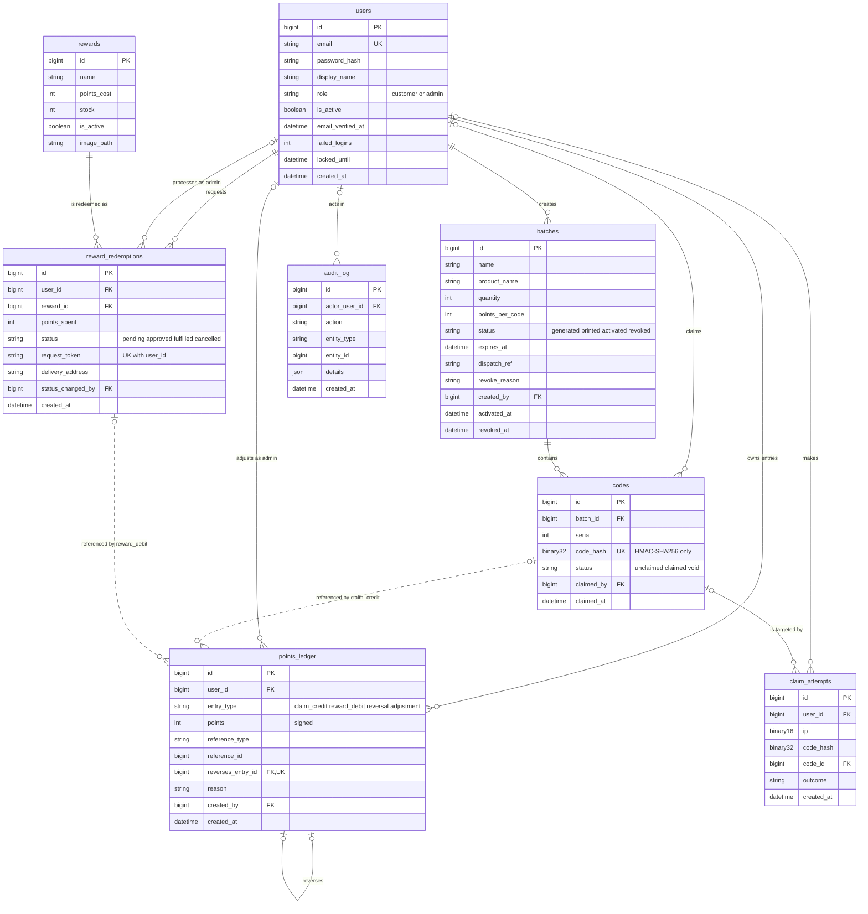
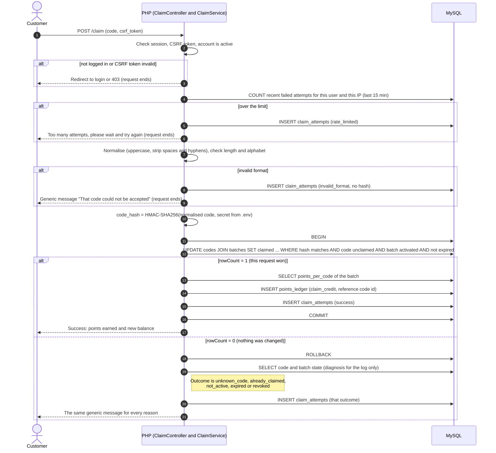
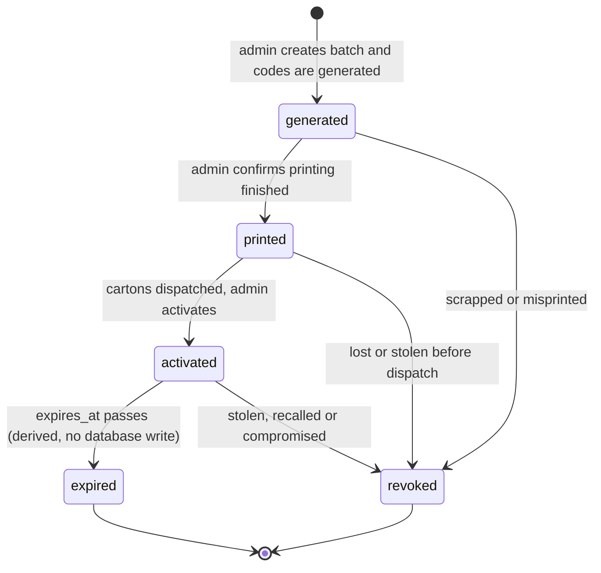
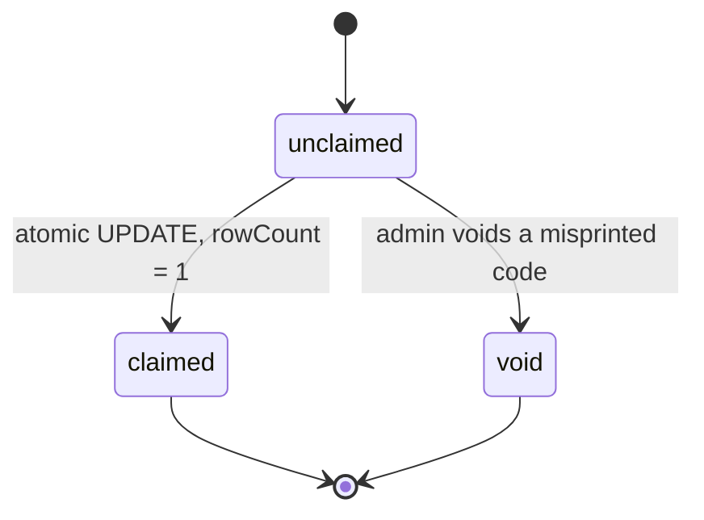

# Customer Loyalty Rewards System: Architecture

**Status:** design only, no application code yet. SQL snippets are the schema.
**Hard constraint:** PHP 8+ and MySQL 8 (InnoDB) only. Server-rendered PHP pages with HTML5/CSS3 and minimal vanilla JavaScript. PDO for all database access. No Node.js, no JavaScript frameworks.
**Prepared:** 23 November 2026

## Contents

1. [Stack choice](#1-stack-choice)
2. [Data model](#2-data-model)
3. [Diagrams](#3-diagrams)
4. [Fraud-prevention design](#4-fraud-prevention-design)
5. [PHP security basics](#5-php-security-basics)
6. [Pages and routes](#6-pages-and-routes)
7. [Folder structure](#7-folder-structure)
8. [Trade-offs and alternatives](#8-trade-offs-and-alternatives)

---

## 1. Stack choice

The rule behind every choice: **a student must be able to explain every line in a live demo.** Fewer moving parts beats cleverness.

| Layer | Choice | Why |
|---|---|---|
| Language | PHP 8.2+ (`declare(strict_types=1)` in every file) | Fixed by the brief. PHP 8 gives typed properties, `match`, and `readonly`, which keep service classes short and readable. |
| Database | MySQL 8.0 with InnoDB | Fixed by the brief. InnoDB gives transactions, row locks and foreign keys. MySQL 8.0.16+ actually *enforces* `CHECK` constraints (older versions parsed and ignored them), and 8.0.13+ allows `DEFAULT (UTC_TIMESTAMP())`. |
| DB access | PDO with `ERRMODE_EXCEPTION`, `EMULATE_PREPARES = false`, `FETCH_ASSOC` | Prepared statements only. Real server-side preparation means user input is never spliced into SQL text. Exceptions make a failed query roll the transaction back instead of failing silently. |
| Sessions | Native PHP sessions (file-based) with a hardened cookie | Built in, nothing to install, easy to explain. Only a session ID travels to the browser. See [section 5](#5-php-security-basics). |
| Rendering | Server-rendered PHP templates, CSS in one or two files | The brief says so. Every page works with JavaScript switched off. |
| JavaScript | A single `app.js` of a few small helpers (disable a submit button after click, confirm dialog, copy a value) | Nothing is *required* for correctness. Security never depends on the browser. |
| Config and secrets | `.env` file **outside** the web root, read by a 20-line loader | Keeps the HMAC secret and DB passwords out of Git and out of the document root. |

### Plain PHP versus a micro-framework: decision, plain PHP

**Chosen: plain PHP** with one front controller (`public/index.php`), a tiny router (a lookup table of `METHOD + path` to handler), service classes for business rules, and PHP template files.

Why:

- **Explainability.** With Slim or Laravel, routing, CSRF, validation and sessions happen "by magic" in vendor code. In a viva you would be saying "the framework does that". With plain PHP you can open the file and read it.
- **The hard parts are SQL, not routing.** The project's real value is the atomic claim, the append-only ledger and the redemption transaction. A framework does not help with those and may hide them behind an ORM.
- **No dependency risk.** No Composer needed at all (a 10-line `spl_autoload_register` loads classes from `src/`).
- **Fits the brief's spirit.** The constraint is "PHP and MySQL only".

What you give up: you write your own CSRF helper, router and validator. They are all under about 60 lines each and are listed in [section 7](#7-folder-structure). You must be disciplined to stop business logic leaking into page files, so the rule is: **controllers parse the request and call a service; only services touch the database.**

### Local development: Docker Compose, not XAMPP

**Chosen: Docker Compose** (`php:8.3-apache` plus `mysql:8.0`).

Why: **XAMPP ships MariaDB, not MySQL 8.** MariaDB differs in places that matter here (`CHECK` handling, JSON, trigger and privilege details). Demonstrating on MariaDB would break the "MySQL 8" constraint. Docker pins the exact versions, so "it works on my machine" becomes "it works from `docker compose up`".

Fallback if Docker is not possible: install MySQL 8 Community Server natively and use PHP's built-in server or Apache. Do **not** use XAMPP's database.

```yaml
# docker-compose.yml (sketch)
services:
  web:
    build: ./docker/web          # FROM php:8.3-apache, docker-php-ext-install pdo_mysql, DocumentRoot /var/www/html/public
    ports: ["8080:80"]
    volumes: ["./:/var/www/html"]
    depends_on: [db]
  db:
    image: mysql:8.0
    environment:
      MYSQL_DATABASE: loyalty
      MYSQL_ROOT_PASSWORD: ${DB_ROOT_PASSWORD}
    volumes:
      - dbdata:/var/lib/mysql
      - ./database:/docker-entrypoint-initdb.d:ro   # schema.sql, triggers.sql, grants.sql, seed.sql run in name order
volumes:
  dbdata:
```

Notes: init scripts run as MySQL `root`, so creating triggers works. If you later create triggers as a non-root migration user while binary logging is on (Docker's MySQL 8 enables it by default), MySQL demands either the `SUPER` privilege or `log_bin_trust_function_creators=1`. Run migrations as root locally and document this.

---

## 2. Data model

### 2.1 Conventions

- Engine InnoDB, charset `utf8mb4`, strict SQL mode (`STRICT_ALL_TABLES`, `NO_ZERO_DATE`).
- **All timestamps are UTC**, written by the database with `UTC_TIMESTAMP()`. PDO sets `time_zone = '+00:00'` at connect time. Conversion to local time happens only when displaying.
- Primary keys are `BIGINT UNSIGNED AUTO_INCREMENT`.
- Foreign keys use the default `RESTRICT`. Nothing in this system is ever cascaded away. Rows are deactivated, never deleted.

### 2.2 Schema (`database/schema.sql`)

```sql
SET NAMES utf8mb4;

-- ---------------------------------------------------------------- users
CREATE TABLE users (
  id                BIGINT UNSIGNED NOT NULL AUTO_INCREMENT,
  email             VARCHAR(254)    NOT NULL,
  password_hash     VARCHAR(255)    NOT NULL,            -- output of password_hash()
  display_name      VARCHAR(100)    NOT NULL,
  role              ENUM('customer','admin') NOT NULL DEFAULT 'customer',
  is_active         TINYINT(1)      NOT NULL DEFAULT 1,
  email_verified_at DATETIME        NULL,
  failed_logins     SMALLINT UNSIGNED NOT NULL DEFAULT 0,
  locked_until      DATETIME        NULL,
  created_at        DATETIME        NOT NULL DEFAULT (UTC_TIMESTAMP()),
  PRIMARY KEY (id),
  UNIQUE KEY uq_users_email (email),
  CONSTRAINT chk_users_email_len CHECK (CHAR_LENGTH(email) >= 3)
) ENGINE=InnoDB DEFAULT CHARSET=utf8mb4;

-- -------------------------------------------------------------- batches
CREATE TABLE batches (
  id              BIGINT UNSIGNED NOT NULL AUTO_INCREMENT,
  name            VARCHAR(120)    NOT NULL,
  product_name    VARCHAR(120)    NOT NULL,
  quantity        INT UNSIGNED    NOT NULL,              -- how many codes
  points_per_code INT UNSIGNED    NOT NULL,
  status          ENUM('generated','printed','activated','revoked') NOT NULL DEFAULT 'generated',
  expires_at      DATETIME        NULL,                  -- NULL = never expires
  dispatch_ref    VARCHAR(120)    NULL,                  -- e.g. consignment number, set at activation
  revoke_reason   VARCHAR(255)    NULL,
  created_by      BIGINT UNSIGNED NOT NULL,
  created_at      DATETIME        NOT NULL DEFAULT (UTC_TIMESTAMP()),
  printed_at      DATETIME        NULL,
  activated_at    DATETIME        NULL,
  revoked_at      DATETIME        NULL,
  PRIMARY KEY (id),
  KEY idx_batches_status (status),
  CONSTRAINT fk_batches_created_by FOREIGN KEY (created_by) REFERENCES users(id),
  CONSTRAINT chk_batches_quantity  CHECK (quantity BETWEEN 1 AND 100000),
  CONSTRAINT chk_batches_points    CHECK (points_per_code BETWEEN 1 AND 10000),
  CONSTRAINT chk_batches_printed   CHECK (status = 'generated' OR printed_at IS NOT NULL OR status = 'revoked'),
  CONSTRAINT chk_batches_activated CHECK (status NOT IN ('activated') OR activated_at IS NOT NULL),
  CONSTRAINT chk_batches_revoked   CHECK (status <> 'revoked' OR (revoked_at IS NOT NULL AND revoke_reason IS NOT NULL))
) ENGINE=InnoDB DEFAULT CHARSET=utf8mb4;

-- ---------------------------------------------------------------- codes
CREATE TABLE codes (
  id          BIGINT UNSIGNED NOT NULL AUTO_INCREMENT,
  batch_id    BIGINT UNSIGNED NOT NULL,
  serial      INT UNSIGNED    NOT NULL,                  -- 1..quantity, non-secret, for support
  code_hash   BINARY(32)      NOT NULL,                  -- HMAC-SHA256(normalised code), raw bytes
  status      ENUM('unclaimed','claimed','void') NOT NULL DEFAULT 'unclaimed',
  claimed_by  BIGINT UNSIGNED NULL,
  claimed_at  DATETIME        NULL,
  PRIMARY KEY (id),
  UNIQUE KEY uq_codes_hash         (code_hash),
  UNIQUE KEY uq_codes_batch_serial (batch_id, serial),
  KEY idx_codes_batch_status (batch_id, status),
  KEY idx_codes_claimed_by   (claimed_by, claimed_at),
  CONSTRAINT fk_codes_batch      FOREIGN KEY (batch_id)   REFERENCES batches(id),
  CONSTRAINT fk_codes_claimed_by FOREIGN KEY (claimed_by) REFERENCES users(id),
  CONSTRAINT chk_codes_claim_consistent CHECK (
        (status = 'claimed' AND claimed_by IS NOT NULL AND claimed_at IS NOT NULL)
     OR (status <> 'claimed' AND claimed_by IS NULL     AND claimed_at IS NULL))
) ENGINE=InnoDB DEFAULT CHARSET=utf8mb4;
-- Deliberately NO plaintext code column anywhere in the database.

-- --------------------------------------------------------- points_ledger
CREATE TABLE points_ledger (
  id                BIGINT UNSIGNED NOT NULL AUTO_INCREMENT,
  user_id           BIGINT UNSIGNED NOT NULL,
  entry_type        ENUM('claim_credit','reward_debit','reversal','adjustment') NOT NULL,
  points            INT             NOT NULL,            -- signed: credits positive, debits negative
  reference_type    ENUM('code','redemption') NULL,
  reference_id      BIGINT UNSIGNED NULL,                -- codes.id or reward_redemptions.id
  reverses_entry_id BIGINT UNSIGNED NULL,                -- set only on reversal rows
  reason            VARCHAR(255)    NULL,
  created_by        BIGINT UNSIGNED NULL,                -- admin who did a manual adjustment/reversal
  created_at        DATETIME        NOT NULL DEFAULT (UTC_TIMESTAMP()),
  PRIMARY KEY (id),
  -- One code can never produce two credits; one redemption never two debits;
  -- one reference can never be reversed twice. NULL references (adjustments) are not constrained.
  UNIQUE KEY uq_ledger_reference (entry_type, reference_type, reference_id),
  UNIQUE KEY uq_ledger_reverses  (reverses_entry_id),
  KEY idx_ledger_user (user_id, created_at),
  CONSTRAINT fk_ledger_user       FOREIGN KEY (user_id)           REFERENCES users(id),
  CONSTRAINT fk_ledger_reverses   FOREIGN KEY (reverses_entry_id) REFERENCES points_ledger(id),
  CONSTRAINT fk_ledger_created_by FOREIGN KEY (created_by)        REFERENCES users(id),
  CONSTRAINT chk_ledger_nonzero   CHECK (points <> 0),
  CONSTRAINT chk_ledger_credit    CHECK (entry_type <> 'claim_credit' OR points > 0),
  CONSTRAINT chk_ledger_debit     CHECK (entry_type <> 'reward_debit' OR points < 0),
  CONSTRAINT chk_ledger_claim_ref CHECK (entry_type <> 'claim_credit'
                                         OR (reference_type = 'code' AND reference_id IS NOT NULL)),
  CONSTRAINT chk_ledger_debit_ref CHECK (entry_type <> 'reward_debit'
                                         OR (reference_type = 'redemption' AND reference_id IS NOT NULL)),
  CONSTRAINT chk_ledger_reversal  CHECK ((entry_type = 'reversal') = (reverses_entry_id IS NOT NULL)),
  CONSTRAINT chk_ledger_adjust    CHECK (entry_type <> 'adjustment'
                                         OR (reason IS NOT NULL AND created_by IS NOT NULL))
) ENGINE=InnoDB DEFAULT CHARSET=utf8mb4;
-- No balance column. Balance = SELECT COALESCE(SUM(points),0) FROM points_ledger WHERE user_id = ?

-- --------------------------------------------------------------- rewards
CREATE TABLE rewards (
  id          BIGINT UNSIGNED NOT NULL AUTO_INCREMENT,
  name        VARCHAR(120)    NOT NULL,
  description TEXT            NULL,
  points_cost INT UNSIGNED    NOT NULL,
  stock       INT             NOT NULL DEFAULT 0,
  is_active   TINYINT(1)      NOT NULL DEFAULT 1,
  image_path  VARCHAR(255)    NULL,
  created_at  DATETIME        NOT NULL DEFAULT (UTC_TIMESTAMP()),
  PRIMARY KEY (id),
  KEY idx_rewards_active (is_active, points_cost),
  CONSTRAINT chk_rewards_cost  CHECK (points_cost > 0),
  CONSTRAINT chk_rewards_stock CHECK (stock >= 0)          -- stock can never go negative
) ENGINE=InnoDB DEFAULT CHARSET=utf8mb4;

-- ------------------------------------------------------ reward_redemptions
CREATE TABLE reward_redemptions (
  id                BIGINT UNSIGNED NOT NULL AUTO_INCREMENT,
  user_id           BIGINT UNSIGNED NOT NULL,
  reward_id         BIGINT UNSIGNED NOT NULL,
  points_spent      INT UNSIGNED    NOT NULL,            -- snapshot of the cost at request time
  status            ENUM('pending','approved','fulfilled','cancelled') NOT NULL DEFAULT 'pending',
  request_token     CHAR(32)        NOT NULL,            -- one-time form token, stops double submit
  delivery_name     VARCHAR(100)    NOT NULL,
  delivery_address  VARCHAR(500)    NOT NULL,            -- snapshot, not a link to the live profile
  admin_note        VARCHAR(255)    NULL,
  created_at        DATETIME        NOT NULL DEFAULT (UTC_TIMESTAMP()),
  status_changed_at DATETIME        NULL,
  status_changed_by BIGINT UNSIGNED NULL,
  PRIMARY KEY (id),
  UNIQUE KEY uq_redemption_token (user_id, request_token),
  KEY idx_redemptions_status (status, created_at),
  KEY idx_redemptions_user   (user_id, created_at),
  CONSTRAINT fk_red_user    FOREIGN KEY (user_id)           REFERENCES users(id),
  CONSTRAINT fk_red_reward  FOREIGN KEY (reward_id)         REFERENCES rewards(id),
  CONSTRAINT fk_red_changer FOREIGN KEY (status_changed_by) REFERENCES users(id),
  CONSTRAINT chk_red_points CHECK (points_spent > 0)
) ENGINE=InnoDB DEFAULT CHARSET=utf8mb4;

-- ---------------------------------------------------------- claim_attempts
CREATE TABLE claim_attempts (
  id         BIGINT UNSIGNED NOT NULL AUTO_INCREMENT,
  user_id    BIGINT UNSIGNED NULL,
  ip         VARBINARY(16)   NOT NULL,                   -- inet_pton() of the address
  code_hash  BINARY(32)      NULL,                       -- hash of what was typed; NULL if format invalid
  code_id    BIGINT UNSIGNED NULL,                       -- filled only when the hash matched a real code
  outcome    ENUM('success','invalid_format','unknown_code','already_claimed',
                  'not_active','expired','revoked','rate_limited') NOT NULL,
  created_at DATETIME        NOT NULL DEFAULT (UTC_TIMESTAMP()),
  PRIMARY KEY (id),
  KEY idx_attempts_user (user_id, created_at),
  KEY idx_attempts_ip   (ip, created_at),
  KEY idx_attempts_out  (outcome, created_at),
  KEY idx_attempts_code (code_id),
  CONSTRAINT fk_attempts_user FOREIGN KEY (user_id) REFERENCES users(id),
  CONSTRAINT fk_attempts_code FOREIGN KEY (code_id) REFERENCES codes(id)
) ENGINE=InnoDB DEFAULT CHARSET=utf8mb4;

-- --------------------------------------------------------------- audit_log
CREATE TABLE audit_log (
  id            BIGINT UNSIGNED NOT NULL AUTO_INCREMENT,
  actor_user_id BIGINT UNSIGNED NULL,                    -- NULL for system or failed-login events
  action        VARCHAR(60)     NOT NULL,                -- e.g. batch.activate, batch.revoke, ledger.adjust
  entity_type   VARCHAR(40)     NULL,
  entity_id     BIGINT UNSIGNED NULL,
  details       JSON            NULL,
  ip            VARBINARY(16)   NULL,
  created_at    DATETIME        NOT NULL DEFAULT (UTC_TIMESTAMP()),
  PRIMARY KEY (id),
  KEY idx_audit_entity (entity_type, entity_id),
  KEY idx_audit_actor  (actor_user_id, created_at),
  KEY idx_audit_action (action, created_at),
  CONSTRAINT fk_audit_actor FOREIGN KEY (actor_user_id) REFERENCES users(id)
) ENGINE=InnoDB DEFAULT CHARSET=utf8mb4;
```

### 2.3 Triggers (`database/triggers.sql`)

Run with `DELIMITER $$` in the mysql client, or as separate statements from a migration script.

```sql
-- Append-only ledger: no UPDATE, no DELETE, ever.
CREATE TRIGGER points_ledger_no_update BEFORE UPDATE ON points_ledger
FOR EACH ROW SIGNAL SQLSTATE '45000' SET MESSAGE_TEXT = 'points_ledger is append-only';

CREATE TRIGGER points_ledger_no_delete BEFORE DELETE ON points_ledger
FOR EACH ROW SIGNAL SQLSTATE '45000' SET MESSAGE_TEXT = 'points_ledger is append-only';

-- A reversal must cancel exactly one earlier entry: same user, opposite sign, same size.
DELIMITER $$
CREATE TRIGGER points_ledger_reversal_check BEFORE INSERT ON points_ledger
FOR EACH ROW
BEGIN
  DECLARE orig_points INT;
  DECLARE orig_user   BIGINT UNSIGNED;
  IF NEW.entry_type = 'reversal' THEN
    SELECT points, user_id INTO orig_points, orig_user
      FROM points_ledger WHERE id = NEW.reverses_entry_id;
    IF orig_points IS NULL OR NEW.points <> -orig_points OR NEW.user_id <> orig_user THEN
      SIGNAL SQLSTATE '45000' SET MESSAGE_TEXT = 'reversal must exactly cancel the original entry';
    END IF;
  END IF;
END$$
DELIMITER ;

-- Audit log: same protection as the ledger.
CREATE TRIGGER audit_log_no_update BEFORE UPDATE ON audit_log
FOR EACH ROW SIGNAL SQLSTATE '45000' SET MESSAGE_TEXT = 'audit_log is append-only';
CREATE TRIGGER audit_log_no_delete BEFORE DELETE ON audit_log
FOR EACH ROW SIGNAL SQLSTATE '45000' SET MESSAGE_TEXT = 'audit_log is append-only';

-- Batch state machine and immutability, enforced in the database as well as in PHP.
DELIMITER $$
CREATE TRIGGER batches_guard BEFORE UPDATE ON batches
FOR EACH ROW
BEGIN
  IF OLD.status <> 'generated'
     AND (NEW.quantity <> OLD.quantity OR NEW.points_per_code <> OLD.points_per_code) THEN
    SIGNAL SQLSTATE '45000' SET MESSAGE_TEXT = 'quantity and points are locked after generation stage';
  END IF;
  IF NEW.status <> OLD.status AND NOT (
        (OLD.status = 'generated' AND NEW.status IN ('printed','revoked'))
     OR (OLD.status = 'printed'   AND NEW.status IN ('activated','revoked'))
     OR (OLD.status = 'activated' AND NEW.status = 'revoked')) THEN
    SIGNAL SQLSTATE '45000' SET MESSAGE_TEXT = 'illegal batch status transition';
  END IF;
END$$

-- A claimed code can never change again (a correction is a ledger reversal, not an un-claim).
CREATE TRIGGER codes_guard BEFORE UPDATE ON codes
FOR EACH ROW
BEGIN
  IF OLD.status = 'claimed' OR NEW.code_hash <> OLD.code_hash OR NEW.batch_id <> OLD.batch_id THEN
    SIGNAL SQLSTATE '45000' SET MESSAGE_TEXT = 'claimed codes and code hashes are immutable';
  END IF;
END$$
DELIMITER ;
```

### 2.4 Database accounts and privileges (`database/grants.sql`)

Two accounts, so a SQL injection or an application bug cannot rewrite history:

```sql
-- The account PHP uses at runtime.
CREATE USER 'loyalty_app'@'%' IDENTIFIED BY '<from .env>';

GRANT SELECT, INSERT, UPDATE ON loyalty.users              TO 'loyalty_app'@'%';
GRANT SELECT, INSERT, UPDATE ON loyalty.batches            TO 'loyalty_app'@'%';
GRANT SELECT, INSERT         ON loyalty.codes              TO 'loyalty_app'@'%';
GRANT UPDATE (status, claimed_by, claimed_at)
                             ON loyalty.codes              TO 'loyalty_app'@'%';  -- column-level
GRANT SELECT, INSERT, UPDATE ON loyalty.rewards            TO 'loyalty_app'@'%';
GRANT SELECT, INSERT, UPDATE ON loyalty.reward_redemptions TO 'loyalty_app'@'%';
GRANT SELECT, INSERT         ON loyalty.points_ledger      TO 'loyalty_app'@'%';  -- no UPDATE, no DELETE
GRANT SELECT, INSERT         ON loyalty.claim_attempts     TO 'loyalty_app'@'%';
GRANT SELECT, INSERT         ON loyalty.audit_log          TO 'loyalty_app'@'%';
-- Never granted: DELETE anywhere, DROP, ALTER, TRIGGER, TRUNCATE (needs DROP), FILE, SUPER.

-- A separate account for schema changes. The web application never connects as this user.
CREATE USER 'loyalty_migrate'@'localhost' IDENTIFIED BY '<kept off the web server>';
GRANT ALL ON loyalty.* TO 'loyalty_migrate'@'localhost';

-- Optional third account used only by a manual script that purges old claim_attempts rows.
CREATE USER 'loyalty_maint'@'localhost' IDENTIFIED BY '<...>';
GRANT SELECT, DELETE ON loyalty.claim_attempts TO 'loyalty_maint'@'localhost';
```

How this protects the ledger: `loyalty_app` holds **only** `SELECT` and `INSERT` on `points_ledger`. It cannot `UPDATE` or `DELETE`, cannot `REPLACE` (which needs `DELETE`), cannot use `INSERT ... ON DUPLICATE KEY UPDATE` (needs `UPDATE`), cannot `TRUNCATE` or `DROP` (needs `DROP`), and cannot drop the triggers (needs `TRIGGER`). The triggers are the second wall: even an account that *did* have `UPDATE` would be stopped.

**Honest limit:** a MySQL administrator (root) can still drop the triggers and edit data. This design is tamper-resistant against the web application and against attackers who reach it, not against a privileged DBA. Backups, the binary log and a periodic reconciliation query cover that gap.

### 2.5 Table-by-table explanation

#### `users`
One table for customers and admins, separated by `role`. Admins are **never** created by the public registration form (the INSERT in the registration code does not mention `role`, so it takes the default `customer`); the first admin is created by a CLI seed script.
- `UNIQUE (email)`: one account per email, and it is the login lookup key.
- `password_hash VARCHAR(255)`: `password_hash()` output; 255 leaves room for future algorithms.
- `is_active`: accounts are deactivated, not deleted (the ledger rows still point at them).
- `failed_logins`, `locked_until`: simple login throttling stored on the row.
- `CHECK` on email length is a minimal sanity guard; real validation is `filter_var` in PHP.

#### `batches`
A batch is one print run, ideally one dispatch consignment, so a theft or recall affects limited stock.
- `status` ENUM: `generated` (codes exist and plaintext was exported once), `printed`, `activated` (claimable), `revoked` (terminal).
- **"Expired" is deliberately not a stored status.** It is derived: `status = 'activated' AND expires_at <= UTC_TIMESTAMP()`. This means no scheduled job is needed and the check is inside the atomic claim query.
- `chk_batches_*`: bounded quantity and points; an activated batch must have `activated_at`; a revoked batch must have a time and a reason.
- `batches_guard` trigger: quantity and points are frozen once the batch leaves `generated`, and only legal status transitions are allowed (see the state diagram). This protects against a PHP bug as well as a human mistake.

#### `codes`
One row per physical box.
- `code_hash BINARY(32) UNIQUE`: the raw 32 bytes of `HMAC-SHA256(normalised_code, CODE_HMAC_SECRET)`. `BINARY(32)` is exactly the digest length, half the size of a hex string, and compares as bytes. `UNIQUE` gives an index for the claim lookup and makes a (theoretical) hash collision fail loudly at generation.
- **No plaintext column.** A database leak or read-only SQL injection exposes hashes that cannot be turned back into usable codes without the secret, which lives in `.env`, not in the database.
- `status` + `claimed_by` + `claimed_at`: the single-use state. `chk_codes_claim_consistent` guarantees the three fields always agree (a claimed code always has a claimant and time; an unclaimed one never does).
- `serial`: a non-secret number for support ("serial 4821 of batch 12"), unique within the batch.
- `codes_guard` trigger: a claimed code can never be modified. Corrections live in the ledger.
- `void`: for a single misprinted or destroyed code, without revoking the whole batch.

#### `points_ledger`
The only place points exist. Rows are signed integers.
- `entry_type`: `claim_credit` (earned), `reward_debit` (spent), `reversal` (cancels an earlier row), `adjustment` (owner or admin correction with a mandatory reason).
- `reference_type` / `reference_id`: what caused the row (a code or a redemption). This is a *polymorphic* reference, so it cannot be a real foreign key. The database instead checks that claims point at a code and debits at a redemption (`chk_ledger_claim_ref`, `chk_ledger_debit_ref`), and the service layer inserts the real id inside the same transaction.
- `UNIQUE (entry_type, reference_type, reference_id)`: **this is the "one code can never produce two credits" guarantee.** A second `claim_credit` for the same code id violates the index and the insert fails. It likewise stops two debits for one redemption. A reversal row copies the reference of the row it cancels, so the same index also means an entry can be reversed only once. Adjustments have `NULL` references, and MySQL treats `NULL`s as distinct in unique indexes, so any number of adjustments is allowed.
- `reverses_entry_id`: self-referencing foreign key, `UNIQUE` (second guard against double reversal). `chk_ledger_reversal` requires it for reversals and forbids it otherwise.
- `chk_ledger_credit` / `chk_ledger_debit`: credits must be positive and debits negative. `chk_ledger_nonzero`: no empty rows.
- Triggers: no `UPDATE`, no `DELETE`; the `BEFORE INSERT` trigger checks a reversal is the exact opposite of its target, for the same user.
- **No balance column.** Balance is `SUM(points)`. Nothing can drift out of sync because nothing is duplicated.
- `idx_ledger_user (user_id, created_at)`: serves both the balance sum and the history page.

#### `rewards`
The catalogue. `CHECK (stock >= 0)` is the last line of defence against overselling; the first line is the conditional `UPDATE ... WHERE stock >= 1`. Rewards are deactivated with `is_active = 0`, never deleted, because old redemptions reference them.

#### `reward_redemptions`
One row per request.
- `points_spent` snapshots the cost at the time (the catalogue price may change later).
- `delivery_name` and `delivery_address` are **copies**, so editing a profile later cannot change an order already in progress.
- `UNIQUE (user_id, request_token)`: the redemption form carries a random one-time token; a double click or browser refresh posts the same token and hits this index.
- Status changes use conditional updates (`WHERE id = ? AND status = 'pending'`) and check the affected-row count, so two admins cannot process the same request.

#### `claim_attempts`
Every attempt, success or failure. It is both the rate-limit counter (no Redis) and the raw material for anomaly flags. It stores the **hash** of what was typed, never the plaintext. `outcome` records the *true* reason even though the customer only ever sees a generic message. `ip` is `VARBINARY(16)` so it holds IPv4 and IPv6.

#### `audit_log`
Who did what, when, from where: batch create/print/activate/revoke, code export, reward and stock edits, redemption status changes, adjustments, admin logins. Same trigger protection as the ledger. `details` is JSON for before/after values.

### 2.6 Key database operations (SQL only)

**Atomic claim (the single-use protection).** One statement checks and changes state together. There is no "SELECT, then UPDATE" gap.

```sql
UPDATE codes c
JOIN batches b ON b.id = c.batch_id
SET c.status = 'claimed', c.claimed_by = :user_id, c.claimed_at = UTC_TIMESTAMP()
WHERE c.code_hash = :hash
  AND c.status   = 'unclaimed'
  AND b.status   = 'activated'
  AND (b.expires_at IS NULL OR b.expires_at > UTC_TIMESTAMP());
-- PHP: if ($stmt->rowCount() !== 1) { treat as failure }
```

Why it is safe under concurrency: InnoDB takes an exclusive row lock on the matching `codes` row. If two requests arrive together, the second one waits, then re-evaluates `status = 'unclaimed'`, finds it false and updates zero rows. Exactly one request sees `rowCount() === 1`. (`rowCount()` counts rows *changed*; we always change `status`, so a match is always a change.)

Then, in the **same transaction**, PHP reads `points_per_code` and inserts the `claim_credit` ledger row. If anything fails, the whole transaction rolls back and the code stays unclaimed.

**Redemption.** Locks the customer row first, so two simultaneous redemptions by one customer take turns.

```sql
BEGIN;
SELECT id FROM users WHERE id = :uid FOR UPDATE;                         -- serialise this customer
SELECT COALESCE(SUM(points),0) AS bal FROM points_ledger WHERE user_id = :uid;
-- PHP: if bal < reward.points_cost -> ROLLBACK, "insufficient points"
UPDATE rewards SET stock = stock - 1 WHERE id = :rid AND is_active = 1 AND stock >= 1;   -- rowCount must be 1
INSERT INTO reward_redemptions (...status 'pending', request_token ...) VALUES (...);
INSERT INTO points_ledger (user_id, entry_type, points, reference_type, reference_id)
       VALUES (:uid, 'reward_debit', -:cost, 'redemption', :redemption_id);
COMMIT;
```

**Cancellation (pending only).**

```sql
BEGIN;
SELECT id FROM users WHERE id = :uid FOR UPDATE;
UPDATE reward_redemptions SET status = 'cancelled', status_changed_at = UTC_TIMESTAMP()
 WHERE id = :id AND status = 'pending';                                  -- rowCount must be 1
INSERT INTO points_ledger (user_id, entry_type, points, reference_type, reference_id, reverses_entry_id)
       VALUES (:uid, 'reversal', +:cost, 'redemption', :id, :original_debit_entry_id);
UPDATE rewards SET stock = stock + 1 WHERE id = :rid;
COMMIT;
```

**Balance and history.**

```sql
SELECT COALESCE(SUM(points), 0) FROM points_ledger WHERE user_id = :uid;

SELECT id, created_at, entry_type, points, reason,
       SUM(points) OVER (ORDER BY id) AS running_balance
FROM points_ledger WHERE user_id = :uid ORDER BY id DESC LIMIT 25 OFFSET :off;
-- (compute the window over the full set in a subquery if paging, so the running total is correct)
```

**Lock-order rule** (avoids deadlocks): always lock in the order *customer row, then reward or code row, then ledger insert*. If MySQL still returns a deadlock (`SQLSTATE 40001`), the service retries once. Keep InnoDB's default `REPEATABLE READ`; correctness comes from explicit locks and conditional updates, not from raising the isolation level.

---

## 3. Diagrams

All three render on GitHub (Mermaid code fences).

### 3.1 ER diagram

Solid lines are real foreign keys. Dotted lines are the polymorphic `reference_id` links in the ledger, which MySQL cannot enforce as foreign keys.



### 3.2 Sequence diagram: customer claims a code

Every failure path ends with the **same generic message** to the customer. The true reason is recorded only in `claim_attempts`.



Notes on the diagram:

- The diagnosis `SELECT` happens **after** the failed update and is used only to label the log. It never decides whether a claim succeeds, so a race between diagnosis and another request can at worst mislabel a log row.
- A customer who re-submits a code they claimed themselves may be told "you already claimed this code" (safe: it reveals nothing about anyone else's codes). Everything else is generic.
- `rate_limited` rows are written to the log but are **excluded** from the failure count; otherwise a lockout would extend itself forever.

### 3.3 State diagram: batch lifecycle



Rules behind the arrows:

| State | Codes claimable? | Notes |
|---|---|---|
| `generated` | No | Plaintext codes exported once, as a CSV for the printer. They cannot be retrieved again. |
| `printed` | No | Codes are on boxes in the factory, not yet shipped. A claim attempt here is a theft signal. |
| `activated` | **Yes** | Only state in which the claim `UPDATE` can succeed (and only before `expires_at`). Quantity and points are frozen. |
| `expired` | No | Not stored. Derived from `expires_at`. |
| `revoked` | No | Terminal. Needs a reason, is audited, and lists already-claimed codes for admin review. |

Individual codes have their own tiny lifecycle:



---

## 4. Fraud-prevention design

### 4.0 The limitation you must state up front

**A valid code proves that someone has the code. It does not prove that they bought the product.** The system rewards possession of a code, not a verified sale. Say this in the README, the terms and conditions, and the viva. Everything below *reduces* and *detects* fraud; none of it eliminates it.

### (a) Single-use protection (enforced by the database)

**What it is:** a `status` column on `codes` and one atomic conditional `UPDATE ... WHERE status = 'unclaimed'`, checked by affected-row count, inside a transaction together with the ledger credit. Backed by a `UNIQUE` index on the ledger so even a PHP bug cannot credit one code twice.

**What it stops:**
- The same code being credited twice (replay after the legitimate claim).
- Two simultaneous requests, or a double-clicked button, producing two credits. The second one updates zero rows.
- A claim succeeding on a batch that is not activated, is revoked or has expired, because those conditions are inside the same statement.
- A partial result: code marked claimed but no points (or points but no claim). Both commit together or neither does.

**What it does NOT stop:**
- Someone who obtains an **unused** code (steals a box, photographs the code in a shop, receives it in a chat group) and claims it **first**. The real buyer then finds it already used. Single-use limits the damage to one claim; it cannot tell the thief from the buyer.
- Guessing is not stopped by this layer either; that is entropy and rate limiting, below.
- A database administrator editing data directly.

### (b) Copy protection (physical packaging)

**What it is:** the code is hidden under a tamper-evident scratch-off panel, or printed inside the lid or an inner flap, so it cannot be read without opening or damaging the pack. This is a **printing and packaging** control, not software.

**What it stops:**
- Casual reading or photographing of codes in shops, warehouses or delivery vehicles *before* purchase.
- Buyers unknowingly purchasing a pack whose code was already exposed, because a scratched panel is visible and can be refused.

**What it does NOT stop:**
- Reuse once someone has the code (scratch, copy, reseal).
- Insider exposure: printers, packers and staff see codes before the panel is applied. Restrict access to print files and to the one-time CSV export.
- Theft of intact boxes (the thief then holds genuine unclaimed codes). Activating batches only after dispatch mitigates this: stolen codes are not claimable, and attempts to claim them raise a flag.
- A determined person defeating the panel, or opening boxes in a shop, reading the code and putting the box back.
- Anything at all in the software; the application cannot see the physical world.

**How (a) and (b) combine:** they fail differently. Physical hiding lowers the chance that a code is seen before purchase. Single-use limits the damage after exposure to one successful claim. Neither stops a thief with an intact box, which is why dispatch-time activation, revocation and monitoring exist.

### 4.1 Code entropy and format

- **12 characters** from a **31-character alphabet**: `23456789ABCDEFGHJKMNPQRSTUVWXYZ`. It removes `0`, `O`, `1`, `I` and `L`, the characters people misread.
- Search space: 31^12 is about 7.9 × 10^17 (roughly 59 bits).
- Generated with PHP's `random_int()` (a cryptographically secure generator), never `rand()`, `mt_rand()` or a counter.
- Printed in groups of four for readability: `K7QM-4TXD-9HPA`. The QR code encodes `https://yourdomain/claim?c=K7QM4TXD9HPA`, which **only pre-fills the form**. The claim itself is a logged-in, CSRF-protected `POST`. A claim must never happen on `GET`, because link previews and scanners fire `GET` requests.
- **Normalisation** before hashing: uppercase, remove spaces and hyphens, then validate with the pattern `^[2-9A-HJKMNP-Z]{12}$`. Anything else is `invalid_format` and never reaches the database.
- **Keyed hashing:** the stored value is `hash_hmac('sha256', $normalised, $secret, true)` (raw 32 bytes), with `CODE_HMAC_SECRET` (at least 32 random bytes) in `.env`. The secret is needed to *check* a code, so the database alone cannot be used to forge or look up valid codes. Back the secret up separately: **if it is lost, every code becomes unverifiable.**
- **Guessing odds:** with 1,000,000 valid codes in circulation, a single random guess succeeds with probability about 1.3 × 10^-12. With the rate limits below (a handful of failures per 15 minutes per account and per IP), an attacker cannot make meaningful progress.
- Why not bcrypt for codes? bcrypt is salted, so you cannot look a code up by hash. The claim needs a deterministic lookup. HMAC gives that and, being keyed, resists offline brute force of a leaked table.

### 4.2 Rate limiting in MySQL (no Redis)

`claim_attempts` is both the log and the counter. Before processing a claim:

```sql
SELECT COUNT(*) FROM claim_attempts
WHERE user_id = :uid
  AND outcome NOT IN ('success','rate_limited')
  AND created_at > UTC_TIMESTAMP() - INTERVAL 15 MINUTE;
-- Same query keyed on ip = :ip (limit higher, because shared Wi-Fi exists).
```

| Limit | Default (configurable) | Type |
|---|---|---|
| Failed attempts per account per 15 min | 5 | Throttle: wait and retry |
| Failed attempts per IP per 15 min | 20 | Throttle |
| Successful claims per account per day | 10 | **Hard block** (the strongest control, because accounts are harder to fake than IPs) |
| Login failures | 5, then `locked_until` for 15 minutes | Throttle |

Honest points:
- The count and the claim are separate statements, so a burst of truly parallel requests might slip a few extra attempts through. That is acceptable: the limit slows guessing from "impossible" to "even more impossible", and **the real defence against guessing is entropy**, not the counter.
- IP and device data are **risk signals, not identity.** Mobile networks share IPs and families share phones, so IP rules throttle or flag, and never permanently ban.
- Use `REMOTE_ADDR`. Trust `X-Forwarded-For` only if the app sits behind a proxy you control, because clients can spoof it.
- Old `claim_attempts` rows are purged by a manual maintenance script (about 90 days) using the separate `loyalty_maint` account. The ledger and audit log are never purged.

### 4.3 Generic error messages

Every failed claim shows one message, for example: *"That code could not be accepted. Check it and try again, or contact support."* The page never says "already used", "expired", "not yet active" or "revoked". Why: specific messages let a guesser learn which codes exist and what state they are in, and tell a thief which of their stolen codes are worth claiming. The honest customer with a misprinted code is not stranded, because the page links to support, and support can look up the **true** reason by serial number and `claim_attempts`.

Exception: a customer retrying a code that **they themselves** already claimed may see "You already claimed this code". It leaks nothing about anyone else.

Also: constant-ish response behaviour (same page, same status code for every failure) and no different timing path for "hash exists" versus "hash does not exist" beyond the single query.

### 4.4 Anomaly flags for the admin dashboard

There is no separate flags table in this schema. Flags are **computed on demand** from `claim_attempts`, `codes`, `points_ledger` and `reward_redemptions`, and shown on the admin dashboard with a link to the relevant customer or batch. Examples (thresholds are settings, not magic numbers):

| # | Flag | Severity | Source |
|---|---|---|---|
| 1 | Claim attempts on codes in a batch that is not activated, or revoked (possible theft or a leaked batch) | **High** | `outcome IN ('not_active','revoked')` |
| 2 | An account with many failed attempts in 24 hours | Medium | `claim_attempts` by `user_id` |
| 3 | One IP used by several distinct accounts in a short window | Medium | `claim_attempts` by `ip` |
| 4 | More than N successful claims by one account in a day | Medium | `codes.claimed_by` |
| 5 | A burst of claims on consecutive serials in one batch by one account (looks like someone holding a stack of stolen boxes) | Medium | `codes.serial` |
| 6 | New account that claims and redeems within hours | Medium | `users.created_at`, ledger |
| 7 | Many accounts redeeming to the same delivery address | Medium | `reward_redemptions.delivery_address` |
| 8 | A batch claimed abnormally fast | Low | claims per hour per batch |

Two example queries:

```sql
-- Flag 1: probing of codes that should not be claimable yet (highest-value signal)
SELECT b.id AS batch_id, a.outcome, COUNT(*) AS attempts, COUNT(DISTINCT a.user_id) AS accounts
FROM claim_attempts a
JOIN codes   c ON c.id = a.code_id
JOIN batches b ON b.id = c.batch_id
WHERE a.outcome IN ('not_active','revoked') AND a.created_at > UTC_TIMESTAMP() - INTERVAL 7 DAY
GROUP BY b.id, a.outcome ORDER BY attempts DESC;

-- Flag 3: one IP, many accounts
SELECT INET6_NTOA(ip) AS ip, COUNT(DISTINCT user_id) AS accounts, COUNT(*) AS attempts
FROM claim_attempts
WHERE user_id IS NOT NULL AND created_at > UTC_TIMESTAMP() - INTERVAL 24 HOUR
GROUP BY ip HAVING accounts >= 4 ORDER BY accounts DESC;
```

Flags **inform a human**; they do not auto-ban. Admin actions available from a flag: deactivate account, revoke batch, reverse points (all audited). Because there is no flags table, "dismissed" decisions are recorded as `audit_log` entries. If review volume grows, adding a `suspicious_events` table is a clean next step.

---

## 5. PHP security basics

| Concern | Control | Where |
|---|---|---|
| Passwords | `password_hash($pw, PASSWORD_DEFAULT)` on register; `password_verify()` on login; `password_needs_rehash()` after a successful login. No custom hashing, never MD5/SHA for passwords. Enforce a sensible minimum length. | `Auth` service |
| Login errors | One message for "no such email" and "wrong password". Failed attempts increment `failed_logins` and set `locked_until`. | `Auth` service |
| Session cookie | `session.cookie_httponly=1`, `session.cookie_secure=1` (on HTTPS; allowed off only on localhost via config), `session.cookie_samesite=Lax`, `session.use_strict_mode=1`, `session.use_only_cookies=1`. Custom session name. | `Session::start()` before any output |
| Session fixation | `session_regenerate_id(true)` immediately after a successful login (and after any role or password change). Logout clears `$_SESSION`, expires the cookie and calls `session_destroy()`. | `Auth` service |
| Session lifetime | Idle timeout (about 30 minutes, checked from `$_SESSION['last_seen']`) and an absolute timeout. | `Session` helper |
| CSRF | Per-session random token (`bin2hex(random_bytes(32))`) in a hidden field of **every** POST form, verified with `hash_equals()` before any action. All state changes are POST (including logout). `SameSite=Lax` is a second layer, not a replacement. | `Csrf` helper, checked centrally in the router for every POST |
| Double submit | Redemption form carries a one-time `request_token` (also `UNIQUE` in the database). | `RedemptionService` |
| SQL injection | PDO prepared statements only, real (non-emulated) prepares, bound parameters for every value, including `LIMIT`/`OFFSET` (bind as integers). Any dynamic ORDER BY uses an allow-list. Binary hashes bound with `PDO::PARAM_LOB`. | `Db` wrapper and services |
| XSS | Every value printed into HTML goes through one helper, `e()` = `htmlspecialchars($v, ENT_QUOTES \| ENT_SUBSTITUTE, 'UTF-8')`. Templates never echo raw input. | `View` and templates |
| Authorisation | `require_login()` and `require_role('admin')` are the **first statement** of every handler. The router also refuses any `/admin/*` route without the admin role (defence in depth). The server decides; hiding a menu link is cosmetic. Customer pages always filter by the session's `user_id`, never by an id from the URL alone (prevents viewing someone else's redemption). | Router and controllers |
| Mass assignment | Registration INSERT names its columns; `role` is never read from a form. | `Auth` service |
| Secrets | `.env` outside the web root and outside Git (`.env.example` committed). | Config loader |
| Errors | `display_errors=0`, `log_errors=1` to a file outside the web root. Users see a generic error page. | `php.ini` / bootstrap |
| Headers | `Content-Security-Policy: default-src 'self'` (no inline script needed), `X-Content-Type-Options: nosniff`, `Referrer-Policy: same-origin`, `frame-ancestors 'none'`. | Bootstrap |
| Uploads (reward images, admin only) | Check extension allow-list, real MIME type (`finfo`), size limit; server-generated filename; saved under `public/uploads`; never execute that folder. | `RewardService` |
| Transport | HTTPS required in any real deployment (cookies and passwords). Documented in the deployment notes. | Server |
| Privacy | Collect only name, email, password; ask for address only at redemption. Anonymise personal data on account closure (ledger rows stay). | Services |

---

## 6. Pages and routes

Server-rendered. `GET` shows a page, `POST` changes state, and every `POST` verifies the CSRF token. `GET /claim?c=...` only **pre-fills** the field.

### 6.1 Public (no login)

| Method | Path | Purpose |
|---|---|---|
| GET | `/` | Landing page: how it works, link to register and log in |
| GET, POST | `/register` | Create a customer account (accept terms) |
| GET, POST | `/login` | Customer login |
| GET, POST | `/admin/login` | Admin login (separate page, same table, `role = 'admin'` required) |
| GET | `/rewards` | Browse the reward catalogue (read-only, no redeem button until logged in) |
| GET | `/terms` | Terms and conditions, including the "code proves possession, not purchase" statement |
| GET | `/privacy` | Short privacy notice |
| POST | `/logout` | Destroy session |

### 6.2 Customer (login required, role `customer`)

| Method | Path | Purpose |
|---|---|---|
| GET | `/account` | Dashboard: balance (from the ledger), recent activity |
| GET | `/claim` | Claim form (accepts `?c=CODE` to pre-fill) |
| POST | `/claim` | Submit a code; success shows points earned and new balance, failure shows the generic message |
| GET | `/history` | Paginated ledger with running balance, reversals shown |
| GET | `/rewards/{id}` | Reward detail |
| GET | `/rewards/{id}/redeem` | Redemption form (delivery details, one-time token) |
| POST | `/rewards/{id}/redeem` | Redeem (transaction in section 2.6) |
| GET | `/redemptions` | My redemptions with status |
| POST | `/redemptions/{id}/cancel` | Cancel while `pending` |
| GET, POST | `/profile` | Edit name and delivery details, change password |

### 6.3 Admin (login required, role `admin`; every handler re-checks)

| Method | Path | Purpose |
|---|---|---|
| GET | `/admin` | Dashboard: codes by status, claims today, points issued/redeemed/outstanding, pending redemptions, low stock, anomaly flags |
| GET | `/admin/batches` | Batch list with status counts |
| GET, POST | `/admin/batches/new` | Create a batch; codes are generated, plaintext CSV downloaded once |
| GET | `/admin/batches/{id}` | Batch detail, counts, claim velocity |
| POST | `/admin/batches/{id}/printed` | `generated` to `printed` |
| POST | `/admin/batches/{id}/activate` | `printed` to `activated` (records dispatch reference) |
| POST | `/admin/batches/{id}/revoke` | Revoke with a reason; shows claimed codes for review |
| GET | `/admin/codes/lookup` | Support: enter a code, see status, batch, claimant, attempts |
| GET | `/admin/rewards` | Reward list |
| GET, POST | `/admin/rewards/new` and `/admin/rewards/{id}/edit` | Create or edit a reward, adjust stock (audited) |
| GET | `/admin/redemptions` | Queue filtered by status |
| POST | `/admin/redemptions/{id}/approve` and `/fulfil` and `/cancel` | Conditional status changes with a note |
| GET | `/admin/users` and `/admin/users/{id}` | Search customers; view profile, ledger, claims, redemptions |
| POST | `/admin/users/{id}/deactivate` and `/reactivate` | Account control, with a reason |
| GET, POST | `/admin/adjustments/new` | Manual ledger adjustment or reversal, reason mandatory |
| GET | `/admin/flags` | Anomaly report (section 4.4) |
| GET | `/admin/audit` | Read-only, filterable audit log |

Not in this version (listed so nobody asks): email verification and password-reset pages need an extra token table, so they are deferred. The `email_verified_at` column is already in place.

---

## 7. Folder structure

```
loyalty/
├── public/                     # the ONLY directory the web server exposes
│   ├── index.php               # front controller: bootstrap, route, dispatch
│   ├── assets/
│   │   ├── css/style.css
│   │   └── js/app.js           # tiny helpers only
│   └── uploads/                # reward images (no script execution here)
├── src/
│   ├── Core/
│   │   ├── Env.php             # reads .env
│   │   ├── Db.php              # PDO factory (exceptions, no emulated prepares, UTC session)
│   │   ├── Router.php          # METHOD + path -> handler, central CSRF and auth gates
│   │   ├── Session.php         # cookie flags, timeouts, regeneration
│   │   ├── Csrf.php            # token create / verify
│   │   ├── View.php            # render(template, data) with e() escaping helper
│   │   └── Validator.php       # small input-checking helpers
│   ├── Controllers/            # parse request, call a service, choose a template
│   │   ├── AuthController.php
│   │   ├── ClaimController.php
│   │   ├── RewardController.php
│   │   ├── AccountController.php
│   │   └── Admin/ (BatchController, RewardAdminController, RedemptionAdminController,
│   │               UserAdminController, AdjustmentController, DashboardController, AuditController)
│   └── Services/               # ALL business rules and ALL SQL live here
│       ├── AuthService.php
│       ├── CodeGenerator.php   # random_int, alphabet, HMAC, chunked inserts
│       ├── BatchService.php    # lifecycle transitions + audit
│       ├── ClaimService.php    # the atomic claim transaction
│       ├── LedgerService.php   # balance, history, credit, debit, reversal, adjustment
│       ├── RedemptionService.php
│       ├── RateLimiter.php     # claim_attempts queries
│       ├── AnomalyService.php  # flag queries for the dashboard
│       └── AuditLogger.php
├── templates/                  # PHP view files, escaped output only
│   ├── layout.php  partials/
│   ├── public/  customer/  admin/
├── config/
│   ├── routes.php              # the route table
│   └── app.php                 # reads settings from Env; thresholds live here or in a settings table later
├── database/                   # run in this order by Docker or by hand
│   ├── 01_schema.sql
│   ├── 02_triggers.sql
│   ├── 03_grants.sql
│   └── 04_seed.sql             # demo products, batches, customers
├── bin/                        # command-line scripts (never web-reachable)
│   ├── create-admin.php
│   ├── purge-attempts.php
│   └── reconcile.php           # checks ledger integrity
├── demo/                       # scripts for the live demonstration
│   ├── race_claim.php          # two parallel claims on one code
│   ├── race_redeem.php         # two parallel redemptions on one balance
│   └── ledger_tamper.sql       # attempted UPDATE / DELETE on the ledger
├── docker/web/Dockerfile
├── docker-compose.yml
├── logs/                       # error log (outside public/, git-ignored)
├── .env.example                # committed. .env itself is git-ignored
├── .gitignore
├── README.md                   # setup, limitation statement, threat model, demo script
├── ASSUMPTIONS.md
└── ARCHITECTURE.md
```

Rule of thumb for the viva: **public/ holds what the browser may fetch, src/ holds the logic, database/ holds the truth.**

---

## 8. Trade-offs and alternatives

Written so you can say each one aloud in a live demo.

### 8.1 Decisions and why

| Decision | The alternative | Why I chose this | What I give up |
|---|---|---|---|
| **Plain PHP, no framework** | Slim or Laravel | Every line is mine and explainable. The hard part of this project is SQL and security, which a framework would not do for me. | I write my own router, CSRF helper and validator. More code to maintain than a framework would need. |
| **Docker for local dev** | XAMPP | XAMPP uses MariaDB. The brief says MySQL 8, and the constraints and triggers behave slightly differently. Docker pins the real thing. | One more tool to learn. Needs Docker installed. |
| **Balance = SUM of an append-only ledger** | A `balance` column on `users` | One source of truth, a full audit trail, and corrections that never rewrite history. A balance column can drift or be edited silently. | Summing is slightly slower than reading a column. Fine at this scale. If it ever matters, add a *rebuildable* summary, not the truth. |
| **Triggers and restricted DB user** | Rely on careful PHP | The database refuses tampering even if my PHP has a bug or is attacked with SQL injection. Two independent walls. | Triggers are extra schema to maintain. A DBA with root can still bypass them. I say so. |
| **Atomic `UPDATE ... WHERE status='unclaimed'`** | `SELECT` then `UPDATE` in PHP | The check and the change are one step, so two simultaneous requests cannot both win. Check `rowCount()` to know who won. | Slightly less obvious to read than two simple statements. |
| **HMAC-SHA256 of the code, stored as `BINARY(32)`** | Plaintext codes, unkeyed SHA-256, or bcrypt | Plaintext leaks cash-like values if the database leaks. Unkeyed SHA-256 can be brute-forced offline. bcrypt cannot be looked up by value. Keyed HMAC supports lookup and resists a leaked table. | I cannot show a code again after generation. If the secret is lost, all codes are unverifiable, so it must be backed up. |
| **12 characters, 31-letter alphabet, `random_int`** | Short numeric codes | About 59 bits of entropy makes guessing impractical. No look-alike characters means fewer support calls. | A 12-character code is longer to type, hence the QR code and the grouping. |
| **Rate limiting in MySQL (`claim_attempts`)** | Redis or an in-memory cache | No extra infrastructure. The same table doubles as the log for fraud analysis. | A little extra database load, and a burst can slip a few extra attempts past the counter. Entropy is the real defence. |
| **One generic failure message** | Helpful specific messages | Specific messages teach guessers and thieves. Support sees the true reason in the log. | Honest customers get less feedback. The support link and serial lookup compensate. |
| **File-based PHP sessions** | Sessions stored in MySQL | Built in, nothing to build or explain. | Does not scale across several servers. Irrelevant for one demo server. |
| **"Expired" derived from `expires_at`** | A scheduled job that flips a status | No cron job, no stale state, and the check is inside the claim query. | The batch's `status` can still say `activated` after expiry. Reports must use the same condition. |
| **Two roles: customer and admin** | Separate owner and staff roles | The brief asks for `customer`/`admin`. Simpler to build and explain. | An admin can do everything, including revoke batches. A real deployment should split roles (change the ENUM, add a role check helper). |
| **Anomaly flags computed by queries** | A `suspicious_events` table with a review workflow | Fits the eight tables in the brief; flags are always fresh and cannot get out of date. | Cannot store "reviewed and dismissed" state. Dismissals go in `audit_log`. A table is the natural upgrade. |
| **Per-account limit is the hard control; IP is soft** | Ban by IP or device | Phones and Wi-Fi are shared; IPs and cookies are not identity. A hard IP ban punishes innocent people. | A determined fraudster with many accounts can still spread claims out. The flags exist to catch that pattern. |
| **Email and password, no SMS** | Phone number with SMS code | Free, no gateway, easy to demo. | Email verification and reset need a token table and a mailer, deferred in this version. |

### 8.2 What this system honestly does NOT do

- **It cannot prove a purchase.** It rewards whoever holds an unclaimed valid code. Scratch panels, dispatch-time activation, limits and monitoring make abuse harder and more visible, not impossible.
- **It cannot stop a thief who claims first.** Single-use means the *second* claimant is refused, not that the first was honest.
- **It does not protect against a MySQL root user.** The triggers and privileges defend against the application and attackers, not a trusted administrator. Backups and `reconcile.php` are the answer.
- **It does not identify devices reliably.** A plain web app cannot, so IP signals are hints.
- **It is not a production payment or privacy compliance review.** Terms wording should be reviewed by someone qualified.

### 8.3 Questions an examiner is likely to ask

1. **"What happens if two people claim the same code at the same instant?"** Both send the same atomic `UPDATE`. InnoDB locks the row for the first; the second waits, then sees the status is no longer `unclaimed` and changes zero rows. Exactly one gets `rowCount() = 1`. I demo this with `demo/race_claim.php`.
2. **"Can an admin or a bug edit someone's points?"** Not through the app. The app's MySQL account has `SELECT` and `INSERT` only on the ledger, and triggers reject `UPDATE` and `DELETE` from anyone. A correction is a new reversing row with a reason, visible in the history. I demo this with `demo/ledger_tamper.sql`.
3. **"If your database is stolen, can the thief claim codes?"** They get HMAC hashes, not codes. Without the secret in `.env` they cannot produce a code that hashes to a stored value, and brute force across about 59 bits is impractical.
4. **"How do you stop someone writing a script to guess codes?"** Entropy (7.9 × 10^17 possibilities), rate limiting on account and IP, a generic error, and a high-severity flag for probing of unactivated codes.
5. **"Does a code prove the customer bought the product?"** No, and I state that in the README and the terms. The mitigations reduce and detect fraud; they do not eliminate it.
6. **"Why can you not just have a `points` column?"** It would let a bug or an attacker change the number with no trace and no way to reconstruct history. The ledger makes every change an addition that can be audited and summed.
7. **"Why not use a framework?"** Because I must be able to explain every line, and the interesting logic is in the database transactions, not routing.
