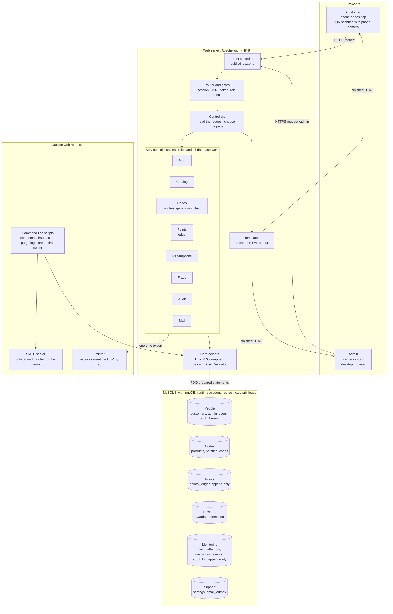
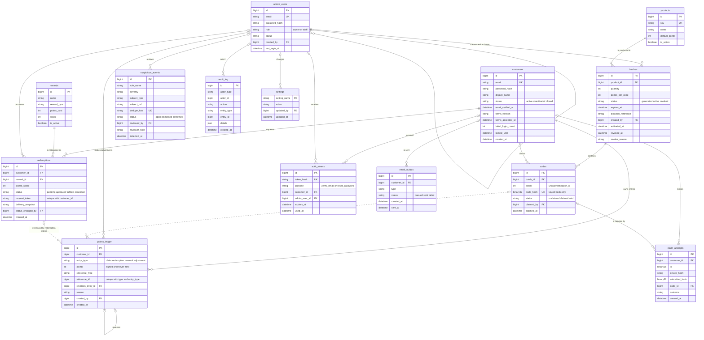

# Customer Loyalty Rewards System: Architecture and Database Design

**Status:** design for approval. No SQL queries and no PHP code in this document.
**Source of truth:** the approved requirements analysis and `ASSUMPTIONS.md` (gaps G1 to G32, requirements CUS, PRD, RWD, ADM, FRD, NFR).
**Fixed stack:** PHP 8+, MySQL 8 (InnoDB), PDO, server-rendered HTML5/CSS3, minimal vanilla JavaScript, PHP sessions, plain modular PHP. No Node.js, Python, Laravel, React or Vue.

**Where this design deliberately differs from my earlier `ARCHITECTURE.md`:** that file contained SQL (which this step says to hold back) and used an eight-table, single-`users`-table model. This document follows the approved analysis more closely (14 tables, separate admin accounts). Each place where the two disagree is listed in section 8 for your decision. Treat this document as the one to approve.

## Contents

1. System architecture
2. Mermaid architecture diagram
3. Database table design (with relationships)
4. Mermaid ER diagram
5. Important workflows
6. Security and data integrity
7. Proposed project structure
8. Remaining decisions that need your approval

---

## 1. System architecture

### 1.1 The big picture in plain language

This is a classic "server-rendered" web application. The browser asks for a page. PHP runs on the server, talks to MySQL, builds the finished HTML and sends it back. The browser does very little: it shows pages and submits forms. Nothing security-relevant is decided in the browser.

The application is **one PHP code base with two doors**:

- **The customer door** (`/`, `/claim`, `/account`, ...) is used mostly on phones, because customers scan a QR code on the box.
- **The admin door** (`/admin/...`) is used by the factory owner and staff on a desktop.

Both doors lead to the same PHP code and the same MySQL database, but they use **different login tables and different session namespaces**, so a customer session can never be mistaken for an admin session (approved decision G1).

### 1.2 How the four parties interact

| Party | What they do | How they reach the system |
|---|---|---|
| Customer | Registers, scans the QR code, claims codes, redeems rewards | Browser. The phone's own camera reads the QR code, which opens a claim URL that only pre-fills the form. |
| Administrator (owner or staff) | Manages products, batches, rewards, customers, redemptions; reviews fraud flags | Browser, through `/admin`. |
| PHP | Receives every request, checks login, CSRF token and role, applies the business rules, talks to the database, and renders the page | One front controller (`public/index.php`). |
| MySQL | Stores all data, and **enforces the rules that must never be broken** (single use, append-only ledger, no negative stock) | PDO only, using prepared statements. |

### 1.3 Request life cycle (every page works this way)

1. The browser sends a request to the **front controller** (one file that receives everything).
2. The **router** matches the method and path to a handler.
3. **Gates** run before the handler: start the session safely; for a POST, check the CSRF token; for a protected page, check the user is logged in and has the right role.
4. The **controller** reads and validates the input, then calls a **service**.
5. The **service** contains the business rules and is the only layer that talks to MySQL (through a small PDO wrapper). Anything that changes several tables runs inside one **database transaction**.
6. The controller picks a **template**. The template prints only escaped output.
7. The finished HTML goes back to the browser.

Two further things run **outside** web requests: command-line scripts (send queued email, run the heavy fraud scan, purge old attempt logs) and the manual, one-time CSV export of printable codes.

### 1.4 Two protections that must never be confused (fixed design decision)

- **Single-use protection** lives in the **database**. It guarantees a code can be credited once.
- **Copy protection** lives in the **packaging** (scratch panel or code inside the lid). It reduces the chance a code is seen before purchase.

They fail differently and neither proves a purchase. **A valid code proves someone has the code, not that they bought the product.** That sentence belongs in the README, the terms and conditions and the viva.

### 1.5 Module responsibilities

| Module | Responsibility | Talks to |
|---|---|---|
| **Core** | Shared plumbing: read `.env`, database connection, router, session, CSRF, template rendering, input validation | Everything |
| **Auth** | Customer and admin registration/login/logout, email verification, password reset, login throttling, role checks | `customers`, `admin_users`, `auth_tokens`, Mail |
| **Customers** | Profile, terms acceptance, account closure and anonymisation; admin-side customer search and deactivation | `customers` |
| **Catalog** | Products (SKU, name, default points) and rewards (cost, stock, availability, image) | `products`, `rewards` |
| **Codes** | Batch creation, secure code generation, one-time export, batch lifecycle, and the **claim** operation | `batches`, `codes`, Points, Fraud |
| **Points** | The only module allowed to write the ledger: credits, debits, reversals, adjustments, balances, history | `points_ledger` |
| **Redemptions** | Customer redemption, cancellation, stock reservation; admin processing queue | `redemptions`, `rewards`, Points |
| **Fraud** | Records every attempt, applies rate limits, runs rule checks, manages the review queue | `claim_attempts`, `suspicious_events` |
| **Admin** | Dashboard, reports and CSV export, settings page, audit-log viewer, staff account management | Reads across modules |
| **Audit** | Writes the append-only record of who did what | `audit_log` |
| **Mail** | Queues transactional email in the same transaction as the event; sends later | `email_outbox` |

**Golden rule:** controllers never contain SQL or business rules. Only services do. This keeps the claim and redemption logic in exactly one place each, which makes it testable and easy to explain.

---

## 2. Mermaid architecture diagram



---

## 3. Database table design

### 3.1 Conventions

- InnoDB, `utf8mb4`, strict SQL mode.
- Every timestamp is **UTC**, produced by the database clock, never PHP's (approved decision G30). Conversion to local time happens only when displaying.
- Primary keys are auto-numbered big integers.
- Foreign keys use "restrict": nothing is ever cascaded away. People, products, rewards and batches are **deactivated, never deleted**.
- Money-like values (points) are whole numbers.

### 3.2 The 14 tables at a glance

| # | Table | Purpose | Priority |
|---|---|---|---|
| 1 | `customers` | Customer accounts | Must |
| 2 | `admin_users` | Owner and staff accounts (separate from customers) | Must |
| 3 | `auth_tokens` | Email-verification and password-reset tokens (hashed) | Must |
| 4 | `products` | What the factory makes | Must |
| 5 | `batches` | One print and dispatch run of codes | Must |
| 6 | `codes` | One row per physical box, hash only | Must |
| 7 | `points_ledger` | The only place points exist (append-only) | Must |
| 8 | `rewards` | Reward catalogue with stock | Must |
| 9 | `redemptions` | Reward requests and fulfilment status | Must |
| 10 | `claim_attempts` | Every claim try, success or failure; also the rate-limit counter | Must |
| 11 | `suspicious_events` | Fraud flags and the review queue | Must |
| 12 | `audit_log` | Append-only record of admin and security actions | Must |
| 13 | `settings` | Tunable thresholds (limits, timeouts) | Should |
| 14 | `email_outbox` | Queued transactional email | Should |

### 3.3 Table by table

For each table: purpose, important columns, keys, constraints and indexes, and what the database itself enforces.

#### 1. `customers`
**Purpose:** one row per customer. Never deleted, because the ledger refers to them.
**Important columns:**
- Identity and login: email, password hash, display name.
- Optional profile: phone, one saved delivery address (see decision D9).
- State: status (active, deactivated, closed), deactivation reason, email-verified time.
- Terms: terms version accepted, time accepted (approved G31).
- Login protection: failed-login counter, locked-until time.
- Timestamps: created, closed/anonymised.

**Keys and constraints:**
- Primary key: id.
- Unique: email (the login lookup and "one account per email").
- Index: status (admin filtering).
- Rule: claiming requires verified email (enforced by the service). On closure, personal fields are replaced by placeholders while the id and ledger rows stay (approved G22).

#### 2. `admin_users`
**Purpose:** owner and staff accounts, kept apart so a stolen customer login can never reach admin pages (approved G1).
**Important columns:** email, password hash, display name, role (owner or staff), status, failed-login counter, locked-until time, last login time, who created the account, created time.
**Keys and constraints:**
- Primary key: id. Unique: email.
- Foreign key: created-by points to another admin row.
- Rule: never created through a public form. The first owner is created by a command-line script. Only an owner can create or disable staff.

#### 3. `auth_tokens`
**Purpose:** one-time links for email verification and password reset. Only the **hash** of the token is stored, so a database leak cannot be used to take over accounts.
**Important columns:** token hash, purpose (verify email or reset password), owner (a customer or an admin user), expiry time, used time, created time.
**Keys and constraints:**
- Primary key: id. Unique: token hash.
- Foreign keys: customer (nullable) and admin user (nullable). A check rule says exactly one of the two is set.
- Index: owner plus purpose (to invalidate older tokens when a new one is issued).
- Reset tokens are valid about 30 minutes and single-use (approved G23). Admin password resets are one-time links issued by an owner, never an emailed password.

#### 4. `products`
**Purpose:** consistent product identity (approved G4).
**Important columns:** SKU, name, description, default points, active flag, created time.
**Keys and constraints:** primary key id; unique SKU; check that default points are positive. Deactivated, never deleted.

#### 5. `batches`
**Purpose:** a group of codes printed and dispatched together. Keep batches small (about one per consignment), so a theft or recall touches limited stock (approved G7).
**Important columns:**
- Links: product, created-by admin.
- Numbers: quantity, points per code.
- State: status (generated, active, revoked; "expired" is derived, see below).
- Timing: expiry time (optional), activated time and by whom, revoked time, by whom and reason.
- Dispatch: dispatch reference, set at activation.
- Export: time the one-time plaintext export was made.

**Keys and constraints:**
- Primary key: id. Foreign keys: product, created-by admin, activated-by admin, revoked-by admin.
- Indexes: product; status.
- Database rules: quantity and points within sensible bounds; revoked batches must have time, admin and reason; **only legal status moves are allowed** (generated to active or revoked; active to revoked; revoked is final); **quantity and points are frozen once the batch leaves "generated"** (approved G10, PRD-06).
- "Expired" is **not stored**. A batch is expired when it is active and its expiry time has passed. The claim check reads this directly, so no scheduled job is needed (approved G8).

#### 6. `codes`
**Purpose:** one row per physical box. The most security-sensitive table.
**Important columns:**
- Batch link and a **serial number** (non-secret, for support references).
- **Code hash**: the keyed hash (HMAC-SHA-256 of the normalised code, using a secret from `.env`), stored as 32 raw bytes. **No plaintext code is stored anywhere in the database.**
- Status (unclaimed, claimed, void), claimed-by customer, claimed time.

**Keys and constraints:**
- Primary key: id. Foreign keys: batch, claimed-by customer.
- **Unique: code hash** (fast lookup and collision protection).
- Unique: batch plus serial.
- Indexes: batch plus status (batch reports); claimed-by plus time (a customer's claims, daily limit).
- Database rules: the three claim fields are all set or all empty; a claimed code can never change again; the hash and batch can never change.
- Whether a code is claimable depends on its **batch** being active and unexpired, not on a per-code flag (see decision D4).

#### 7. `points_ledger`
**Purpose:** the **only** place points exist. A customer's balance is the sum of their rows. There is no balance column anywhere.
**Important columns:**
- Customer.
- Entry type: claim, redemption, reversal, adjustment (and "expiry", reserved but unused in version 1, approved G11).
- Points: signed whole number, never zero.
- Reference type and reference id: what caused the row (a code or a redemption).
- Reverses-entry: set only on reversal rows; points at the entry being cancelled.
- Reason, created-by admin (for adjustments and manual reversals), created time.

**Keys and constraints:**
- Primary key: id. Foreign keys: customer, reverses-entry (self), created-by admin.
- **Unique: entry type plus reference type plus reference id.** This is the "one code can never produce two credits" guarantee. It also stops two debits for one redemption and a second reversal of the same thing.
- **Unique: reverses-entry.** Second guard: an entry can be reversed once.
- Index: customer plus time/id (balance and history).
- Database rules: claim points positive, redemption points negative, points never zero; claims must reference a code; redemptions must reference a redemption; adjustments must have a reason and an admin; a reversal must carry a link and must be the exact opposite of the entry it cancels, for the same customer.
- Protected from change: see section 6.6.

#### 8. `rewards`
**Purpose:** the catalogue of physical items (approved G13: physical only in version 1).
**Important columns:** name, description, reward type (always "physical" for now, kept so vouchers could be added later), points cost, stock, active flag, optional availability dates, image file name, created time.
**Keys and constraints:** primary key id; index on active plus cost (catalogue browsing). Database rules: cost positive; **stock can never go negative** (last line of defence; the first is a conditional reservation, see workflow 5). Deactivated, never deleted. Image upload is admin-only and validated.

#### 9. `redemptions`
**Purpose:** one row per reward request, moving through a small workflow (approved G15).
**Important columns:**
- Links: customer, reward.
- **Points spent** (snapshot of the cost at request time).
- Status: pending, approved, fulfilled, cancelled.
- **Delivery details as a snapshot** (name, address or pickup choice), copied at request time so later profile edits cannot change an order in progress.
- Tracking or admin note; status-changed time and by whom; created time.
- **Request token**: a random one-time value from the form.

**Keys and constraints:**
- Primary key: id. Foreign keys: customer, reward, changed-by admin.
- **Unique: customer plus request token** (a double click or refresh cannot create a second redemption).
- Indexes: status plus created time (admin queue); customer plus created time (my redemptions).
- Database rule: points spent positive.
- Status changes are conditional ("only if still pending") so two admins cannot process the same request.

#### 10. `claim_attempts`
**Purpose:** a record of **every** claim attempt, successful or not. It is the rate-limit counter (no Redis, approved G27) and the raw material for fraud rules.
**Important columns:** customer (if known), IP address, device hash (from a first-party random token, stored hashed, approved G19), hash of what was typed (empty if the format was invalid), matched code (if the hash matched a real code), outcome, created time.
**Outcomes:** success, invalid format, unknown code, already claimed, not active, expired, revoked, rate limited.
**Keys and constraints:** primary key id; foreign keys customer and code (both nullable); indexes on customer plus time, IP plus time, device plus time, outcome plus time, code.
**Rules:** **plaintext is never stored here either.** The true outcome is stored even though the customer only ever sees a generic message. Rows older than about 90 days are purged by a manual script (approved G29).

#### 11. `suspicious_events`
**Purpose:** fraud flags with a human review queue (approved G18, FRD-03).
**Important columns:** rule name, severity (low, medium, high), subject type (customer, device, IP, batch) and subject identifier, details (structured text such as counts and window), **dedupe key**, status (open, dismissed, confirmed), detected time, reviewer, reviewed time, reviewer note.
**Keys and constraints:** primary key id; **unique dedupe key** (so re-running a scan cannot create the same flag twice); index status plus severity plus time (the review queue); foreign key reviewer (admin).

#### 12. `audit_log`
**Purpose:** "who did what, when, from where" for admins and security events (approved G24).
**Important columns:** actor type (admin, customer, system) and actor id, action name, entity type and entity id, details (before/after values), IP, created time.
**Keys and constraints:** primary key id; indexes on entity, actor plus time, action plus time. **Append-only**, protected the same way as the ledger. Logged actions include admin logins and failed logins, batch create/activate/revoke/export, reward and stock edits, redemption status changes, adjustments, role changes, settings changes, and CSV exports of personal data.

#### 13. `settings`
**Purpose:** thresholds you may want to tune without code changes (claims per day, failed attempts, cool-down minutes, session timeouts; approved G19, ADM-09).
**Important columns:** setting name (the key), value, description, updated time, updated by.
**Keys and constraints:** primary key is the setting name; foreign key updated-by (admin). Every change is audited. This table is deliberately editable; it is configuration, not history.

#### 14. `email_outbox`
**Purpose:** emails are queued in the **same transaction** as the event that triggers them and sent afterwards, so a mail-server failure never undoes a claim or redemption (approved G21).
**Important columns:** recipient (customer, nullable, plus address), type (verification, reset, redemption status), subject, body, status (queued, sent, failed), attempts, created time, sent time.
**Keys and constraints:** primary key id; foreign key customer (nullable); index status plus created time. Transactional email only; no marketing mail.

### 3.4 Relationships in plain language

- A **product** has many **batches**; a **batch** has many **codes**; each code belongs to exactly one batch.
- A **code** is claimed by zero or one **customer**. Once claimed it never changes.
- A **customer** has many **ledger entries**. Every claim creates one ledger entry that points at the code; every redemption creates one that points at the redemption. These two links are "soft" (the ledger stores a type and an id) because MySQL cannot make one column point at two different tables. The database instead checks the combination (a claim must reference a code; a redemption must reference a redemption), and the service inserts the real id in the same transaction.
- A ledger **reversal** points at the one entry it cancels (a real self-referencing foreign key).
- A **customer** has many **redemptions**; each redemption is for one **reward**; each reward can be redeemed many times.
- **Admin users** appear as the actor on batches, rewards/stock changes, redemption processing, adjustments, flag reviews and settings.
- **Claim attempts** link to the customer and, when the typed code matched, to the code. **Suspicious events** are raised from claim attempts, claims and redemptions, and refer to their subject by type and identifier.
- **Auth tokens** and **email outbox** hang off customers (and, for tokens, admin users).

---

## 4. Mermaid ER diagram

Solid lines are real foreign keys. Dotted lines are the soft ledger references that MySQL cannot enforce as foreign keys. `audit_log` and `suspicious_events` refer to their subjects by type and id, so they have no foreign-key line to every table.



---

## 5. Important workflows

Each workflow lists the happy path first, then the failure paths. "Transaction" means all steps succeed together or none of them happen.

### 5.1 Customer registration and login

**Registration**
1. The customer opens the registration page and enters name, email and password, and ticks acceptance of the current terms.
2. The server checks the CSRF token and validates the input (email format, minimum password length).
3. If the email already exists, the database's unique rule rejects it. The page shows a neutral message (it does not confirm that the address is registered).
4. The password is turned into a hash; the plain password is never stored or logged.
5. In one transaction the server creates the customer (status active, email unverified, terms version and time recorded), creates a verification token (only its hash is stored, with an expiry), and queues the verification email in the outbox.
6. The customer clicks the emailed link. The server finds the token by its hash, checks it is unused and unexpired, sets the email-verified time and marks the token used.
7. Until the email is verified the customer may browse but **cannot claim** codes (approved G2).

**Login**
1. The customer submits email and password with a CSRF token.
2. If the account is locked out, the server refuses without checking anything else.
3. The server verifies the password against the stored hash. On failure it increments the failed-login counter, may set a lock-out time, and shows the **same message** whether the email exists or not.
4. Deactivated or closed accounts cannot log in.
5. On success the failed counter is reset, a **new session ID is issued** (prevents session fixation), and the customer id is placed in the customer session namespace.

**Password reset:** request form shows the same message whether the email exists; a single-use, expiring link is emailed; using it sets a new password, invalidates the token and ends other sessions.

**Admin login** follows the same steps against `admin_users`, from the separate `/admin/login` page, with its own session namespace. Successful and failed admin logins are written to the audit log.

### 5.2 Product-code generation and batch activation

**Generation (owner only)**
1. The owner selects a product, quantity, points per code (defaulting from the product) and an optional expiry date, and submits with a CSRF token.
2. The server creates the batch in status **generated** and records the actor in the audit log.
3. The server generates the codes: each is 12 characters from a 31-character alphabet with no look-alike characters, produced with PHP's cryptographically secure random generator. Generation runs in chunks, each in its own transaction.
4. For each code the server normalises it, computes the **keyed hash** with the secret from `.env`, and stores only the hash plus a serial number. If a hash ever collides, the unique rule rejects it and a new code is generated.
5. The plaintext codes exist only in memory. The owner downloads a **one-time CSV** (human-readable code in groups of four and the QR link for each box) for the printer. The export is written to the audit log and the batch records that the export happened. **After this the plaintext codes cannot be retrieved.**
6. If the download fails, the plaintext is lost. The remedy is to revoke that batch and generate another. This is a stated limitation of storing only hashes.

**Printing and dispatch:** codes are printed (ideally under a scratch panel) and boxes are packed. The batch stays inactive: codes cannot be claimed yet, so codes stolen before dispatch are useless.

**Activation (owner only)**
1. When the cartons leave the factory, the owner activates the batch, entering a dispatch reference and an optional expiry date.
2. The database permits the move only from "generated" to "active". Quantity and points per code become locked.
3. The action is audited. From this moment the claim rule accepts the batch's codes.

**Revocation (owner only):** a reason is mandatory. The batch becomes revoked (final). Unclaimed codes in it immediately stop working. Already-claimed codes from it are listed for the owner to review; points are reversed customer by customer by a human decision, not automatically (approved G9). Revoked is a one-way door.

**Expiry:** nothing is "run". Once the expiry time passes, the claim check simply stops accepting the batch's codes.

### 5.3 Customer claims a product code

1. The customer scans the QR code with the phone camera, or types the printed code. The QR link opens the claim page and **only pre-fills the field**. Nothing is claimed by opening a link, because scanners and link previews fire page requests on their own.
2. If not logged in, the customer logs in first and returns to the claim page.
3. The customer presses submit. The server checks the CSRF token, the login, and that the account is active and email-verified.
4. **Rate limit check:** the server counts this customer's and this IP's recent failures from `claim_attempts`. If over the limit, it records a "rate limited" row and shows a wait-and-retry message. (Rate-limited rows are not counted as failures, otherwise a lock-out would extend itself forever.)
5. **Format check:** the input is normalised (upper case, spaces and hyphens removed) and checked for the exact length and alphabet. If wrong, an "invalid format" row is recorded and the generic message appears. The database is never queried with malformed input.
6. The server computes the keyed hash of the normalised code.
7. **Transaction begins.**
8. The customer's row is locked first (the approved lock-order rule), so two simultaneous claims by one customer take turns and the per-account daily limit is counted consistently. If the daily limit is already reached, the claim stops (this limit is a hard block).
9. **The atomic claim:** one single conditional change marks the code claimed by this customer **only if** the hash matches, the code is still unclaimed, its batch is active, and the batch has not expired. The server then looks at how many rows were changed.
10. **If exactly one row changed:** this request won. The server reads the points from the batch, writes the **claim entry in the ledger** (referencing the code), writes a "success" attempt row, and commits. The customer sees points earned and the new balance.
11. **If no row changed:** nothing was written. The server rolls back, then does a read-only look at the code and batch **only to label the log** with the true reason (unknown code, already claimed, not active, expired or revoked), records the attempt, and shows the **same generic message**. Failed attempts on not-yet-active or revoked codes are flagged high severity (a possible theft signal).
12. **Special case:** if the code was already claimed by this same customer, the page may say so. It reveals nothing about anyone else's codes.

### 5.4 Points calculation and ledger entry

- **Where points come from:** each batch fixes its points per code at activation (approved G10). The claim reads that number; it is never taken from the browser.
- **Ledger rows:** every change to a customer's points is one new row: claim (positive), redemption (negative), reversal (the exact opposite of an earlier row) or adjustment (owner or admin, with a mandatory reason).
- **Balance:** the sum of the customer's ledger rows. It is always calculated; it is never stored. This removes any chance of a stored number drifting away from the truth.
- **History page:** the ledger shown newest first with a running balance and readable descriptions. Reversals appear openly ("Reversal of ..."); nothing is hidden.
- **Corrections:** never edit or delete. Add an opposite row that points at the original. The database allows each entry to be reversed once, and only by its exact opposite.
- **Same transaction rule:** every ledger row is written in the same transaction as the business event it records, so you can never have "claimed with no points" or "points with no claim".
- **Negative balances:** possible after a reversal for a customer who already redeemed. The balance then blocks new redemptions until points are earned back. The terms must say so (approved G9, G31).
- **Reconciliation:** a report checks that every claim row has a claimed code, every redemption row has a redemption, and every reversal points at a valid entry.

### 5.5 Reward redemption

**Customer request**
1. The customer browses active rewards (cost, stock status and whether they can afford it).
2. The redemption form shows delivery or pickup details (see decision D8) and carries a one-time request token.
3. On submit the server checks CSRF, login and active status.
4. **Transaction begins.** The customer row is locked first. The balance is calculated from the ledger. If it is lower than the cost, the transaction is rolled back with "insufficient points".
5. **Stock reservation:** one conditional change reduces the reward's stock by one **only if** the reward is active and stock is at least one. If no row changed, roll back with "out of stock".
6. The server creates the redemption (status pending, delivery details copied as a snapshot, request token) and the **negative ledger row** referencing it.
7. Commit. A double click or refresh reuses the same request token and is rejected by the database's unique rule.

**Processing:** admins see a queue filtered by status. Each change (pending to approved to fulfilled, or cancelled) is a conditional change ("only if still in the expected status"), records who and when, and takes a note. Two admins cannot process the same request twice.

**Cancellation:** the customer may cancel while pending; an admin may cancel before fulfilled; after fulfilment only an owner adjustment can correct it (approved G16). Cancellation is one transaction: conditional status change, a **reversing** ledger row (positive, pointing at the original debit), and stock restored. The ledger rules make a second refund impossible.

**Notifications:** status changes queue an email in the outbox (a failed email never undoes the redemption).

### 5.6 Admin management

Permissions are enforced on the server for every request (approved G1, ADM-01). Hiding a menu item is cosmetic only.

| Area | Owner | Staff |
|---|---|---|
| Products: create, edit, deactivate | Yes | Yes |
| Rewards and stock: create, edit, deactivate | Yes | Yes (stock edits audited) |
| Batches: create and export codes | Yes | No |
| Batches: activate | Yes | No |
| Batches: revoke | **Owner only** | No |
| Customers: search, view profile, ledger, claims, redemptions | Yes | Yes |
| Customers: deactivate or reactivate (reason required) | Yes | Yes |
| Redemption queue: approve, fulfil, cancel | Yes | Yes |
| Ledger adjustments and reversals (reason required) | **Owner only** | No |
| Fraud review queue: dismiss or confirm | Yes | Yes |
| Settings and thresholds | Owner only | No |
| Staff accounts: create, disable, issue reset link | Owner only | No |
| Reports and CSV export (audited) | Yes | Yes |
| Audit log viewer (read-only) | Yes | Yes |

Every state-changing admin action writes to the audit log with actor, time, IP and before/after details.

### 5.7 Fraud detection and suspicious-activity monitoring

**Principle:** flag for a human, throttle where it is safe, and hard-block only on per-account limits. IP and device data are **risk signals, not proof of identity** (phones are shared, mobile networks share IPs, cookies clear).

1. **Record everything.** Every claim attempt is stored in `claim_attempts` with customer, IP, device hash, the true outcome and time.
2. **Cheap checks at claim time:** rate limits per account and per IP; the per-account daily claim cap (hard block); an immediate high-severity flag when someone tries a code in a not-yet-active or revoked batch.
3. **Heavier checks on a schedule or on demand** (an admin button or a command-line script; no background service needed). The scan looks for:
   - many failed attempts by one account;
   - several accounts sharing one IP or device within a time window;
   - bursts of claims on consecutive serial numbers by one account;
   - new accounts that claim and redeem quickly;
   - many accounts redeeming to the same delivery address;
   - a batch being claimed abnormally fast.
4. **Store flags.** Each hit becomes a row in `suspicious_events` with rule, severity, subject and details. A dedupe key means re-running the scan never duplicates a flag.
5. **Review queue.** An admin sees open flags sorted by severity. Actions: dismiss (with note), confirm, deactivate the customer, revoke the batch (owner), reverse points (owner). Every action is audited.
6. **Tune.** Thresholds live in `settings`, so you can adjust them while demonstrating without changing code.

**Limits to state honestly:** this detects patterns after the fact. It cannot tell a thief who claims first from a legitimate buyer. It reduces and reveals fraud; it does not eliminate it.

---

## 6. Security and data integrity

### 6.1 Duplicate code claims
- Each box has its own unique code (approved G3), so there is no shared code that can be claimed repeatedly.
- The code's row has a status. The claim is **one conditional change** whose success is judged by "how many rows changed". There is no "look first, then write" gap.
- The ledger has a unique rule on (entry type, reference type, reference id). Even if a PHP bug tried to credit one code twice, the database refuses the second row.
- Any claim row must be written in the same transaction as the code change, so the two cannot disagree.

### 6.2 Simultaneous claim requests
- When two requests hit the same code together, InnoDB locks the code row for the first. The second waits, then re-checks "still unclaimed?", finds it is not and changes nothing. Exactly one request wins.
- Requests by the **same customer** queue on the customer-row lock, so daily limits are counted consistently and redemptions cannot both spend the same balance.
- **Lock-order rule:** always lock in the same order (customer, then code or reward, then ledger). A deadlock is retried once.
- MySQL's default isolation level is kept. Safety comes from explicit locks and conditional changes, not from a higher isolation setting.

### 6.3 Code guessing and brute-force attempts
- **Entropy:** 12 characters from 31 gives about 7.9 × 10^17 possibilities (roughly 59 bits). With a million valid codes in circulation, one random guess has about a one-in-a-trillion chance.
- **Secure generation:** cryptographic random generator, never a counter or a predictable function.
- **Rate limits** per account and per IP, counted from `claim_attempts` in MySQL. Burst races may let a few extra attempts through; that is acceptable because entropy, not the counter, is the main defence.
- **One generic failure message** for every failure reason, so guessers learn nothing about which codes exist or what state they are in. Support sees the true reason in the log.
- **Verified email required** to claim, so mass account creation costs an attacker some effort.
- **Probing alerts:** attempts on not-yet-active or revoked codes raise a high-severity flag.
- **Keyed hash:** a stolen database does not reveal usable codes without the secret held in `.env`.
- Login and password-reset forms are throttled separately.

### 6.4 Unauthorized admin access
- Admin accounts live in a **separate table** with a **separate session namespace** and login page. They cannot be created through public registration. The first owner is created from the command line.
- **Server-side checks on every admin request:** the router refuses anything under `/admin` without an admin session, and each handler checks the specific role (owner or staff) as its first step.
- **Least privilege:** staff cannot create batches, revoke batches, adjust points or change settings.
- **Login hardening:** password hashing, failed-attempt lock-out, session regeneration on login, idle and absolute timeouts, HTTPS in any real deployment.
- **Accountability:** all admin logins, failed logins and state changes are in the append-only audit log.
- **Damage limiting:** the web application's database account cannot rewrite history, so even a hijacked admin session cannot silently alter the ledger or audit trail through the application.

### 6.5 Points manipulation
- Points values come only from the database (the batch and reward cost), never from form fields.
- Only the Points module writes the ledger. Controllers and pages cannot.
- No editable balance exists. The balance is derived.
- The database rejects wrong signs (a claim must be positive, a redemption negative), zero rows, and malformed reversals.
- Manual adjustments are owner-only, need a reason, are audited, and may have a configurable maximum.
- A periodic reconciliation report compares the ledger with claims and redemptions.
- Per-account hard limits and anomaly flags catch unusual earning patterns.

### 6.6 Ledger immutability
Three independent layers:
1. **Privileges.** The account PHP uses at runtime can only read and add rows to the ledger. It cannot change or remove them, cannot rebuild or empty the table, and cannot touch triggers. Schema changes use a separate migration account that the web application never uses.
2. **Triggers.** The database itself rejects any attempt to change or remove a ledger row, whoever makes it. Another trigger checks that a reversal exactly cancels its target.
3. **Constraints.** Sign rules, unique references and the unique reversal link.

The audit log is protected the same way.

**Honest limit:** a database administrator with enough privilege can still remove the triggers or edit data. This design resists the application and attackers, not a privileged administrator. Backups (off-server, with a tested restore), the binary log and the reconciliation report cover that gap.

### 6.7 Database transactions and rollback
- InnoDB provides transactions. Each business event is one transaction.
- **What goes inside a transaction:**
  - Claim: customer lock, the atomic code claim, the ledger credit, the attempt record.
  - Redemption: customer lock, balance check, stock reservation, redemption row, ledger debit.
  - Cancellation: status change, reversing ledger row, stock restore.
  - Batch generation: each chunk of codes.
  - Registration: customer, verification token, outbox email.
- **On any failure** (an unexpected error, a rule violation, "zero rows changed" where one was expected), the whole transaction is rolled back and the customer sees a safe generic error. Nothing is half-done.
- **Email never blocks a business event.** The email is queued inside the transaction and sent later by a script.
- PDO is set to raise exceptions so that errors cannot pass silently.

### 6.8 Baseline controls on every page
Prepared statements only; output escaping on every printed value; a CSRF token on every POST (including logout); session cookie flags (HttpOnly, Secure, SameSite=Lax); secrets in a file outside the web root; errors logged, never displayed; security headers including a content security policy; image uploads validated and renamed; customer pages always filter by the logged-in customer's own id so one customer cannot view another's data.

### 6.9 Fixed limitation (repeated on purpose)
A valid code proves possession of the code, not purchase. Residual risks: theft from warehouses or vehicles, boxes opened in shops, codes photographed and shared, resold opened boxes, and insider exposure at the printer. Mitigations: scratch panel, activation only after dispatch, per-account limits, monitoring and batch revocation. These reduce and detect fraud; they do not eliminate it.

---

## 7. Proposed project structure

Beginner-friendly means: **one place for each kind of thing, with names that say what they do.** A new reader should be able to guess where any behaviour lives.

```
loyalty/
├── public/                      The ONLY folder the web server exposes
│   ├── index.php                Front controller: every request enters here
│   ├── assets/
│   │   ├── css/                 Stylesheets (mobile-first)
│   │   └── js/                  One small file of helpers (disable button after click, confirm dialogs)
│   └── uploads/                 Reward images (scripts never run from here)
│
├── src/                         All PHP logic, kept out of the web root
│   ├── Core/                    Shared plumbing used by every module
│   │   ├── Env                  Reads the .env file
│   │   ├── Database             Creates the PDO connection (exceptions on, UTC time, real prepared statements)
│   │   ├── Router               Matches method and path to a handler; applies the gates
│   │   ├── Session              Safe session start, cookie flags, timeouts, namespaces
│   │   ├── Csrf                 Creates and checks CSRF tokens
│   │   ├── View                 Renders a template; provides the escaping helper
│   │   └── Validator            Small input-checking helpers
│   └── Modules/                 One folder per feature area (a controller and a service each)
│       ├── Auth/                Register, login, logout, verify email, reset password, role checks
│       ├── Customers/           Profile, closure; admin-side customer screens
│       ├── Catalog/             Products and rewards
│       ├── Codes/               Batches, code generation, export, lifecycle, the claim operation
│       ├── Points/              Ledger service: the only writer of points
│       ├── Redemptions/         Request, cancel, admin queue
│       ├── Fraud/               Attempt logging, rate limits, rule scans, review queue
│       ├── Admin/               Dashboard, reports, settings, audit viewer, staff accounts
│       ├── Audit/               Writes audit-log entries
│       └── Mail/                Queues emails; the sending script lives in bin/
│
├── templates/                   HTML pages (PHP files that print escaped data)
│   ├── layout/                  Shared header, footer, navigation
│   ├── public/                  Landing, register, login, terms, privacy
│   ├── customer/                Claim, account, history, rewards, redemptions, profile
│   └── admin/                   Dashboard, batches, rewards, redemptions, customers, flags, audit
│
├── config/
│   ├── routes.php               The route table: which URL runs which handler, who may access it
│   └── app.php                  Settings read from .env (names, timeouts, defaults)
│
├── database/                    Created in the next step, after you approve this design
│   └── (schema, triggers, privileges, seed data)
│
├── bin/                         Command-line scripts (never reachable from the web)
│   ├── create-owner             Creates the first owner account
│   ├── send-email-outbox        Sends queued emails
│   ├── run-fraud-scan           Runs the heavier fraud rules
│   ├── purge-old-logs           Removes old attempt and token rows
│   └── reconcile-ledger         Checks ledger integrity
│
├── demo/                        Scripts for the live demonstration (later step)
├── docker/                      Local environment definition (MySQL 8 and PHP-Apache)
├── storage/logs/                Error log, outside the web root and out of Git
├── docs/                        ASSUMPTIONS.md, ARCHITECTURE_DESIGN.md, README
├── .env.example                 Template for secrets (the real .env is never committed)
└── .gitignore
```

| Folder or file | Why it exists |
|---|---|
| `public/` | Anything the browser may fetch. Keeping it small means source code and secrets are never downloadable. |
| `public/index.php` | A single entry point so security gates run for every request. |
| `src/Core/` | Written once, reused everywhere. Each file is short and focused so you can explain it. |
| `src/Modules/*` | Feature-based grouping. To change "how claiming works" you open `Codes`; to change "how balances work" you open `Points`. |
| `templates/` | Pages contain presentation only: no SQL and no business rules. |
| `config/routes.php` | One readable list of every page and who may see it; easy to audit for missing role checks. |
| `database/` | The truth about data. Empty until you approve this design. |
| `bin/` | Work that should not happen inside a web request (email, scans, clean-up). |
| `.env` and `.env.example` | Secrets (database passwords, the code-hashing secret) stay out of Git and out of the web root. |
| `storage/logs/` | Errors are logged for you, never shown to visitors. |

---

## 8. Remaining decisions that need your approval

Each item has my recommended default. **Nothing below has been assumed silently**: where I took a position, it is labelled.

### A. Conflicts between your earlier brief and the approved analysis

| # | Decision | Options | Recommendation |
|---|---|---|---|
| D1 | Where admin accounts live | (a) separate `admin_users` table (approved analysis, G1); (b) one `users` table with a role column (earlier brief) | (a), because it limits the damage of a stolen customer login |
| D2 | Admin roles | (a) owner and staff (approved G1); (b) a single admin role (earlier brief) | (a), one role column and one permission check |
| D3 | Batch lifecycle names | (a) generated, active, revoked, with expired derived (approved PRD-05); (b) add a stored "printed" step (earlier brief) | (a). A "printed" step adds a state with no security value; you can record print date as a note if wanted |
| D4 | How a code becomes claimable | (a) code status stays unclaimed/claimed/void and the claim also requires the **batch** to be active and unexpired; (b) flip every code to "active" when the batch is activated | (a). It avoids rewriting up to 100,000 rows at activation or revocation, and revocation is instant. This is an interpretation of the approved lifecycle, so please confirm it |
| D5 | Claim record | (a) store claimed-by and claimed-at on the code; (b) add a separate `code_claims` table | (a). The unique ledger reference is already the second line of defence, so a separate table adds little |
| D6 | Table count and scope | (a) 14 tables as in section 3; (b) the earlier eight tables plus deferring `suspicious_events`, `settings`, `auth_tokens`, `email_outbox` | (a), but you could build `settings` and `email_outbox` last (marked "Should") |
| D7 | The earlier `ARCHITECTURE.md` | Replace it with this design, keep both, or delete it | Replace it. It contains SQL this step says to hold back, and uses the eight-table model |

### B. Design details the analysis left open

| # | Decision | Options | Recommendation |
|---|---|---|---|
| D8 | Rewards: shipped or collected at the factory (owner question 3) | Ship; collect; both | Decide before schema, because it changes what delivery data is stored. Default: shipping address snapshot with a pickup option flag |
| D9 | Saved delivery addresses (CUS-04 says "addresses") | One saved address on the customer; a separate address table | One saved address, plus entering a different one per redemption. A table adds work for little demo value |
| D10 | Support notes on a customer (G28) | A notes column on the customer; notes stored in the audit log; a notes table | Store as audit-log entries of type "note" (no extra table) |
| D11 | Device token for soft fraud signals (G19) | Implement now; add the column and implement later; skip | Include the column and a simple random cookie now; treat it purely as a signal |
| D12 | Fraud scan trigger (FRD-02) | Admin button only; command-line script on a schedule; both | Both: a button for the demo, the same script for scheduling |
| D13 | Local environment | Docker Compose; XAMPP | Docker Compose. XAMPP ships MariaDB, not MySQL 8, which would break the stack constraint |
| D14 | Maximum batch size | Choose a limit (the approved analysis assumes up to about a million codes in total) | 50,000 codes per batch for the demo; small batches also limit theft impact |
| D15 | Default thresholds | e.g. 5 failed attempts per account and 20 per IP per 15 minutes; 10 successful claims per account per day | Accept these as starting values; they live in `settings` |

### C. Business questions for the factory owner (from the analysis)

1. How many points should a typical box earn, and what does the cheapest reward cost?
2. Who prints the codes, and can the vendor apply scratch-off panels or print inside lids?
3. Shipped or collected rewards (same as D8)?
4. Will the owner reverse points and allow negative balances after a stolen or recalled batch?
5. How long must financial records be kept (sets the retention period for the ledger and redemptions)?

### Next step (only after your approval)
Once you confirm or change D1 to D15, I will move to the database SQL (tables, constraints, triggers, privileges), and only after that to the page and route map and the PHP implementation. I will not start either until you approve.
