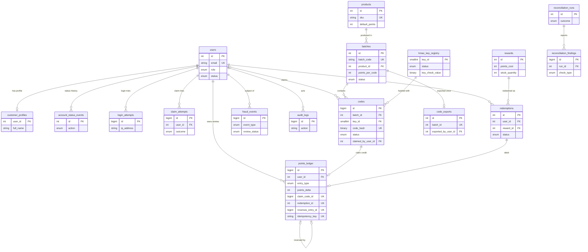

# DATABASE_DESIGN.md: Customer Loyalty Rewards System

Stage 2 design document. **Design only: no SQL schema file, no executable SQL, no tables have been created.** Table and column descriptions below are a *specification* that Stage 3 will turn into a schema.

Companion documents: [ARCHITECTURE.md](ARCHITECTURE.md), [WORKFLOWS.md](WORKFLOWS.md), [PROJECT_STRUCTURE.md](PROJECT_STRUCTURE.md), [ASSUMPTIONS.md](ASSUMPTIONS.md), [TEST_PLAN.md](TEST_PLAN.md).

Labels are the same as in ARCHITECTURE.md section 0: **[Confirmed]**, **[Requirement]**, **[Project constraint]**, **[Fact]**, **[Recommendation]**, **[Assumption]**, **[Unresolved]**.

---

## 1. Conventions

| Topic | Rule | Label |
|---|---|---|
| Engine | InnoDB for every table (needed for transactions and foreign keys) | [Recommendation] |
| Access | PDO prepared statements only | [Project constraint] |
| Character set | `utf8mb4`, collation `utf8mb4_unicode_ci` | [Recommendation]; [Unresolved Q-02: confirm with `SHOW COLLATION` on the installed server] |
| Time | All timestamps stored in UTC in `DATETIME` columns (not `TIMESTAMP`, which converts time zones and has a year-2038 limit) | [Recommendation] |
| Primary keys | `INT UNSIGNED AUTO_INCREMENT` for small tables; `BIGINT UNSIGNED AUTO_INCREMENT` for tables that can grow large (`codes`, `points_ledger`, `claim_attempts`, `login_attempts`, `fraud_events`, `audit_logs`). A foreign key column must use exactly the same type as the key it points to. | [Recommendation] |
| Delete rules | **No `ON DELETE CASCADE` anywhere.** Every foreign key uses RESTRICT, so history cannot disappear by accident. Rows are deactivated or anonymised, not deleted. | [Recommendation] |
| Fixed value lists | `ENUM` columns (ARCHITECTURE section 10 trade-off) | [Recommendation] |
| Booleans | `TINYINT(1)` (MySQL and MariaDB both treat `BOOLEAN` as this) | [Fact, general knowledge; not re-verified] |
| JSON | No `JSON` column type (MariaDB stores it as text). Structured details go into a `TEXT` column holding a JSON string that contains **no secrets**. | [Recommendation, ARCHITECTURE section 9] |
| Naming | `snake_case`, lowercase table and column names (Ubuntu is case-sensitive for table names) | [Recommendation] |
| Secrets | No plaintext code, no HMAC secret key, no password is ever stored in a column | [Confirmed] (decision 3) |
| CHECK constraints | Do not rely on them. Enforcement depends on the MySQL/MariaDB version, so every rule that a CHECK would express is **also** enforced in services and, where possible, by conditional updates. | [Recommendation]; [Unresolved Q-02: confirm enforcement on your installed version] |
| Database account | The application uses its own least-privilege database user, not `root`. For `points_ledger` and `audit_logs` that user gets INSERT and SELECT only (no UPDATE, no DELETE), so "append-only" is enforced by the database itself. | [Recommendation, supports ARCHITECTURE 13.4 and 13.7] |

---

## 2. Complete table list

17 tables. All 17 are represented in the current ARCHITECTURE §3 module inventory, and every table has one named write-owning module. The earlier inventory gap C-02 has been corrected.

| # | Table | Purpose | Write-owning module | Source |
|---|---|---|---|---|
| 1 | `users` | Login accounts for customers and administrators | Authentication & account lifecycle | ARCH §3 |
| 2 | `customer_profiles` | Name, phone and contact details of a customer | Customer profiles | ARCH §3 |
| 3 | `account_status_events` | History of suspensions, reactivations and closure status events | Authentication & account lifecycle | ARCH §3 / 13.2 |
| 4 | `login_attempts` | Login rate-limit evidence | Authentication & account lifecycle | **New** (ARCH §3) |
| 5 | `products` | Products and default points | Products | ARCH §3 |
| 6 | `batches` | Production batches and their state | Production batches | ARCH §3 |
| 7 | `hmac_key_registry` | Metadata about each HMAC key (never the secret) | Key management | ARCH §3 |
| 8 | `codes` | One row per retail box code: HMAC hash, key ID, status | Code lifecycle (one CodesRepository; transition owners in note below) | ARCH §3 |
| 9 | `code_exports` | Evidence that a batch export happened | CSV export | ARCH §3 |
| 10 | `claim_attempts` | Every claim attempt, for rate limits and review | Customer code claiming | ARCH §3 |
| 11 | `points_ledger` | Append-only record of every points change | LedgerService (all business services delegate ledger inserts) | ARCH §3 |
| 12 | `rewards` | Reward catalogue and stock | Reward catalogue (RewardService owns all stock changes) | ARCH §3 |
| 13 | `redemptions` | A customer's redemption of a reward | Reward redemption (RedemptionService) | ARCH §3 |
| 14 | `fraud_events` | Suspicious events and their review status | Fraud monitoring | ARCH §3 |
| 15 | `audit_logs` | Append-only "who did what" | Audit logging | ARCH §3 |
| 16 | `reconciliation_runs` | One row per reconciliation report run | Reconciliation | ARCH §3 / 13.4 |
| 17 | `reconciliation_findings` | Discrepancies found by a run | Reconciliation | ARCH §3 / 13.4 |

**Write-ownership note.** Each table has one repository and one owning module. The Authentication & account-lifecycle module owns writes to `users`, `login_attempts` and `account_status_events`; Customer profiles owns `customer_profiles`; ProductService owns `products`; BatchService owns `batches` and all batch-state changes; the Code lifecycle module owns `codes` through one CodesRepository (CodeGeneratorService inserts, ClaimService changes `unclaimed→claimed`, BatchService changes `unclaimed→voided`); KeyService owns `hmac_key_registry`; ExportService owns `code_exports`; ClaimService owns `claim_attempts`; LedgerService alone inserts `points_ledger`; RewardService alone writes `rewards`, including stock reservation/restock/return; RedemptionService owns `redemptions`; FraudService owns `fraud_events`; AuditService owns `audit_logs`; ReconciliationService owns `reconciliation_runs` and `reconciliation_findings`. Admin pages coordinate through these services and never write around them. Cross-service methods that participate in a caller's transaction do not start nested transactions. See ARCHITECTURE §3.2 and ASSUMPTIONS §7.

---

## 3. Table definitions

In each table: **Null** = whether NULL is allowed. "UTC" means a UTC `DATETIME`.

### 3.1 `users`

| Column | Type | Null | Notes |
|---|---|---|---|
| `id` | INT UNSIGNED, auto-increment | No | **Primary key** |
| `email` | VARCHAR(254) | No | Login identifier, stored lowercase. After the 30-day closure window, replace with a unique non-routable `closed-user-<id>@example.invalid` value [Assumption A-17]. |
| `password_hash` | VARCHAR(255) | No | Output of PHP `password_hash`. 255 is the width the PHP manual recommends so future algorithms fit. [Fact, PHP manual; not re-verified] |
| `role` | ENUM('customer','admin') | No | Default `customer` |
| `status` | ENUM('active','suspended','closed') | No | Default `active` |
| `created_at` | DATETIME (UTC) | No | |
| `updated_at` | DATETIME (UTC) | No | |
| `last_login_at` | DATETIME (UTC) | Yes | |

- **Unique:** `email`.
- **Indexes:** the unique index on `email` serves login lookups; `(role, status)` for admin lists.
- **Notes:** One table with a role (ARCHITECTURE section 10). The `users` row is the **per-customer lock target** (section 6.3). Closure never deletes this row; after the 30-day recovery window the email is replaced with a unique non-routable placeholder, while the profile's identifying fields are cleared/anonymised. [Assumption A-17]

### 3.2 `customer_profiles`

| Column | Type | Null | Notes |
|---|---|---|---|
| `user_id` | INT UNSIGNED | No | **Primary key and foreign key** to `users.id` (one-to-one) |
| `full_name` | VARCHAR(120) | No | Set to `Closed account` after the closure recovery window [A-17]. |
| `phone` | VARCHAR(20) | Yes | Not unique (families share phones) |
| `contact_details` | VARCHAR(255) | Yes | "Optional contact details" from ARCHITECTURE §3 |
| `anonymised_at` | DATETIME (UTC) | Yes | Set when name, phone and contact details were anonymised after the A-17 recovery window |
| `created_at`, `updated_at` | DATETIME (UTC) | No | |

### 3.3 `account_status_events`

Supports ARCHITECTURE 13.2 (who suspended, when, why, whether lifted). A suspension is "lifted" when a later `reactivate` row exists; no editing of old rows.

| Column | Type | Null | Notes |
|---|---|---|---|
| `id` | INT UNSIGNED, auto-increment | No | **PK** |
| `user_id` | INT UNSIGNED | No | **FK** to `users.id` (the affected account) |
| `action` | ENUM('suspend','reactivate','close_request','anonymise') | No | |
| `reason_category` | VARCHAR(40) | No | One of the initial categories in ASSUMPTIONS A-30 (`fraud_review`, `abuse`, `customer_request`, `security_concern`, `legal_or_retention`, `admin_correction`, `other`) |
| `reason_text` | VARCHAR(500) | Yes | Internal only; never shown to the customer [ARCH 13.2] |
| `acted_by_user_id` | INT UNSIGNED | No | **FK** to `users.id`. For a customer closure request this is the customer. |
| `created_at` | DATETIME (UTC) | No | |

- **Index:** `(user_id, id)`.

### 3.4 `login_attempts`

Stores no attempted email text (avoids keeping typos that may be someone else's address).

| Column | Type | Null | Notes |
|---|---|---|---|
| `id` | BIGINT UNSIGNED, auto-increment | No | **PK** |
| `user_id` | INT UNSIGNED | Yes | **FK** to `users.id`; NULL when the email did not match any account |
| `ip_address` | VARCHAR(45) | No | Long enough for IPv6 text. Initial direct-Apache deployment uses the server-provided client address; only an explicitly allowlisted trusted proxy may supply forwarded addresses [Assumption A-29]. |
| `succeeded` | TINYINT(1) | No | |
| `created_at` | DATETIME (UTC) | No | |

- **Indexes:** `(ip_address, created_at)` and `(user_id, created_at)` for the two rate-limit counts.
- Only actual credential attempts are recorded. A request rejected solely because an existing lockout is active does not insert another `succeeded = 0` row, so repeated blocked requests cannot extend the lockout window [A-04].

### 3.5 `products`

| Column | Type | Null | Notes |
|---|---|---|---|
| `id` | INT UNSIGNED, auto-increment | No | **PK** |
| `sku` | VARCHAR(40) | No | Factory product code |
| `name` | VARCHAR(150) | No | |
| `description` | TEXT | Yes | |
| `default_points` | INT UNSIGNED | No | Default points per code for new batches |
| `is_active` | TINYINT(1) | No | Deactivate instead of delete |
| `created_by_user_id` | INT UNSIGNED | No | **FK** to `users.id` |
| `created_at`, `updated_at` | DATETIME (UTC) | No | |

- **Unique:** `sku`.
- **Note:** Changing `default_points` later does **not** change existing batches (batches keep a copy; section 3.6).

### 3.6 `batches`

| Column | Type | Null | Notes |
|---|---|---|---|
| `id` | INT UNSIGNED, auto-increment | No | **PK** |
| `batch_code` | VARCHAR(30) | No | Human-readable label such as a printed batch number. **Not a secret.** |
| `product_id` | INT UNSIGNED | No | **FK** to `products.id` |
| `points_per_code` | INT UNSIGNED | No | Copied from the product when the batch is created; may be overridden at creation [A-05]; service validates 1–10,000 [A-34] |
| `planned_quantity` | INT UNSIGNED | No | Number of box codes requested; must be between 1 and 1,000 [Assumption A-10]. |
| `generated_count` | INT UNSIGNED | Yes | Codes actually inserted; NULL until generated |
| `status` | ENUM('draft','generated','exported','printed','active','voided') | No | Exactly the states of ARCHITECTURE 13.9. Default `draft`. |
| `created_by_user_id` | INT UNSIGNED | No | **FK** to `users.id` |
| `generated_at`, `exported_at`, `printed_at`, `activated_at`, `voided_at` | DATETIME (UTC) | Yes | Filled as the state is reached |
| `activated_by_user_id`, `voided_by_user_id` | INT UNSIGNED | Yes | **FK** to `users.id` |
| `void_reason` | VARCHAR(500) | Yes | Required when voided (service rule) |
| `created_at`, `updated_at` | DATETIME (UTC) | No | |

- **Unique:** `batch_code`.
- **Indexes:** `(status)`, `product_id`.
- **Transition ownership:** only `BatchService` changes `status`. Each transition is a **conditional update** that names the expected previous state (for example "set `active` where status is `printed`"); zero changed rows means "not allowed or already done" (this also makes activation and voiding idempotent, ARCH 13.9).
- **Allowed transitions:** `draft→generated→exported→printed→active`, and `voided` from any state except `voided`. `voided` is final.
- Key IDs are stored **per code** (section 3.8), not per batch, so there is one source of truth.

### 3.7 `hmac_key_registry`

See section 7 for how it is used. **It contains metadata only. The secret keys live in `.env`, never here, and are never in ordinary database backups** [ARCH 13.6, Confirmed by decision 3 + Requirement].

| Column | Type | Null | Notes |
|---|---|---|---|
| `key_id` | SMALLINT UNSIGNED | No | **PK, not auto-increment.** Chosen by the operator so it matches the key ID name in `.env`. |
| `label` | VARCHAR(60) | No | Human name, e.g. "demo key 1" |
| `algorithm` | VARCHAR(20) | No | `HMAC-SHA256` [Confirmed, decision 3] |
| `status` | ENUM('active','retired','revoked') | No | See section 7.2 |
| `key_check_value` | BINARY(32) | No | HMAC of a fixed public text under the key. Lets the app confirm that the `.env` secret matches this row **without** storing the secret. Reveals nothing usable about the key if the key is long and random. [Recommendation] |
| `created_at` | DATETIME (UTC) | No | |
| `activated_at`, `retired_at`, `revoked_at` | DATETIME (UTC) | Yes | |
| `notes` | VARCHAR(255) | Yes | Custodian, backup location **description** only (no secrets) |

- **Unique:** `label`.
- **Rows are never deleted** (`codes.key_id` points here with RESTRICT).
- **"Only one active key"** cannot be expressed as a simple unique rule in MySQL/MariaDB. Rule is enforced by the key-management service inside a transaction that locks the registry rows. An optional database-level trick (a generated column that is 1 when active and NULL otherwise, with a unique index) depends on version support. [Unresolved]

### 3.8 `codes`

| Column | Type | Null | Notes |
|---|---|---|---|
| `id` | BIGINT UNSIGNED, auto-increment | No | **PK**; also the order in the CSV |
| `batch_id` | INT UNSIGNED | No | **FK** to `batches.id` |
| `key_id` | SMALLINT UNSIGNED | No | **FK** to `hmac_key_registry.key_id`. Which key produced `code_hash`. [Confirmed, decision 3] |
| `code_hash` | BINARY(32) | No | HMAC-SHA-256 of `loyalty-code-v1:` followed by the normalised 16-character code. 32 raw bytes (convert to/from hex in the repository only). The fixed prefix is the agreed domain-separation input [Recommendation RC-14; BINARY(32) is a Recommendation: avoids collation questions] |
| `status` | ENUM('unclaimed','claimed','voided') | No | Default `unclaimed` |
| `claimed_by_user_id` | INT UNSIGNED | Yes | **FK** to `users.id`; set only when claimed |
| `claimed_at` | DATETIME (UTC) | Yes | |
| `voided_at` | DATETIME (UTC) | Yes | Only for **code-level** voids (partial void, ARCH 13.9) |
| `created_at` | DATETIME (UTC) | No | |

- **Unique:** `code_hash` (a duplicate hash can never be stored; also the lookup index).
- **Indexes:** `(batch_id, status)` for batch counts and void; `claimed_by_user_id`; `key_id`.
- **A code is claimable only if** `codes.status = 'unclaimed'` **and** its batch `status = 'active'`. Voiding a whole batch just sets the batch to `voided` (no mass rewrite of codes); code-level `voided` is for partial recalls. [Recommendation]
- **Rule:** `claimed_by_user_id` and `claimed_at` are set if and only if status is `claimed` (service rule).
- **Never stored:** the plaintext code, any prefix or suffix of it.
- **Transition owners:** insert = code-generation service; `unclaimed→claimed` = claim service only; `unclaimed→voided` = batch/void service only.
- **Entropy fact:** 30 symbols and 16 positions give 30^16 ≈ 4.3 × 10^23 combinations (about 78.5 bits). [Arithmetic from confirmed decision 4]

### 3.9 `code_exports`

Evidence that an export happened. **Contains no code, no hash list, no file path** and no file is stored (ARCH §7 item 8, §10).

| Column | Type | Null | Notes |
|---|---|---|---|
| `id` | INT UNSIGNED, auto-increment | No | **PK** |
| `batch_id` | INT UNSIGNED | No | **FK** to `batches.id` |
| `exported_by_user_id` | INT UNSIGNED | No | **FK** to `users.id` |
| `code_count` | INT UNSIGNED | No | Rows written to the CSV |
| `status` | ENUM('recorded','failed') | No | See section 8 |
| `ip_address` | VARCHAR(45) | Yes | |
| `correlation_id` | VARCHAR(36) | Yes | Ties the row to the technical log |
| `exported_at` | DATETIME (UTC) | No | |

- **Unique:** `batch_id`. This enforces **one export per batch** ("one-time", ARCH §7 item 8). A reprint is a **new batch** [ARCH 13.9].

### 3.10 `claim_attempts`

| Column | Type | Null | Notes |
|---|---|---|---|
| `id` | BIGINT UNSIGNED, auto-increment | No | **PK** |
| `user_id` | INT UNSIGNED | No | **FK** to `users.id` |
| `ip_address` | VARCHAR(45) | No | |
| `outcome` | ENUM('success','invalid_format','not_found','already_claimed','batch_inactive','code_voided','rate_limited') | No | Detailed outcome is **internal only**; customers see generic messages |
| `code_id` | BIGINT UNSIGNED | Yes | **FK** to `codes.id`; set only when a row was found |
| `created_at` | DATETIME (UTC) | No | |

- **Never stored:** the submitted text of the code.
- **Indexes:** `(user_id, created_at)`, `(ip_address, created_at)`, `code_id`.
- **Rate-limit counts** count failures (all outcomes except `success` and `rate_limited`). `rate_limited` rows are kept for review but are not counted, so a locked-out customer's retries cannot extend their own lockout forever. [Recommendation]
- Initial limits and windows are the selected defaults in [Assumption A-04]; keep them configurable.

### 3.11 `points_ledger`

See section 9.

| Column | Type | Null | Notes |
|---|---|---|---|
| `id` | BIGINT UNSIGNED, auto-increment | No | **PK** |
| `user_id` | INT UNSIGNED | No | **FK** to `users.id` (whose points) |
| `entry_type` | ENUM('claim','redemption','reversal','adjustment') | No | |
| `points_delta` | INT | No | **Signed**: positive = credit, negative = debit. Never 0. (Signed-amount convention chosen, as ARCH 13.4 asks.) |
| `claim_code_id` | BIGINT UNSIGNED | Yes | **FK** to `codes.id`. Set only for `claim` entries. |
| `redemption_id` | INT UNSIGNED | Yes | **FK** to `redemptions.id`. Set only for `redemption` entries. |
| `reverses_entry_id` | BIGINT UNSIGNED | Yes | **FK** to `points_ledger.id` (self). Set only for `reversal` entries. |
| `idempotency_key` | VARCHAR(64) | Yes | Set for `adjustment` and `reversal` requests so a retry cannot post twice |
| `reason` | VARCHAR(255) | Yes | Required (service rule) for `reversal` and `adjustment` |
| `created_by_user_id` | INT UNSIGNED | No | **FK** to `users.id`: the customer for claims and redemptions, the administrator for reversals and adjustments |
| `created_at` | DATETIME (UTC) | No | |

- **Unique (each allows many NULLs but never a repeated non-NULL value):** `claim_code_id`, `redemption_id`, `reverses_entry_id`, `idempotency_key`. [Fact: InnoDB unique indexes accept multiple NULLs; MySQL manual, general knowledge, not re-verified in this session]
- **Indexes:** `(user_id, id)` serves history pages (newest first) and the balance sum.
- **Required column pattern per entry type** (service rule):

| `entry_type` | `points_delta` | Column that must be set | Columns that must be NULL |
|---|---|---|---|
| `claim` | > 0 | `claim_code_id` | `redemption_id`, `reverses_entry_id` |
| `redemption` | < 0 | `redemption_id` | `claim_code_id`, `reverses_entry_id` |
| `reversal` | exactly minus the original's delta | `reverses_entry_id`, `idempotency_key`, `reason` | `claim_code_id`, `redemption_id` |
| `adjustment` | any sign | `idempotency_key`, `reason` | the three reference columns |

- A reversal of a reversal is not allowed (service rule).

### 3.12 `rewards`

| Column | Type | Null | Notes |
|---|---|---|---|
| `id` | INT UNSIGNED, auto-increment | No | **PK** |
| `name` | VARCHAR(150) | No | |
| `description` | TEXT | Yes | |
| `points_cost` | INT UNSIGNED | No | Positive value; maximum 1,000,000 points in the initial design [Assumption A-34]. |
| `stock_quantity` | INT UNSIGNED | No | Units still available. Unlimited stock is not supported initially. [Assumption A-06] |
| `is_active` | TINYINT(1) | No | |
| `created_at`, `updated_at` | DATETIME (UTC) | No | |

- **Index:** `(is_active)`.
- `points_cost` must be 1–1,000,000 [A-34].
- Stock changes only through RewardService's conditional methods in section 6.6. Manual restocks are written to `audit_logs` with before and after values.

### 3.13 `redemptions`

| Column | Type | Null | Notes |
|---|---|---|---|
| `id` | INT UNSIGNED, auto-increment | No | **PK** |
| `user_id` | INT UNSIGNED | No | **FK** to `users.id` |
| `reward_id` | INT UNSIGNED | No | **FK** to `rewards.id` |
| `points_cost` | INT UNSIGNED | No | **Copy** of the reward's cost at request time |
| `status` | ENUM('pending','fulfilled','cancelled') | No | Default `pending` [Assumption A-08] |
| `idempotency_token` | CHAR(32) | No | One-time token issued with the confirmation form (stops double-click double redemption) |
| `requested_at` | DATETIME (UTC) | No | |
| `fulfilled_at`, `cancelled_at` | DATETIME (UTC) | Yes | |
| `fulfilled_by_user_id`, `cancelled_by_user_id` | INT UNSIGNED | Yes | **FK** to `users.id` |
| `fulfilment_note` | VARCHAR(255) | Yes | |
| `cancel_reason` | VARCHAR(500) | Yes | Required when cancelled (service rule) |

- **Unique:** `(user_id, idempotency_token)`.
- **Indexes:** `(user_id, requested_at)`, `(status, requested_at)`, `reward_id`.

### 3.14 `fraud_events`

| Column | Type | Null | Notes |
|---|---|---|---|
| `id` | BIGINT UNSIGNED, auto-increment | No | **PK** |
| `event_type` | ENUM('login_bruteforce','repeated_invalid_codes','claim_rate_exceeded','many_accounts_one_ip','voided_batch_code_claimed','redemption_burst','other') | No | Initial fraud-event taxonomy [Recommendation; thresholds and alert triggers are selected in ASSUMPTION A-04; extend by documented design change] |
| `severity` | ENUM('info','warning','high') | No | |
| `user_id` | INT UNSIGNED | Yes | **FK** to `users.id` |
| `ip_address` | VARCHAR(45) | Yes | |
| `batch_id` | INT UNSIGNED | Yes | **FK** to `batches.id` |
| `code_id` | BIGINT UNSIGNED | Yes | **FK** to `codes.id` |
| `details` | VARCHAR(500) | Yes | Short note. **Never a plaintext code, key or password.** |
| `review_status` | ENUM('open','reviewed','dismissed','escalated') | No | Default `open` |
| `reviewed_by_user_id` | INT UNSIGNED | Yes | **FK** to `users.id` |
| `reviewed_at` | DATETIME (UTC) | Yes | |
| `review_note` | VARCHAR(500) | Yes | |
| `created_at` | DATETIME (UTC) | No | |

- **Indexes:** `(review_status, created_at)`, `user_id`, `ip_address`, `batch_id`.
- Only the `review_*` columns may change after insert (service rule).

### 3.15 `audit_logs`

| Column | Type | Null | Notes |
|---|---|---|---|
| `id` | BIGINT UNSIGNED, auto-increment | No | **PK** |
| `actor_user_id` | INT UNSIGNED | Yes | **FK** to `users.id`; NULL for system or command-line actions (for example first-admin creation) |
| `action` | VARCHAR(60) | No | e.g. `batch.activate`, `customer.suspend`, `points.adjust` |
| `entity_type` | VARCHAR(40) | No | |
| `entity_id` | BIGINT UNSIGNED | Yes | |
| `reason` | VARCHAR(500) | Yes | |
| `details` | TEXT | Yes | JSON text of before/after values. No secrets, no plaintext codes. |
| `ip_address` | VARCHAR(45) | Yes | |
| `correlation_id` | VARCHAR(36) | Yes | |
| `created_at` | DATETIME (UTC) | No | |

- **Indexes:** `(entity_type, entity_id)`, `(actor_user_id, created_at)`, `(action, created_at)`.
- Append-only: INSERT and SELECT only for the application's database user.

### 3.16 `reconciliation_runs` and 3.17 `reconciliation_findings`

Supports ARCH 13.4 ("a run records its time, scope, outcome and unresolved discrepancies").

`reconciliation_runs`

| Column | Type | Null | Notes |
|---|---|---|---|
| `id` | INT UNSIGNED, auto-increment | No | **PK** |
| `run_by_user_id` | INT UNSIGNED | No | **FK** to `users.id` |
| `scope` | ENUM('all','customer','batch') | No | |
| `scope_ref_id` | BIGINT UNSIGNED | Yes | Customer or batch ID when scoped |
| `outcome` | ENUM('clean','discrepancies','failed') | No | |
| `discrepancy_count` | INT UNSIGNED | No | |
| `started_at`, `finished_at` | DATETIME (UTC) | No / Yes | |

`reconciliation_findings`

| Column | Type | Null | Notes |
|---|---|---|---|
| `id` | BIGINT UNSIGNED, auto-increment | No | **PK** |
| `run_id` | INT UNSIGNED | No | **FK** to `reconciliation_runs.id` |
| `check_type` | ENUM('claim_vs_code','redemption_vs_debit','reversal_link','balance_vs_report') | No | The four comparisons of ARCH 13.4 |
| `user_id` | INT UNSIGNED | Yes | **FK** to `users.id` |
| `ledger_entry_id` | BIGINT UNSIGNED | Yes | **FK** to `points_ledger.id` |
| `expected_value`, `actual_value` | BIGINT | Yes | |
| `status` | ENUM('open','acknowledged','resolved_by_correction') | No | Default `open` |
| `note` | VARCHAR(500) | Yes | |

- **Index:** `(run_id)`, `(status)`.
- Findings are never auto-deleted or auto-fixed; resolution is a new compensating ledger entry [ARCH 13.4].

---

## 4. Relationships and entity relationship diagram

### 4.1 Relationship list

| From | To | Kind | Meaning |
|---|---|---|---|
| `users` | `customer_profiles` | 1 to 0..1 | Each customer has one profile; admins have none |
| `users` | `account_status_events` | 1 to many | Status history |
| `users` | `login_attempts`, `claim_attempts` | 1 to many | Rate-limit evidence |
| `users` | `points_ledger` | 1 to many | A customer's points history |
| `users` | `redemptions` | 1 to many | |
| `users` | `fraud_events`, `audit_logs` | 1 to many | As subject or actor |
| `products` | `batches` | 1 to many | A product has many batches |
| `batches` | `codes` | 1 to many | |
| `batches` | `code_exports` | 1 to 0..1 | One export at most |
| `hmac_key_registry` | `codes` | 1 to many | Which key hashed each code |
| `users` | `codes` | 1 to many (optional) | `claimed_by_user_id` |
| `codes` | `points_ledger` | 1 to 0..1 | The single claim credit (unique `claim_code_id`) |
| `rewards` | `redemptions` | 1 to many | |
| `redemptions` | `points_ledger` | 1 to 0..1 | The single debit (unique `redemption_id`) |
| `points_ledger` | `points_ledger` | 1 to 0..1 | An entry can be reversed once (unique `reverses_entry_id`) |
| `reconciliation_runs` | `reconciliation_findings` | 1 to many | |

There is **no circular foreign key**: the ledger points at `redemptions` and `codes`, never the reverse.

### 4.2 Entity relationship diagram

Only key columns are shown. See section 3 for all columns.

---

## 5. Unique constraints and index summary

### 5.1 Unique constraints

| Table | Unique on | Protects against |
|---|---|---|
| `users` | `email` | Two accounts with one email |
| `products` | `sku` | Duplicate product codes |
| `batches` | `batch_code` | Duplicate printed batch numbers |
| `hmac_key_registry` | `key_id` (PK), `label` | Ambiguous key identity |
| `codes` | `code_hash` | Duplicate or colliding codes |
| `code_exports` | `batch_id` | A second export of the same batch |
| `points_ledger` | `claim_code_id` | **Two credits for one code** (backstop) |
| `points_ledger` | `redemption_id` | Two debits for one redemption |
| `points_ledger` | `reverses_entry_id` | Reversing one entry twice |
| `points_ledger` | `idempotency_key` | A retried adjustment or reversal posting twice |
| `redemptions` | `(user_id, idempotency_token)` | Double-click double redemption |

### 5.2 Non-unique indexes

| Table | Index | Used by |
|---|---|---|
| `users` | `(role, status)` | Admin customer lists |
| `login_attempts` | `(ip_address, created_at)`, `(user_id, created_at)` | Login throttling |
| `claim_attempts` | `(user_id, created_at)`, `(ip_address, created_at)`, `code_id` | Claim throttling, fraud review |
| `batches` | `status`, `product_id` | Batch lists |
| `codes` | `(batch_id, status)`, `claimed_by_user_id`, `key_id` | Counts, void, key-retirement checks |
| `points_ledger` | `(user_id, id)` | History and balance |
| `redemptions` | `(user_id, requested_at)`, `(status, requested_at)`, `reward_id` | Lists and fulfilment queue |
| `fraud_events` | `(review_status, created_at)`, `user_id`, `ip_address`, `batch_id` | Review queue |
| `audit_logs` | `(entity_type, entity_id)`, `(actor_user_id, created_at)`, `(action, created_at)` | Audit search |
| `account_status_events` | `(user_id, id)` | Customer detail page |
| `reconciliation_findings` | `run_id`, `status` | Report display |

Foreign key columns get an index automatically in InnoDB if none exists. [Fact, MySQL manual; general knowledge, not re-verified]

---

## 6. Transactions, locking and concurrency

This section is the one ARCHITECTURE 6.7 points to.

### 6.1 General transaction rules [Recommendation]

1. **One business action is one transaction**, started in a **service** (never in a page or repository). [ARCH 3.2 rule 2]
2. Every statement in the transaction uses PDO exceptions. Any exception means **rollback**, then a safe message. A transaction in an uncertain state is never reused. [ARCH 13.5]
3. **Decide by affected rows, not by a prior read.** A "check then update" is never trusted by itself; the update itself carries the condition ("only if still unclaimed", "only if stock is at least 1"). PDO's `rowCount()` for MySQL normally reports **changed** rows, which is what we want because the update always changes the status or stock. [Fact, PHP manual; not re-verified]
4. Keep transactions short: no email, no file writing, no HTML rendering, no waiting for the user inside one.
5. DDL statements (creating or altering tables) cause an implicit commit in MySQL/MariaDB, so schema changes are never done inside a business transaction. [Fact, general knowledge; not re-verified]
6. **Deadlock retry:** retry the whole transaction at most once, only for deadlock or lock-wait errors, and only for operations that are idempotent by design. Never retry validation failures or unique-constraint conflicts. [ARCH 6.7, 13.5]
7. Audit rows for administrative changes are written **inside** the same transaction. Fraud events and failed claim attempts are written **outside** (after rollback) so they survive. [ARCH 3.2 rules 3 and 4]
8. `SELECT ... FOR UPDATE` and `LOCK IN SHARE MODE` are the selected portable lock syntax; confirm support on the installed MySQL/MariaDB version before implementation [Recommendation; Unresolved Q-02].

### 6.2 Isolation level and why: READ COMMITTED [Recommendation]

Points-changing transactions are run at **READ COMMITTED**.

Plain-language reason. In InnoDB's default level (REPEATABLE READ), a normal `SELECT` inside a transaction reads from a **snapshot** taken at the transaction's first normal read. If a transaction reads anything with a normal SELECT *before* it gets the customer lock, then waits for the lock, its snapshot can be older than the other transaction that just finished. When it then sums the ledger it would **not see** the other transaction's new rows, and a customer could overspend. At READ COMMITTED, each normal SELECT sees the latest committed data, so after the lock is obtained the balance sum is current. Locking reads (`FOR UPDATE`) always read the latest committed row. [Fact: MySQL manual, "consistent reads" and "transaction isolation levels"; carried from Stage 1 research, not re-verified in this session]

The isolation level is set for the **next transaction only**, immediately before it begins.

### 6.3 Lock order (prevents deadlocks) [Recommendation]

Every transaction takes locks in this fixed order, and skips steps it does not need:

1. `users` row of the customer (**the customer lock**)
2. `batches` row
3. `codes` row
4. `redemptions` row
5. `rewards` row
6. then plain INSERTs (ledger, attempts, redemptions, audit)

| Transaction | Locks taken, in order |
|---|---|
| Claim | users (exclusive) → batches (shared) → codes (conditional update) |
| Redemption request | users (exclusive) → rewards (conditional update) |
| Redemption cancel | users (exclusive) → redemptions (exclusive) → rewards |
| Redemption fulfil | redemptions (conditional update) only |
| Suspend / reactivate | users (exclusive) |
| Points adjustment / reversal | users (exclusive) |
| Batch activate / void | batches (exclusive) → codes (conditional update, void only) |
| Reward edit / restock | rewards |

Because every transaction goes in the same direction, two transactions cannot wait on each other in a circle. Suspending a customer takes the same customer lock as a claim, so a suspension and a claim cannot interleave: either the claim finished first, or it sees `suspended`.

### 6.4 Claim transaction [Recommendation]

**Outside the transaction (no database locks held):**

1. Check rate limits (counts from `claim_attempts`).
2. Normalise the input and reject a bad format (record `invalid_format`).
3. Compute the HMAC under each **usable** key (active and retired, never revoked) and look up the row by `code_hash` (normal read). Not found: record `not_found`, return the generic message.

**Inside one READ COMMITTED transaction:**

4. Lock the customer row (`FOR UPDATE`); confirm `status = 'active'`.
5. Lock the code's batch row in shared mode; confirm batch `status = 'active'`. (A concurrent void needs the exclusive lock, so it waits for this transaction or completes first.)
6. **Conditional update of the code:** set `claimed`, `claimed_by_user_id`, `claimed_at` only where `id` matches **and** `status = 'unclaimed'`.
7. If **exactly one row changed**, continue. If zero rows changed, someone else claimed or voided it: roll back and return the generic failure.
8. Insert the ledger credit (`entry_type = claim`, `points_delta = batches.points_per_code`, `claim_code_id = codes.id`).
9. Insert the `claim_attempts` row with `outcome = success`.
10. Commit.

**After a rollback or failure:** write the failure into `claim_attempts` and, if a threshold is crossed, into `fraud_events`.

### 6.5 Duplicate claim prevention (five layers) [Recommendation]

| Layer | Mechanism | What it stops |
|---|---|---|
| 1 | Only the hash is stored, `code_hash` unique | Duplicate codes in the data |
| 2 | **Conditional update** `unclaimed → claimed`, success only if one row changed | Two simultaneous claims of the same code: the database lets exactly one win |
| 3 | `points_ledger.claim_code_id` **unique** | Even if a bug skipped layer 2, a second credit for the same code is rejected |
| 4 | Code update and ledger credit in **one transaction** | A code marked claimed with no points, or points with no claim |
| 5 | Customer lock | A customer's own parallel requests are processed one after another |

Two customers submit the same code at the same moment:

| Step | Customer A | Customer B |
|---|---|---|
| 1 | Begins, locks A's user row | Begins, locks B's user row (different rows, no wait) |
| 2 | Conditional update: sets claimed; 1 row changed | Conditional update **waits**: the code row is locked by A |
| 3 | Inserts credit, commits | |
| 4 | | Update resumes, sees status is no longer `unclaimed`; 0 rows changed |
| 5 | Sees "points added" | Rolls back; sees the generic failure; the attempt is recorded |

If the **same** customer double-clicks, the customer lock serialises the two requests and the second finds the code already claimed. The code row records who claimed it, so that customer alone may be told "you already claimed this code" (see ASSUMPTIONS A-23).

### 6.6 Reward stock concurrency [Recommendation]

**Redemption request (customer lock first):**

1. Begin at READ COMMITTED. Lock the customer row; confirm `active`.
2. Read the reward; confirm `is_active` and take its `points_cost`.
3. Calculate the balance: sum of `points_delta` for the customer. Because the customer lock is held and the level is READ COMMITTED, this sum is current. If balance is below cost: roll back, return "insufficient points".
4. **RewardService reservation method:** perform the conditional stock update, reducing `stock_quantity` by one only where the reward `id` matches, `is_active = 1` **and** `stock_quantity >= 1`. RewardService owns this write and participates in the RedemptionService transaction.
5. If **zero rows changed**: roll back, return "out of stock". Stock never goes below zero.
6. Insert the `redemptions` row (status `pending`, copy of cost, the form's `idempotency_token`).
7. Insert the ledger debit (`entry_type = redemption`, `points_delta = -points_cost`, `redemption_id`).
8. Commit.

Two customers, one unit left:

| Step | Customer A | Customer B |
|---|---|---|
| 1 | Balance OK | Balance OK |
| 2 | Conditional update: stock 1 → 0, 1 row changed | Conditional update **waits** on the reward row |
| 3 | Inserts redemption and debit, commits | Resumes: stock is 0, condition `>= 1` fails; 0 rows changed |
| 4 | Success | Rolls back; "out of stock"; **B's points are untouched** |

A customer's balance check (step 3) runs *before* the stock update so that a customer with too few points never holds the reward lock.

**Cancellation (admin):** RedemptionService locks the customer row and redemption row, confirms `pending`, calls LedgerService to insert a **reversal** (+cost, `reverses_entry_id` = the original debit), calls RewardService to return one stock unit, sets the redemption to `cancelled`, writes the audit row and commits. RewardService's stock method participates in the current transaction; it does not open a nested transaction. [Assumption A-08]

### 6.7 Admin adjustments and corrections [Recommendation]

Follow ARCH 13.4: lock the customer row, insert the compensating or adjustment ledger entry with an `idempotency_key`, write the audit row, commit. A repeated submission fails on the unique `idempotency_key` and is reported as "already applied", not as an error.

### 6.8 Batch activation and voiding [Recommendation]

- **Activate:** conditional update `printed → active`. Zero rows changed means not allowed or already active (idempotent). Audit row in the same transaction.
- **Void (whole batch):** lock the batch row exclusively; conditional update to `voided` where status is not already `voided`; write `void_reason`, actor, time, and the affected unclaimed count into `audit_logs`. Repeating the void is a harmless no-op. Points already credited stay; remediation of claimed codes uses compensating ledger entries (ARCH 13.9).
- **Void (partial):** a code-level update `unclaimed → voided` for a listed set of codes, in one transaction, with the count recorded.

### 6.9 Generation transaction [Recommendation]

Described in section 8.2 and WORKFLOWS 2.3: all hash rows for a batch are inserted in **one transaction** so a batch is either fully generated or not generated at all.

---

## 7. HMAC key registry in depth

### 7.1 What goes where

| Item | Stored in | Notes |
|---|---|---|
| Secret key bytes | `.env` (outside web root), plus a separate encrypted backup held by the factory owner as named custodian | Never in the database or ordinary backups; retain historical keys while code rows reference them [A-12/A-27, ARCH 13.6] |
| Key ID, label, status, dates, check value | `hmac_key_registry` | Metadata only |
| Key ID used for each code | `codes.key_id` | Required for verification and rotation |
| Active key ID | `.env` **and** registry (must agree) | A mismatch blocks code generation |

### 7.2 Key states

| State | Meaning | Used to generate new codes? | Used to verify claims? |
|---|---|---|---|
| `active` | The one key for new codes | Yes | Yes |
| `retired` | Replaced for new batches; retained for historical code verification | No | **Yes, for all code rows with this key ID, including claimed/voided rows** |
| `revoked` | Key disabled because compromise is suspected or confirmed | No | **No**: all codes under it become unverifiable and require the incident procedure |

[Assumption A-12] keeps retired keys available for all code rows using their key ID. Because the initial design retains code rows, normal rotation does not revoke historical keys. Revocation is reserved for suspected or confirmed compromise. The initial system has no routine code-row purge, so normal key rotation never revokes historical keys; emergency revocation intentionally disables verification for all codes under that key and triggers incident handling.

### 7.3 Registry checks

At admin code-generation time and at application self-check:

1. Exactly one `active` row exists.
2. The `.env` active key ID equals that row.
3. For each key present in `.env`, recompute the check value and compare with `key_check_value` (constant-time comparison). A mismatch means the wrong secret or a damaged `.env` and **stops generation and verification for that key**.
4. A registry row with no matching secret in `.env` is reported, not ignored, because its codes cannot be verified.

### 7.4 Rotation outline

1. Generate a new random secret (at least 32 random bytes) and store it in `.env` under a new key ID; back it up separately.
2. Add a registry row; compute its check value.
3. In one transaction: set the old key `retired`, the new key `active`; audit.
4. New batches use the new key. All old codes (unclaimed, claimed or voided) still verify under the retired key, allowing the same-customer repeat-claim response and historical lookup.
5. Verification tries **each usable key** and looks up the resulting hash; a match must also have a `codes.key_id` equal to the key used. Cost is one HMAC per usable key per claim attempt, which is small.
6. Keep the retired key in protected configuration and its separate encrypted backup while any `codes` rows reference it. Routine rotation does not revoke it; emergency compromise follows the incident procedure in A-12.

Duplicate-plaintext note: after rotation the same plaintext would hash differently under the new key, so the unique `code_hash` alone cannot detect that plaintext repeating. At generation time the generator therefore also computes each candidate's hash under **every usable key** and rejects a candidate if any already exists. With about 4.3 × 10^23 possible codes this is a safety net, not an expected event. [Recommendation]

### 7.5 Backup link [ARCH 13.6]

Database backup and key backup are separate assets. A database restore **without** the keys leaves historical codes unverifiable; keys without the registry and `codes.key_id` data are also insufficient. Restore checks: registry rows present, key check values match, a few known test codes verify.

---

## 8. Code exports and generation in depth

### 8.1 What an export record means

`code_exports` records **that** an export was issued, by whom and how many codes. It cannot be used to recreate the CSV. `UNIQUE(batch_id)` enforces one export per batch.

### 8.2 Generation, export and the plaintext problem [Recommendation, see ASSUMPTIONS C-01]

Plaintext codes must never be stored, yet the CSV needs plaintext. Therefore plaintext exists **only in PHP memory during one admin request**:

1. Admin submits "Generate and export" for a `draft` batch (POST, CSRF token, password re-entry, administrator role).
2. The server checks the registry (section 7.3), confirms `draft` and that no `code_exports` row exists.
3. It generates all codes in memory, computes hashes, and in **one transaction** inserts all `codes` rows and sets the batch to `generated`. **Commit A.** (If this fails, nothing was revealed and nothing is stored.)
4. In a second transaction it inserts the `code_exports` row and sets the batch to `exported`, with the audit row. **Commit B.**
5. Only after Commit B does the server send the CSV from memory to the browser.
6. Plaintext is then discarded. It was never written to a file, log, session or database. Use a string buffer or `php://memory`; do not use `php://temp`, which can spill to a temporary file after its threshold. [Recommendation; PHP manual fact F-14]

If Commit A succeeds but Commit B fails, or the download is interrupted, the batch is `generated` or `exported` but the admin may not hold the CSV. The recovery is **void the batch and create a new one**. Nothing was activated, so no customer can be affected. The `code_exports.status` value `failed` is used when the server knows delivery did not complete.

This means the `generated` state is a short-lived state in normal operation and persists only after a failure. The state list in ARCHITECTURE 13.9 is unchanged.

The selected maximum is 1,000 codes per request [Assumption A-10]. Verify it against the actual PHP web-context memory and execution limits before implementation; lower it if needed [Q-17].

---

## 9. Points ledger in depth

- **Append-only.** No UPDATE or DELETE path exists in code, and the application's database user has no such privilege on `points_ledger`. [ARCH 13.4]
- **Balance** = sum of `points_delta` for one `user_id`. There is **no balance column anywhere**. [ARCH 13.4; Assumption A-19]
- **History** = rows for one user ordered by `id` descending (newest first), paged by "id less than last seen" rather than page offsets, which stays fast and stable as rows are added.
- **Corrections** are new rows: a `reversal` linked to the original and, if needed, a separate `adjustment`; both carry an `idempotency_key` and a `reason`. Original rows never change. [ARCH 13.4]
- **Negative balances:** redemptions require balance at least equal to cost. A reversal or adjustment could push a balance below zero if points were already spent. This is allowed under [Assumption A-26]; the design records the full reversal and blocks further redemptions while the balance is negative. Later credits reduce the deficit.
- **Reconciliation** (administrator-triggered, A-20) compares: each `claim` credit with a `claimed` code whose batch `points_per_code` equals the credit; each `redemption` debit with a non-cancelled redemption of the same cost; each `reversal` with the original (equal and opposite, one reversal per original); and each customer's calculated balance with an independently generated total.
- **Never:** store the balance in `users`, `customer_profiles` or any other table in the initial version.

---

## 10. Items still open for this document

| ID | Item | Where tracked |
|---|---|---|
| Q-02 | Installed MySQL/MariaDB version, collation, CHECK enforcement and selected locking syntax support | ASSUMPTIONS section 6 |
| Q-17 | Actual PHP web-context memory/time limits for the selected 1,000-code batch cap | ASSUMPTIONS section 6 |

The earlier lifecycle, table inventory and write-ownership findings C-01 to C-03 and the additional ownership finding C-17 are corrected. Negative-balance handling and retention defaults are selected in A-26 and A-11; they are not unresolved design branches.

Nothing in this document has been run against a database.

---

## Stage 7 security addendum (implementation extension; does not rewrite the Stage 2 model)

The original approved Stage 2 model defines 17 business/security tables. Stage 7 adds one narrow table, `registration_attempts`, to persist unauthenticated registration throttling without storing submitted emails, names, passwords or raw form data. It stores only an IP address, outcome (`submitted` or `rate_limited`) and UTC timestamp. Existing installations apply `database/stage7_security_upgrade.sql`; fresh installations receive the table from `database/schema.sql`.

The database also enforces the append-only policy for `points_ledger` and `audit_logs` with BEFORE UPDATE and BEFORE DELETE triggers in `database/security_hardening.sql`. The runtime application account receives SELECT/INSERT only on those two tables. It receives no global/schema-management privileges. A separate CLI-only maintenance database account receives SELECT/DELETE only on `login_attempts`, `claim_attempts` and `registration_attempts` so the monthly retention command cannot delete customer/accounting/audit history.

This addendum is an implementation-stage extension, not a retroactive claim that the original 17-table Stage 2 inventory included registration attempts. The extension and its new default throttle are recorded as A-35 in `ASSUMPTIONS.md`.
