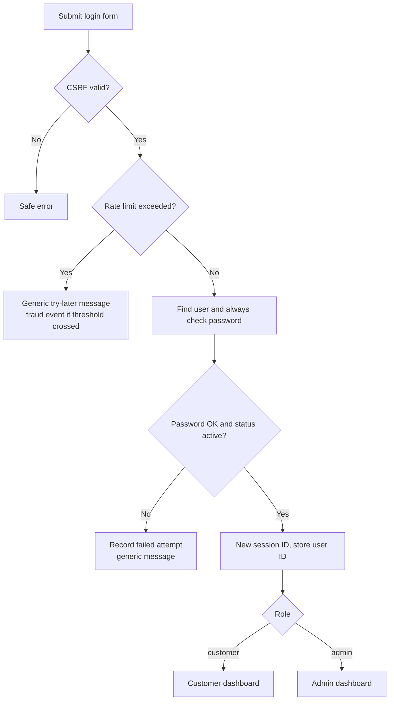
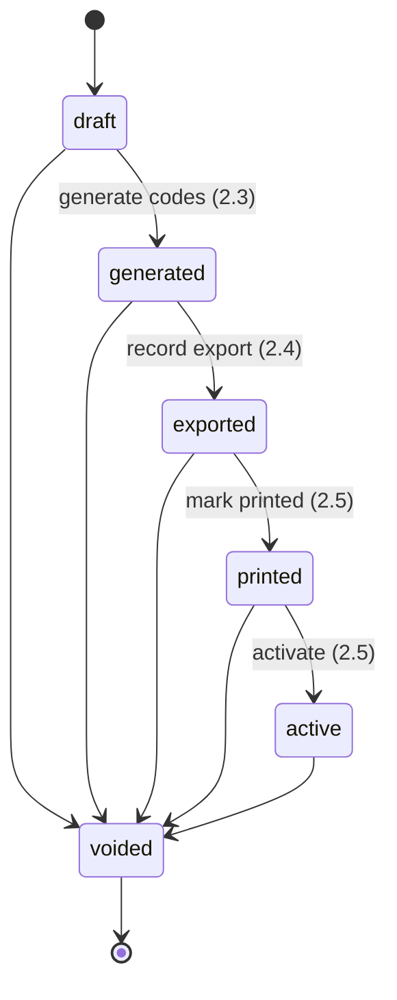
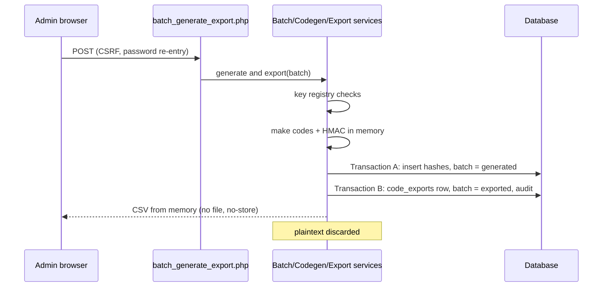
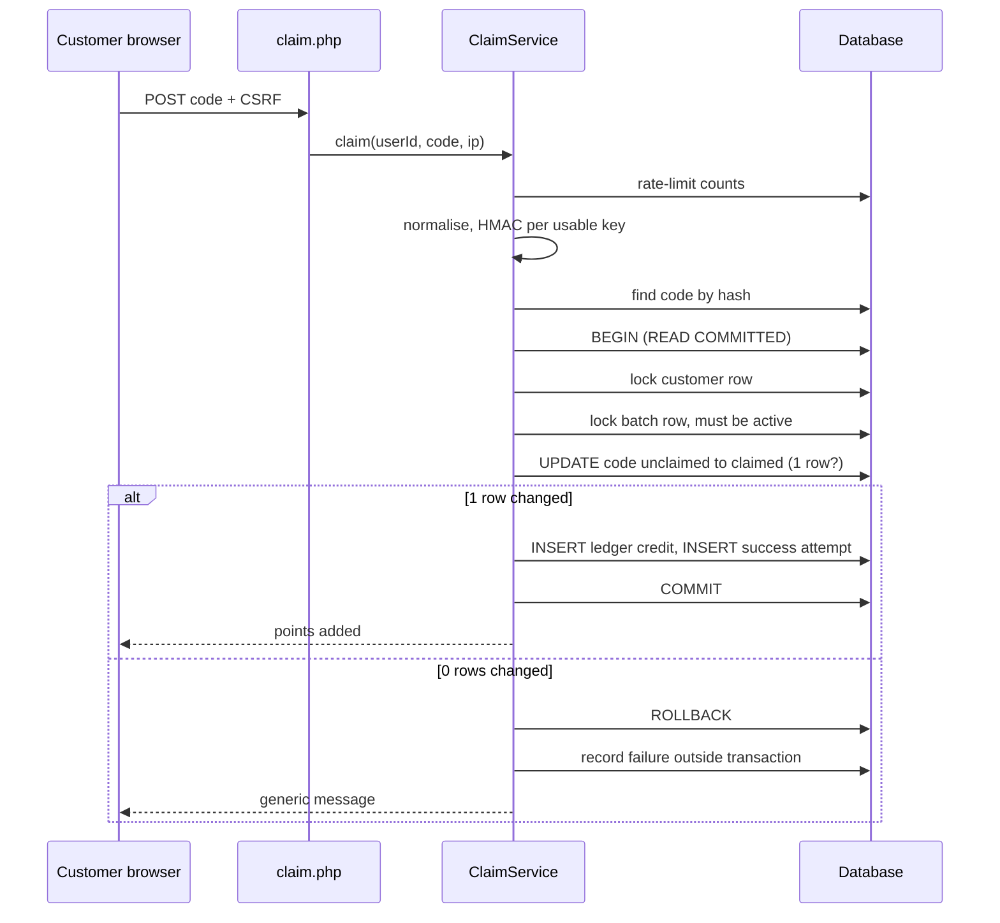
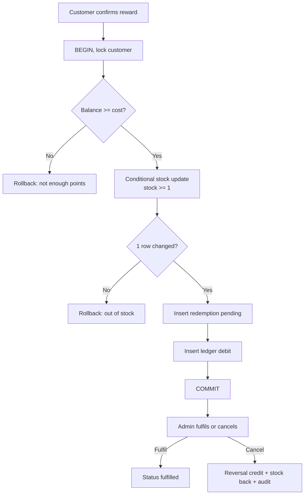
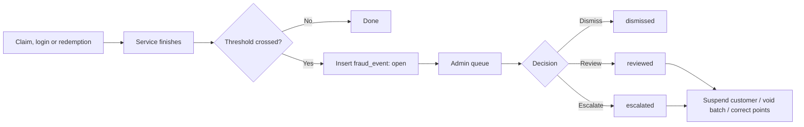

# WORKFLOWS.md: Customer Loyalty Rewards System

Stage 2 design document. **Design only: no application code.** Pseudocode and numbered steps describe behaviour; they are not implementation.

Companion documents: [ARCHITECTURE.md](ARCHITECTURE.md), [DATABASE_DESIGN.md](DATABASE_DESIGN.md), [PROJECT_STRUCTURE.md](PROJECT_STRUCTURE.md), [ASSUMPTIONS.md](ASSUMPTIONS.md), [TEST_PLAN.md](TEST_PLAN.md).

Labels: **[Confirmed]**, **[Requirement]**, **[Project constraint]**, **[Fact]**, **[Recommendation]**, **[Assumption]**, **[Unresolved]** (see ARCHITECTURE section 0).

---

## 0. Conventions used in every workflow

**Standard guards** (run before page logic, in this order, as in ARCHITECTURE section 5): load config and PDO → start session with safe settings → send security headers → require login (if the page is protected) → require `users.status = 'active'` → require the correct role → for POST: verify the CSRF token. Any failure ends the request with a safe message. Deny by default.

**Rules for every workflow:**

- The customer identity always comes from the **session**, never from a form field or URL. [ARCH 13.1]
- Nothing changes state on GET. [ARCH 6.3]
- All output is escaped. All SQL uses prepared statements. [Project constraint for PDO; recommendation for escaping]
- Each workflow names its service, its transaction (if any), and the tables it writes (matching DATABASE_DESIGN section 6).
- Customer messages are **generic and safe**. Technical detail goes only to the application log with a correlation ID. [ARCH 13.5]
- Section numbers 2.3 and 3 are referenced from ARCHITECTURE section 1.2 and keep those numbers.

---

## 1. Customer registration and login

### 1.1 Registration

**Actor:** visitor. **Page:** `register.php`. **Coordinator:** `AuthService`. **Tables written:** `users` (Authentication & account-lifecycle module) and `customer_profiles` (ProfileService).

1. Visitor opens the form (GET). The page creates a CSRF token if the session has none.
2. Visitor submits name, email, optional phone, password, password confirmation (POST + CSRF token).
3. Guards: CSRF valid; visitor is not already logged in.
4. Validate: email shape, name length, password length against the password policy [Assumption A-03], passwords match.
5. Normalise the email to lowercase.
6. Open one transaction. The Authentication & account-lifecycle module creates the `users` row (`role = customer`, `status = active`, password hashed with PHP `password_hash`); `ProfileService` creates the matching `customer_profiles` row using its repository. Commit both together. `AuthService` coordinates; neither page nor repository writes directly.
7. If the email already exists (unique-key conflict), roll back and show a **generic** message that does not reveal whether the email is registered ("If this email can be used, your account is ready"). [Recommendation: avoids account enumeration] Email verification is not part of the first version [Assumption A-02]. There is no email-based forgotten-password flow; a locked-out customer contacts factory support for identity-checked assistance [A-33].
8. Log the customer in: regenerate the session ID, store only the user ID in the session, redirect to the dashboard.
9. Roles are **never** accepted from the form. There is no public admin registration. [Assumption A-07]

### 1.2 Login

**Actor:** customer or administrator (same mechanism). **Page:** `login.php`. **Service:** `AuthService`. **Tables:** `login_attempts` (write), `users` (read, `last_login_at`).

1. GET shows the form. A normal QR-to-login redirect uses an explicit empty fragment (`#`) to prevent the original claim-code fragment from being inherited. As defense in depth, if a fragment is nevertheless present on the login page, a tiny nonce-authorized inline script removes it from the address bar (see 3.1).
2. POST email + password + CSRF token.
3. Authentication module checks `login_attempts` by IP and by account. After 5 failed attempts for either key within 15 minutes, block further logins during that window and show a generic "try again later". FraudService records a `login_bruteforce` event for review [A-04]. Requests rejected solely because this lockout is already active do not insert another failed-attempt row, so repeated blocked requests cannot extend it. For an unknown email, the failure is counted against the IP only because attempted email text is not stored.
4. Look up the user by email. **Always run a password check** (against a dummy hash if no user was found) so timing does not reveal whether the account exists. [Recommendation]
5. On success, and `status = active`: regenerate the session ID, store user ID and login time, update `last_login_at`, and insert a `login_attempts` row with `succeeded = 1`. If the request carries the exact allowlisted route token `return=claim`, a customer is redirected to `claim.php` with no fragment; otherwise redirect by role to the customer or admin dashboard. Never accept an arbitrary return URL. The code itself is never stored in the session or return token.
6. On any failure: insert a `login_attempts` row with `succeeded = 0` and show **one generic message** ("Email or password is incorrect"). A suspended or closed account gets the same message plus a neutral support instruction; internal suspension notes are never shown. [ARCH 13.2]
7. Redirects after login go only to a whitelist of internal pages (prevents open redirects). [Recommendation]

### 1.3 Logout and session rules

1. Logout is a **POST** with a CSRF token (not a link), so another site cannot log a user out.
2. Destroy the session data, expire the cookie.
3. On every protected request the middleware re-reads `users.status`. A suspended account's existing session is rejected on its next request. [ARCH 13.2]
4. Sessions expire after an idle timeout; the session ID changes at login; cookies are HttpOnly, SameSite, and Secure when HTTPS is on. [ARCH 6.2]



---

## 2. Production workflow: product, batch, codes, export, activation

All pages in this section are administrator-only. Every action writes an `audit_logs` row inside its transaction (ARCH 3.2 rule 3).

**Batch states** [ARCH 13.9]: `draft → generated → exported → printed → active → voided`.



### 2.1 Product creation

**Page:** `admin/product_edit.php`. **Service:** `ProductService`. **Table:** `products`.

1. Admin opens the form (GET, admin guard).
2. Submits SKU, name, description, default points per code (POST + CSRF).
3. Validate: SKU not empty and unique; default points per box is a whole number from 1 to 10,000 [Assumption A-34].
4. In one transaction insert `products` and the audit row.
5. Editing later is allowed; **changing default points does not change existing batches.** Products are deactivated, never deleted, because batches refer to them.

### 2.2 Batch creation

**Page:** `admin/batch_create.php`. **Service:** `BatchService`. **Table:** `batches`.

1. Admin chooses an **active** product, a batch label (`batch_code`), the quantity, and optionally a points override. [Assumption A-05]
2. Validate: quantity is between 1 and 1,000 codes [Assumption A-10]. Before implementation, verify this cap against the actual Apache PHP memory and execution limits (Q-17); lower it if necessary.
3. Insert the batch with `status = draft`, `points_per_code` copied from the product (or the override). No codes exist yet; **nothing is claimable.** Audit row written.
4. A draft can be abandoned by voiding it.

### 2.3 Code generation

**Page:** `admin/batch_generate_export.php` (POST only). **Services:** `BatchService`, `CodeGeneratorService`, `KeyService`, `ExportService`. **Tables:** `codes`, `batches`, `code_exports`, `audit_logs`.

**Important design point (see ASSUMPTIONS C-01).** Plaintext codes must never be stored, but the CSV needs them. So generation and export are **one admin request**: plaintext exists only in PHP memory, then goes straight to the browser. The two commits below keep the states honest.

**Code format [Confirmed, decision 4]:** 16 characters from `23456789ABCDEFGHJKMNPQRSTVWXYZ` (30 symbols; `0 1 I L O U` are left out to avoid look-alikes), secure random, no biased modulo. 30^16 is about 4.3 × 10^23 combinations.

**How one code is made (pseudocode, not application code):**

```
repeat 16 times:
    pick index = secure_random_integer(0 .. 29)     # uniform; NOT (random_byte % 30)
    append alphabet[index]
```

Rationale: PHP's `random_int` draws from the operating system's secure random source and returns a uniform value in the range given. [Fact: PHP manual, Stage 1; not re-verified]. Taking a random byte modulo 30 would favour some symbols because 256 does not divide by 30. If bytes were used instead, the safe form is to discard any byte of 240 or more, then take it modulo 30.

**Steps:**

1. Guards: admin role, POST, CSRF token, **password re-entry** (checked with `password_verify`, throttled). [Assumption A-15]
2. Key check (DATABASE_DESIGN 7.3): exactly one active key; `.env` key ID matches the registry; the key check value matches. Any failure stops here with no change.
3. Confirm the batch is `draft` and has no `code_exports` row.
4. Generate `planned_quantity` codes in memory. For each: build it as above, **normalise** (uppercase, no separators), compute `HMAC-SHA-256(active key, "loyalty-code-v1:" + code)`. [Recommendation: the fixed prefix separates this use of the key from any other]. Keep the code and hash.
5. Duplicate control: reject a candidate if its hash is already in this run, or if it already exists in `codes` under **any usable key** (cross-key check, DATABASE_DESIGN 7.4). The unique index on `code_hash` is the final backstop; if it ever fires, abort and roll back the whole run (retry once).
6. **Transaction A:** insert all `codes` rows in chunks (each with `batch_id`, `key_id`, `code_hash`, `status = unclaimed`), set the batch to `generated` with `generated_count` and `generated_at`. Commit. If anything fails: roll back; **nothing was shown to anyone**.
7. Continue to 2.4 in the same request.

### 2.4 CSV export

**Coordinator:** `ExportService`. **Tables:** `code_exports`, `batches`, `audit_logs`. `BatchService` owns the conditional `generated → exported` batch-state transition; `ExportService` coordinates the export and must call that owner rather than updating `batches.status` directly. Optional: `QrSvgRenderer` adapter.

1. **Transaction B:** insert the `code_exports` row (`batch_id` is unique, so a second export of this batch is impossible), set the batch to `exported` with `exported_at`, write the audit row. Commit.
2. Build the CSV **in memory**. [Recommendation] Columns [Assumption A-32]: `batch_code`, `row_number`, `product_sku`, `points`, `code`, `claim_url`. The code is printed in groups of four with hyphens for readability, e.g. `ABCD-EFGH-JKMN-PQRS`; claim normalisation removes separators. The vendor may request a different CSV column order or additional production labels. The claim link is `https://<site>/claim.php#c=<code>`. The code is in the **fragment** so it is not sent to the server by the QR scanner's browser request. [Confirmed, decision 5; Fact: browsers do not send the fragment in the HTTP request, RFC 3986/HTTP semantics, Stage 1]
3. No field in the CSV starts with `=`, `+`, `-` or `@` (spreadsheet formula injection). Codes use letters and digits only and the link starts with `https`. A test covers this (TEST_PLAN CE).
4. Send headers: `Content-Type: text/csv; charset=UTF-8`, `Content-Disposition: attachment`, `Cache-Control: no-store`. Send the bytes, then discard them. **No file is written on the server; no plaintext is logged or put in the session.** [ARCH §7 item 8, §10]
5. The CSV carries **no HMAC key and no hash.** [ARCH 13.6]
6. Optional QR: if the approved library exists, the same step may produce SVGs through the adapter. If not, the CSV alone is complete and the vendor makes the QR labels. [Confirmed, decision 1]
7. **If the download fails** after Transaction B, the admin may not have the file. The plaintext is gone. Recovery: **void the batch and create a new one.** No customer is affected because the batch is not active. The final public production domain must be configured and frozen before real QR labels are printed [Unresolved Q-04].



### 2.5 Marking printed and activating a batch

**Page:** `admin/batch_view.php` (action buttons). **Service:** `BatchService`. **Tables:** `batches`, `audit_logs`.

1. **Mark printed** (POST + CSRF): conditional update `exported → printed`; zero rows changed means wrong state or already done (idempotent). Audit.
2. **Activate** (POST + CSRF): the admin confirms the production and release checks are done. [Assumption A-22: activation is deliberate and manual; it never happens automatically on export or print.] Conditional update `printed → active` with `activated_at` and `activated_by_user_id`. Audit.
3. Only now can customers claim codes from this batch.

### 2.6 Voiding

1. Admin chooses a batch and enters a **reason** (POST + CSRF). Allowed from any state except `voided`.
2. Lock the batch row, conditional update to `voided`, record actor, time, reason and the count of still-unclaimed codes in the audit row. Repeating the request changes nothing.
3. Claims against a voided batch are refused. Points already credited are **not** reversed silently; if needed, a separate audited correction posts compensating ledger entries (section 6.5). [ARCH 13.9]
4. A claim attempt against a voided batch is recorded and may raise a `voided_batch_code_claimed` fraud event, because it can mean an exposed code (section 7).
5. Partial recall: void only listed codes (code-level `voided`), or void the batch and produce a replacement batch. A whole-batch void is never described as selective. [ARCH 13.9]

---

## 3. QR and manual code claiming

**Page:** `claim.php`. **Coordinator:** `ClaimService`. **Tables written:** `codes`, `claim_attempts`, `fraud_events`; `LedgerService` inserts the `points_ledger` credit on the claim service's behalf. **Purchase-proof model:** each sealed retail box contains one concealed unique code. The customer reveals and claims it after purchase; possession of that valid code is accepted as the system's operational proof-of-purchase credential [Assumption A-24]. The code proves possession of a genuine factory-issued secret; it does not independently verify payment, retailer, purchase date or purchaser identity. No receipt upload or POS integration is included [A-25].

### 3.1 QR path (URL fragment) [Confirmed, decision 5]

1. The customer scans the QR code printed under the scratch-off layer or on the insert [Confirmed, decision 6 (see ASSUMPTIONS)]. The scanner opens `https://<site>/claim.php#c=<code>`.
2. The browser requests `claim.php` **without** the fragment, so the code is not in the server's access log.
3. If the customer is not logged in, `claim.php` redirects to the login URL with the fixed route token and an explicit empty fragment (`Location: /login.php?return=claim#`). Under HTTP semantics, an omitted fragment would inherit the original code; the explicit empty fragment prevents that inheritance. After login, the allowlisted route token sends the customer back to `claim.php` with no fragment, where they **scan again or type the code**. No code is stored in the session. [Assumption A-31; RFC 9110, see ASSUMPTIONS F-11.]
4. If logged in, the claim page loads. A small **inline** script reads the fragment, **copies it into the form's code box, and removes it from the address bar** (`history.replaceState`) so it does not stay in the visible URL or be shared by accident. [Recommendation; the exact behaviour must be checked in real browsers, TEST_PLAN]
5. The script **never submits the form**. The customer presses the button (a POST with a CSRF token). Opening the link therefore never changes anything. [ARCH 6.3]
6. The page loads no third-party scripts, fonts or images and sends `Referrer-Policy: no-referrer` and `Cache-Control: no-store`. [ARCH 5, 6.8]
7. If JavaScript is off, the box stays empty and the customer types the code. **Manual entry always works.** [Confirmed, decision 5]

### 3.2 Manual entry path

1. Customer types the code (hyphens and spaces allowed, any letter case).
2. Normalise: uppercase, remove spaces and hyphens. Must be exactly 16 characters, all from the 30-symbol alphabet, or the result is `invalid_format` (counted as a failed attempt).

### 3.3 Claim processing (both paths)

Detailed transaction rules are in DATABASE_DESIGN 6.4 and 6.5.

1. Guards: logged in, active, CSRF valid.
2. **Rate limit** (by account and by IP, from `claim_attempts`). After 10 invalid code attempts for either key within 15 minutes, block further claims during the window, record `rate_limited`, show a generic "too many attempts, try later", and stop. Twenty successful claims in a rolling 24 hours and 10 distinct accounts using one IP within 1 hour create fraud-review alerts but do not automatically block a claim [A-04].
3. Normalise and validate the format.
4. Compute HMAC under each usable key and look up `code_hash`. Not found: record `not_found`, generic failure.
5. **Transaction** (READ COMMITTED): lock customer row and confirm active → lock batch row (shared) and confirm `active` → conditional update `unclaimed → claimed` (exactly one row must change) → insert ledger credit (`claim_code_id` unique) → insert `claim_attempts` success row → commit.
6. On any failure: roll back, then record the failure and raise a fraud event if a threshold is crossed (outside the transaction).
7. Success page: "N points added" and the new balance (calculated from the ledger).



### 3.4 What the customer sees

| Internal outcome | Customer message |
|---|---|
| `invalid_format` | "That code is not in the right format. Check it and try again." (format help only; reveals nothing about real codes) |
| `not_found`, `already_claimed` (by someone else), `batch_inactive`, `code_voided` | **One identical generic message**: "This code is not valid or has already been used." [ARCH §7 item 7] |
| `already_claimed` by **the same customer** | "You have already claimed this code." (shown only to the person who claimed it; it reveals nothing to anyone else; needed for double-clicks, see ASSUMPTIONS A-23) |
| `rate_limited` | "Too many attempts. Please try again later." |
| System error | Generic error page with a correlation ID [ARCH 13.5] |
| Account not active | Neutral status message and support instructions [ARCH 13.2] |

---

## 4. Points history

**Page:** `history.php`. **Service:** `LedgerService` (read). **Table read:** `points_ledger`.

1. Guards: logged in, active. **No user ID is accepted from the URL**; the session user is used.
2. Balance = sum of the customer's `points_delta` values (no stored balance column). [ARCH 13.4, A-19]
3. History = the customer's entries newest first, a page at a time using "entries older than the last one shown" (stable as new rows arrive).
4. Each row is shown in plain language: "Claimed a code from batch X (+N)", "Redeemed reward Y (−N)", "Correction: reason (+/−N)". Original and compensating entries both appear. [ARCH 13.4]
5. The code itself and the HMAC are never shown; the claim line shows only the batch label and points.
6. Output is escaped; the page is `Cache-Control: no-store`.

---

## 5. Reward redemption

**Pages:** `rewards.php` (browse), `redeem.php` (confirm and submit), `redemptions.php` (status). **Coordinator:** `RedemptionService`. **Tables:** `redemptions`, `rewards`, `audit_logs` (admin actions); `LedgerService` inserts the debit and any reversal in `points_ledger`.

### 5.1 Customer redeems

1. Browse active rewards (name, points cost, whether in stock).
2. Choose one; the **confirmation page** shows the cost and the customer's balance and creates a one-time `idempotency_token` stored in the form. Reward costs are positive and at most 1,000,000 points [Assumption A-34].
3. Submit (POST + CSRF + token). `RedemptionService` owns the transaction in DATABASE_DESIGN 6.6: customer lock → balance check → call `RewardService` to reserve one stock unit (the only service allowed to update `rewards`) → insert `redemptions` (pending) → call `LedgerService` to insert the debit → commit. `RewardService` participates in the existing transaction and does not begin another one.
4. Possible results: success (redemption number shown), "not enough points", "this reward is out of stock" (the customer's points are untouched), "this reward is no longer available". Double clicks or reloads hit the unique `(user_id, idempotency_token)` and show the **existing** redemption instead of creating a second.
5. One unit per redemption; unlimited-stock rewards are not supported initially. [Assumption A-06]

### 5.2 Fulfilment and cancellation (administrator)

1. Admin opens the fulfilment queue (`pending` redemptions).
2. **Fulfil:** conditional update `pending → fulfilled` with actor, time and an optional note. Audit. The customer collects the reward at the factory's designated collection point; no delivery address is collected [Assumption A-14].
3. **Cancel:** within the redemption transaction of DATABASE_DESIGN 6.6, call `LedgerService` to insert the reversal linked to the debit, call `RewardService` to return one stock unit, update the redemption to `cancelled`, and write the reason/audit entry. Customers cannot cancel by themselves in the initial version. [Assumption A-08]
4. Fulfil and cancel racing each other are decided by the conditional update on `pending`; exactly one wins.



---

## 6. Admin management

All admin pages require `role = admin` and `status = active`, checked on the server for every request. [ARCH 13.1] One administrator permission tier initially. [Assumption A-16]

### 6.1 Administrator accounts

1. The first administrator is created **once from the command line** (`bin/create_admin.php`) and recorded in `audit_logs` with a NULL actor. There is no public admin registration. [Assumption A-07]
2. Additional administrators, if needed, are created only through the controlled operator/CLI procedure; there is no web screen for administrator management. There is no separate owner/supervisor permission tier; the factory owner is the initial administrator [Assumption A-07/A-16].

### 6.2 Dashboard and customer management

1. **Dashboard:** counts of active batches, claims today, points issued and spent, pending redemptions, open fraud events (read-only through `ReportService`).
2. **Customer search/view:** by email or name; shows profile, status history, balance, ledger and redemptions. Every view of a customer is **read-only for support** and administrator access to personal data is audited. [ARCH 13.1]
3. **Suspend / reactivate:** admin must enter a reason category and text (POST + CSRF). `AdminCustomerService` calls the Authentication & account-lifecycle service, which locks the customer row, updates `users.status`, inserts `account_status_events`, and participates in the same transaction as the audit row. The customer's next request is rejected (section 1.3). Balances and history are kept. [ARCH 13.2; A-18]
4. **Closure/anonymisation:** a closure request sets `users.status = closed` immediately and records `close_request`; the factory owner may cancel and reactivate it after identity checks within 30 days. After 30 days the account-lifecycle service replaces the email with a unique `closed-user-<id>@example.invalid` value, and ProfileService sets the name to `Closed account`, clears phone/contact details and sets `anonymised_at`. Ledger, redemption, audit, fraud and reconciliation references remain. [A-11/A-17]

### 6.3 Points adjustment and correction

1. Admin chooses a customer and either a **correction of an original entry** or a **manual adjustment**, and enters a reason. (Admins never claim or redeem on a customer's behalf. [ARCH 13.1])
2. Transaction: lock the customer row; call `LedgerService` to insert the compensating (`reversal`, linked to the original) or `adjustment` entry with an `idempotency_key`; audit; commit. A repeated submission is reported as "already applied".
3. If a correct amount is needed after a reversal, it is a **separate new** entry. Original rows are never edited. [ARCH 13.4]

### 6.4 Rewards catalogue

**Page:** `admin/rewards.php`. **Owner:** `RewardService`. `RewardService` owns all `rewards` writes: create, edit, deactivate, points-cost changes, restock, stock reservation and stock return. Restock changes write before and after values to `audit_logs`. RedemptionService requests reserve/return operations through RewardService; it never updates `rewards` directly. Stock reservation uses a conditional update that cannot go below zero.

### 6.5 Reports and reconciliation

1. Read-only reports: claims per batch, points issued versus spent, redemptions by status.
2. **Reconciliation** is triggered by an administrator. [Assumption A-20] It runs the four ARCH 13.4 checks: claim credits against claimed codes; one stored-cost debit for each pending/fulfilled redemption; debit-plus-linked-reversal checks for cancelled redemptions (plus all other correction links); and per-customer ledger balances against report totals. It writes a `reconciliation_runs` row and any `reconciliation_findings`, and never auto-corrects. Ledger findings are resolved by a new compensating ledger entry through 6.3. Stock reservation and return are verified separately by the redemption concurrency and cancellation tests in TEST_PLAN §4.9; they are not represented as a separate ledger-reconciliation control.

### 6.6 Audit viewing

Admins can search `audit_logs` by action, entity or actor. Audit rows cannot be edited or deleted from the application.

### 6.7 HMAC key rotation (operator procedure)

ARCHITECTURE section 3 gives key management as loading keys from `.env` and checking against the registry; it does **not** list an admin screen for rotation. This document therefore treats rotation as an **operator procedure with a command-line helper** (Recommendation RC-21; see PROJECT_STRUCTURE 4.4).

1. Create the new secret; save it to the protected key backup **before** using it.
2. Add it to `.env` and add a `hmac_key_registry` row.
3. Run the registry check; confirm the check value matches.
4. In one transaction mark the old key `retired` and the new key `active`; audit.
5. Confirm a code under the old key still verifies and new batches use the new key.
6. Keep the retired key in protected configuration and its separate encrypted backup for as long as any `codes` rows reference its key ID; claimed and voided code rows also need verification for repeat-claim feedback and historical lookup [A-12/A-23].
7. Emergency: if a key is believed exposed, set it `revoked`, identify and void affected unclaimed codes/batches, review already-claimed points separately, and generate replacements under a new key. Revocation disables verification for all codes under that key.

### 6.8 Retention maintenance (operator procedure)

Run `bin/retention_maintenance.php` manually once per month and before a planned archive/backup operation. The script coordinates existing owning services; it does not issue SQL outside their repositories. Authentication's cleanup method removes `login_attempts` older than 90 days, ClaimService removes `claim_attempts` older than 90 days, and the log-retention helper removes technical application log files older than 30 days. It must never delete `points_ledger` or `audit_logs`. `fraud_events` and reconciliation records are retained for at least 2 years and are not automatically deleted in the initial version; the factory owner reviews any later archive/disposal decision. Every run records its operator, time, counts and outcome in the protected technical log; cleanup does not alter customer balances or code states. [Assumption A-11]

---

## 7. Fraud monitoring

**Services:** `FraudService` (also does rate limiting). **Tables:** `fraud_events` (write), `claim_attempts`, `login_attempts` (read). **Page:** `admin/fraud.php`.

### 7.1 Where events are raised

| Trigger | Event type | Severity (initial) |
|---|---|---|
| Many failed logins from one IP or against one account | `login_bruteforce` | warning |
| Many invalid or unknown codes from one account | `repeated_invalid_codes` | warning |
| Too many successful claims by one account in a short time | `claim_rate_exceeded` | info |
| Many accounts claiming from one IP | `many_accounts_one_ip` | warning |
| A real code from a **voided** batch is submitted | `voided_batch_code_claimed` | high |
| Many redemptions in a short time | `redemption_burst` | info |

Initial thresholds are selected in ASSUMPTIONS A-04: 5 failed logins per account or IP per 15 minutes; 10 invalid code attempts per account or IP per 15 minutes; 20 successful claims per account per rolling 24 hours; and an IP-pattern alert at 10 accounts per IP within 1 hour. Keep values configurable and tune before production.

### 7.2 Raising an event

1. The claim, login or redemption service finishes its transaction (success or rollback).
2. **Outside** that transaction, `FraudService` counts recent attempts; if a threshold is crossed and no open event of the same type exists for the same user or IP, it inserts a `fraud_events` row. [ARCH 3.2 rule 4]
3. Event text never contains a plaintext code, key or password. It refers to internal IDs.
4. Rate limiting itself is separate and immediate (it blocks the request); a fraud event is the record for review.

### 7.3 Reviewing

1. Admin opens the queue (`review_status = open`), filtered by type, severity, customer, IP or batch.
2. Opens an event with the related attempts, customer history and batch.
3. Sets the status to `reviewed`, `dismissed` or `escalated` with a note (POST + CSRF). Audit row written.
4. Follow-up actions are separate workflows: suspend a customer (6.2), void a batch (2.6), correct points (6.3).



---

## 8. Workflow to table matrix

| Workflow | Tables written | Transaction |
|---|---|---|
| 1.1 Registration | `users` (Authentication & account-lifecycle module), `customer_profiles` (ProfileService) | Yes |
| 1.2 Login | Authentication owns `login_attempts` and `users` (`last_login_at`); FraudService inserts `fraud_events` when a threshold is crossed | No (attempt/event inserts; account timestamp update) |
| 2.1 Product | `products`, `audit_logs` | Yes |
| 2.2 Batch create | `batches`, `audit_logs` | Yes |
| 2.3 Generate | `codes`, `batches`, `audit_logs` | Yes (A) |
| 2.4 Export | `code_exports`, `batches`, `audit_logs` | Yes (B) |
| 2.5 Printed / activate | `batches`, `audit_logs` | Yes |
| 2.6 Void | `batches` (and `codes` for partial), `audit_logs` | Yes |
| 3 Claim | `codes`, `claim_attempts` (ClaimService); `fraud_events` (FraudService, outside); `points_ledger` (LedgerService) | Yes |
| 4 History | none | n/a |
| 5.1 Redeem | `redemptions` (RedemptionService), `rewards` (RewardService stock reserve); `LedgerService` inserts `points_ledger` | Yes |
| 5.2 Fulfil / cancel | `redemptions` (RedemptionService), `rewards` (RewardService stock return), `audit_logs`; `LedgerService` inserts `points_ledger` reversal on cancel | Yes |
| 6.2 Suspend / reactivate | `users`, `account_status_events` (Authentication & account-lifecycle module), `audit_logs` | Yes |
| 6.2 Closure/anonymisation | `users`, `account_status_events` (Authentication & account-lifecycle module), `customer_profiles` (ProfileService), `audit_logs` | Yes (30-day recovery window; A-11/A-17) |
| 6.3 Adjust | LedgerService inserts `points_ledger`; AuditService inserts `audit_logs` | Yes |
| 6.4 Manage rewards | `rewards` (RewardService), `audit_logs` (AuditService) | Yes |
| 6.5 Reconcile | `reconciliation_runs`, `reconciliation_findings` | Yes |
| 6.7 HMAC key rotation | `hmac_key_registry`, `audit_logs` | Yes (operator CLI procedure) |
| 6.8 Retention maintenance | Expired `login_attempts`, `claim_attempts` (each owning module's cleanup method); old technical log files | No business transaction; invoked manually from CLI |
| 7 Fraud | `fraud_events` (FraudService) | No (outside business transaction) |

Nothing in this document has been implemented or tested. All selected business defaults are identified by [Assumption A-xx] and recorded in ASSUMPTIONS.md.
